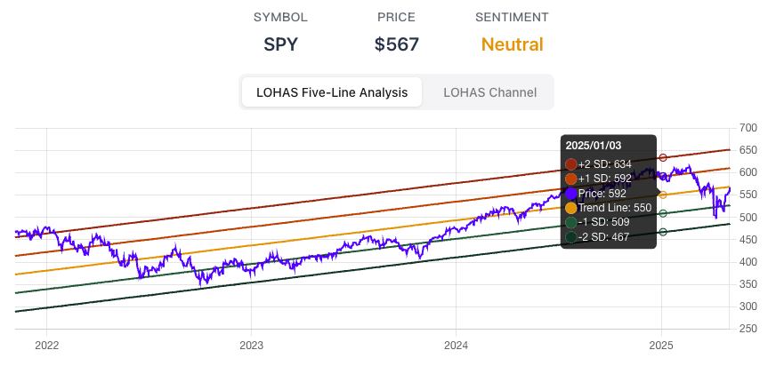
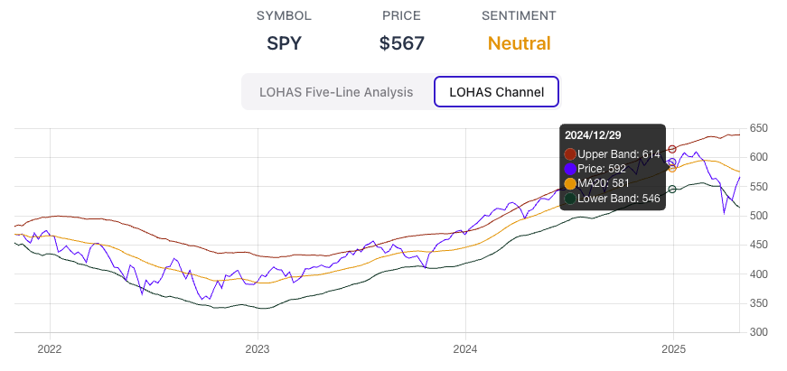
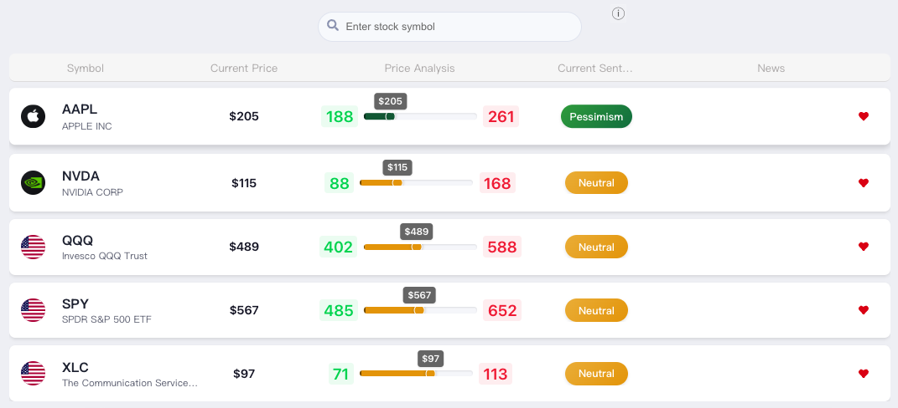

SPYが下落したとき、「一時的な下落なのか、それとも長期トレンドから大きく乖離しているのか」を知りたいと思うのではないでしょうか。**LOHAS Five-Lineでは、株価が長期トレンドに対してどの位置にあるかを確認できます。LOHASチャネルを併用すれば、直近の価格レンジを上抜けたか、下抜けたかも把握できます。**

まず[LOHAS Five-Line](/ja-JP/priceanalysis)を開き、銘柄コードにSPYを入力して、分析期間を3.5年に設定します。株価が5本のラインのどのゾーンにあるか、さらに下のLOHASチャネルを上抜けているか下抜けているかを確認してください。この記事では、2つのチャートの見方を説明します。

## 目次

1. [LOHAS Five-Lineで株価トレンドと乖離を確認する](#lohas-five-lineで株価トレンドと乖離を確認する)
2. [LOHAS Five-Lineの読み方](#lohas-five-lineの読み方)
3. [LOHASチャネルを補助的に使う](#lohasチャネルを補助的に使う)
4. [ウォッチリストで複数銘柄のLOHAS Five-Line上の位置を比較する](#ウォッチリストで複数銘柄のLOHAS Five-Line上の位置を比較する)
5. [価格・市場心理・ファンダメンタルズを組み合わせる](#価格市場心理ファンダメンタルズを組み合わせる)

## LOHAS Five-Lineで株価トレンドと乖離を確認する

LOHAS Five-Lineは、統計学の**平均回帰**を基本にしています。長期的に株価は一定の平均値を中心に変動するという考え方に基づき、**標準偏差**を使って5本のラインを描きます。現在の株価が長期トレンドのどの位置にあるかを確認し、市場がその銘柄に対してどの程度楽観的または悲観的かを把握するためのツールです。

ただし、LOHAS Five-Lineを使う際は、安定した上昇トレンドがある銘柄を選ぶことが前提です。例えば、台湾株の指数連動型ETFである0050や、米国株の指数連動型ETFであるSPYが挙げられます。こうした大型ETFは、経済成長や指数構成銘柄の入れ替えを背景に、長期的には上昇傾向を示してきました。銘柄自体に明確な上昇トレンドがない場合は、LOHAS Five-Lineの利用を避けてください。

LOHAS Five-Lineの5本のラインは次のとおりです。

- **中央のトレンドライン（Trend Line）：** 選択した期間の終値を線形回帰して算出し、株価の乖離を測る基準にします。
- **上下2本ずつの標準偏差ライン（TL+SD、TL+2SD、TL-SD、TL-2SD）：** 株価変動の統計的な特性に基づいて計算し、株価が長期トレンドからどの程度離れているかを示します。

## LOHAS Five-Lineの読み方

- 株価がトレンドラインと、その上下にある最初の標準偏差ライン（TL+SD、TL-SD）の間にある場合：**中立**ゾーンです。保有を続けるかどうかを検討する際の参考になります。
- 株価が上側の最初の標準偏差ライン（TL+SD）に達した場合：**強欲**ゾーンです。一部売却を検討する目安になります。
- 株価が上側の2本目のライン（TL+2SD）に達した場合：**極度の強欲**ゾーンです。価格はトレンドを大きく上回っています。続けてLOHASチャネルの上限も突破しているか確認してください。
- 株価が下側の最初の標準偏差ライン（TL-SD）に達した場合：**恐怖**ゾーンです。一部の買い付けを検討する目安になります。
- 株価が下側の2本目のライン（TL-2SD）に達した場合：**極度の恐怖**ゾーンです。価格はトレンドを大きく下回っています。続けてLOHASチャネルの下限も割り込んでいるか確認してください。

> **LOHAS Five-Lineを使って、自分の恐怖や強欲に左右されず、安値で売ったり高値で買ったりすることを避けましょう。**

## LOHASチャネルを補助的に使う

LOHAS Five-Lineでは株価がトレンドラインからどれほど離れているかを確認できますが、株価の変動は激しいこともあります。一般の投資家にとって、下落中の株を早まって買うことや、上昇が続く銘柄を早く売りすぎることは避けたいものです。その際は**LOHASチャネル**を組み合わせ、売買を急がないための参考にできます。LOHASチャネルは直近20週間の高値と安値から上下の境界を計算し、現在の株価が最近の価格レンジを抜けたかどうかを確認して、市場心理の判断を補います。

株価がLOHAS Five-Lineで「極度の強欲」または「極度の恐怖」のゾーンに入ったら、LOHASチャネルの状態も確認してください。

- 株価がLOHASチャネルの上限も突破した場合：直近20週間の価格レンジを上抜けたことを示します。ただし、トレンドが続く可能性もあるため、保有を続ける選択肢もあります。
- 株価がLOHASチャネルの下限も割り込んだ場合：直近20週間の価格レンジを下抜けたことを示します。ただし、トレンドが続く可能性もあるため、しばらく様子を見る選択肢もあります。

こうした場合は、株価が再びLOHASチャネル内に戻るのを待ってから、売買を検討する方法もあります。ただし、適切な判断は投資スタイルによって異なります。逆張りを行う投資家は早めに買い向かうことを選ぶかもしれません。一方、順張りを重視する投資家はトレンドの転換を確認してから取引するかもしれません。許容できるリスクは人それぞれですので、ご自身で判断してください。

## ウォッチリストで複数銘柄のLOHAS Five-Line上の位置を比較する

複数の銘柄を追跡し、それぞれの株価がLOHAS Five-Lineのどのゾーンにあるかをすばやく確認したい場合は、銘柄を[ウォッチリスト](/ja-JP/watchlist)に追加してください。追加した銘柄にはLOHAS Five-Line上の位置が自動で表示され、簡単に比較できます。例えば、異なるセクターのETFやQQQとDIAの動きを追跡すると、投資家の関心がセクター間でどのように移っているかを観察できます。

## 価格・市場心理・ファンダメンタルズを組み合わせる

私はコストラニーの「主人と犬」のたとえが好きです。ファンダメンタルズは主人で、株価はその周りを走り回る犬のようなものです。銘柄を選ぶときは、まずファンダメンタルズを見て保有する価値があるかを判断します。LOHAS Five-Lineは、現在の価格が元のトレンドからどれほど離れているかを確認するために使います。

市場が恐怖に包まれているときも、慌てて売る必要はありません。市場が過熱しているときも、上昇に飛び乗る前に確認しましょう。同じ基準を使って異なる日付を振り返ると、その日の値動きだけを見て判断するより、自分の判断を検証しやすくなります。

**まずSPYまたは0050で試し、関心のある銘柄をProのウォッチリストに追加して、価格ゾーンをまとめて比較してみてください。** 市場全体の心理を知りたい場合は、続けてSIOの8つのシグナルを確認できます。

---

次の記事：[SIO恐怖・強欲指数で売買タイミングを判断する](/ja-JP/articles/sio-fear-greed-index-buy-sell-timing)

[市場心理指標の最新値を見る](/ja-JP/sentiment-indicators)
