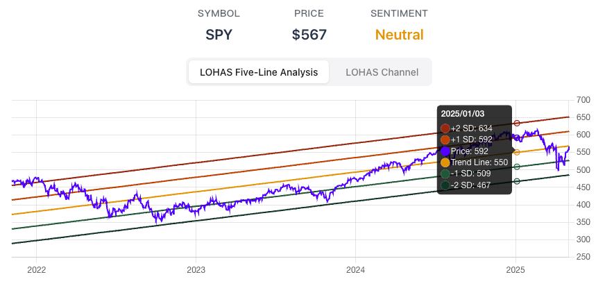
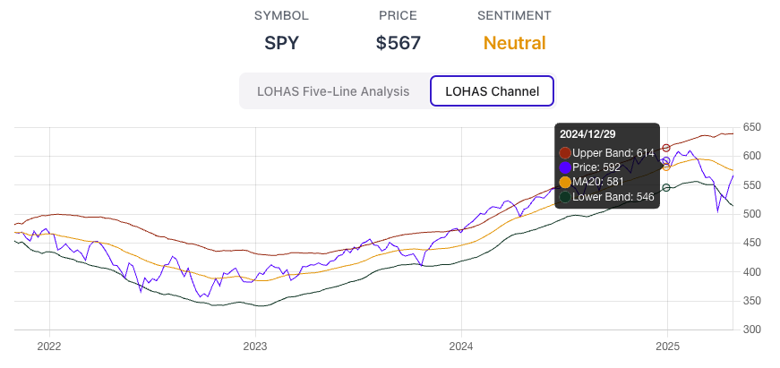
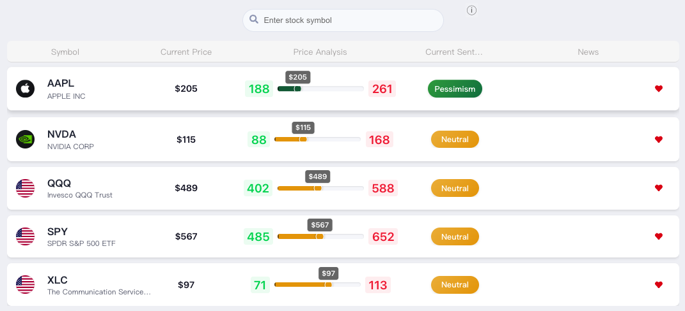

SPY가 조정을 받을 때, 단순한 하락일까요? 아니면 기존 추세에서 크게 벗어난 걸까요? **LOHAS 5선 차트는 주가를 추세라는 맥락 안에서 보여 줍니다. 이어서 LOHAS 채널을 통해 최근 가격 범위를 벗어났는지 확인할 수 있습니다.**

[LOHAS 5선 분석](/ko-KR/priceanalysis)을 열고 SPY를 입력한 다음 기간을 3.5년으로 설정하세요. 가격이 어느 두 선 사이에 있는지 확인하고, 아래의 채널도 살펴보세요. 이 가이드에서는 두 차트를 함께 읽는 방법을 설명합니다.

## 목차

1. [LOHAS 5선 분석으로 가격 추세와 이탈 정도 확인하기](#lohas-5선-분석으로-가격-추세와-이탈-정도-확인하기)
2. [LOHAS 5선 분석은 어떻게 해석할까요?](#lohas-5선-분석은-어떻게-해석할까요)
3. [LOHAS 채널을 보조 지표로 활용하는 방법](#lohas-채널을-보조-지표로-활용하는-방법)
4. [관심 종목 목록에서 여러 종목의 LOHAS 구간을 한 번에 확인하기](#관심-종목-목록에서-여러-종목의-lohas-구간을-한-번에-확인하기)
5. [가격·심리·펀더멘털 함께 살펴보기](#가격심리펀더멘털-함께-살펴보기)

## LOHAS 5선 분석으로 가격 추세와 이탈 정도 확인하기

LOHAS 5선 분석은 통계학의 **평균 회귀(mean reversion)** 개념을 바탕으로 합니다. 장기적으로 주가는 평균값을 중심으로 움직이는 경향이 있다고 가정합니다. 여기에 **표준편차**를 적용해 다섯 개의 선을 그려, 현재 가격이 장기 추세에서 어느 위치에 있는지 판단하고 해당 종목에 대한 시장의 낙관 또는 비관 정도를 가늠합니다.

다만 LOHAS 5선 분석은 **안정적인 상승 추세**를 보이는 자산에 적용할 때 가장 효과적입니다. 대만 지수 ETF 0050이나 미국 지수 ETF SPY가 그 예입니다. 이런 대형 지수 ETF는 경제 성장과 지수 구성 종목 교체의 혜택을 자연스럽게 누리므로 구조적인 상승 동력을 갖습니다. 뚜렷한 장기 상승 추세가 없는 종목에는 이 도구를 사용하지 않는 편이 좋습니다.

LOHAS 5선 분석의 다섯 개 선은 다음과 같습니다.

* **가운데 추세선(Trend Line):** 선택한 기간의 종가를 선형 회귀해 산출하며, 가격 이탈 정도를 측정하는 기준선입니다.
* **위·아래의 표준편차 밴드(TL+SD, TL+2SD, TL-SD, TL-2SD):** 가격 변동성의 통계적 특성을 바탕으로 계산하며, 장기 추세에서 얼마나 벗어났는지 나타냅니다.

## LOHAS 5선 분석은 어떻게 해석할까요?

* 가격이 추세선과 위쪽 첫 번째 선(TL+SD) 또는 아래쪽 첫 번째 선(TL-SD) 사이에 있으면 **중립** 구간입니다. 기존 보유분을 유지하는 것이 적절한 경우가 많습니다.

* 가격이 위쪽 첫 번째 선(TL+SD)에 도달하면 **탐욕** 신호입니다. 보유분 일부를 매도하는 방안을 고려할 수 있습니다.
* 가격이 위쪽 두 번째 선(TL+2SD)에 도달하면 **극도의 탐욕** 신호입니다. 가격이 추세보다 상당히 높으므로 LOHAS 채널도 상단을 돌파했는지 확인하세요.
* 가격이 아래쪽 첫 번째 선(TL-SD)에 도달하면 **공포** 신호입니다. 일부 매수를 고려할 수 있습니다.
* 가격이 아래쪽 두 번째 선(TL-2SD)에 도달하면 **극도의 공포** 신호입니다. 가격이 추세보다 상당히 낮으므로 LOHAS 채널도 하단을 이탈했는지 확인하세요.

> **LOHAS 5선 분석 도구를 활용해 자신의 공포와 탐욕을 다스리고, 바닥에서 팔거나 꼭대기에서 사는 일을 피하세요.**

## LOHAS 채널을 보조 지표로 활용하는 방법

LOHAS 5선 차트는 가격이 추세선에서 얼마나 떨어져 있는지 보여 주지만, 주가 변동은 급격할 수 있습니다. 투자자는 흔히 하락 중인 종목을 성급하게 매수하거나, 너무 일찍 팔아 이후의 급등을 놓치는 일을 피하고 싶어 합니다. 이때 보조 도구로 **LOHAS 채널**을 함께 사용하면 성급한 매수·매도를 피하는 데 도움이 됩니다. 최근 20주의 최고가와 최저가를 바탕으로 채널 상·하단을 계산해, 현재 가격이 최근 범위를 벗어났는지 보여 주며 시장 심리를 한 번 더 판단할 근거를 제공합니다.

LOHAS 5선 차트에서 극도의 탐욕 또는 극도의 공포 구간에 도달하면 LOHAS 채널을 확인하세요.

* 가격이 LOHAS 채널의 *상단선 위로* 돌파했다면 최근 가격 범위보다 높아졌다는 뜻입니다. 다만 추세가 *계속될 수도* 있으므로 보유를 유지하는 방안을 고려할 수 있습니다.
* 가격이 LOHAS 채널의 *하단선 아래로* 이탈했다면 최근 가격 범위보다 낮아졌다는 뜻입니다. 다만 추세가 *계속될 수도* 있으므로 기다리는 방안을 고려할 수 있습니다.

이런 상황에서는 가격이 다시 LOHAS 채널 안으로 들어올 때까지 기다린 뒤 매매를 검토할 수 있습니다. 다만 적절한 대응은 개인의 투자 전략에 따라 달라집니다. 역추세 매매자는 더 일찍 매수하는 방식을 선호할 수 있고, 추세추종 매매자는 추세 반전이 확인될 때까지 기다릴 수 있습니다. 자신의 위험 감수 수준에 맞춰 판단하세요.

## 관심 종목 목록에서 여러 종목의 LOHAS 구간을 한 번에 확인하기

여러 종목을 추적하면서 각 종목의 현재 LOHAS 5선 구간을 빠르게 확인하고 싶다면 [관심 종목 목록](/ko-KR/watchlist)에 추가하세요. 목록에 추가한 종목에는 LOHAS 5선 심리 구간이 자동으로 표시되어 빠르게 비교할 수 있습니다. 예를 들어 여러 업종 ETF를 추적하거나 성장주 중심의 QQQ와 가치주 중심의 DIA를 비교해 시장 심리가 서로 다른 영역 사이에서 어떻게 움직이는지 살펴볼 수 있습니다.

## 가격·심리·펀더멘털 함께 살펴보기

저는 코스톨라니의 ‘주인과 개’ 비유를 좋아합니다. 펀더멘털은 주인이고 가격은 주인 주변을 오가는 개와 같습니다. 먼저 펀더멘털을 살펴 해당 자산을 보유할 가치가 있는지 판단하세요. 5선 차트는 현재 가격이 추세에서 얼마나 멀리 떨어져 있는지 확인하는 데 활용하면 됩니다.

시장이 급락할 때는 매도세에 휩쓸려 서둘러 팔기보다 데이터를 확인하세요. 상승장에서는 추격 매수하고 있는 것은 아닌지 살펴보세요. 동일한 기준선으로 서로 다른 날짜를 비교하면 자신의 판단을 더 쉽게 점검할 수 있습니다.

**먼저 SPY 또는 0050으로 직접 확인해 보세요. 그런 다음 관심 종목을 Pro 관심 종목 목록에 추가해 가격 구간을 한곳에서 비교할 수 있습니다.** 시장 전체를 살펴보고 싶다면 SIO의 여덟 가지 심리 신호도 확인해 보세요.

---

다음 글: [SIO 공포·탐욕 지수로 매수·매도 시점 판단하기](/ko-KR/articles/sio-fear-greed-index-buy-sell-timing)

[모든 시장 심리 지표의 최신 수치 보기](/ko-KR/sentiment-indicators)
