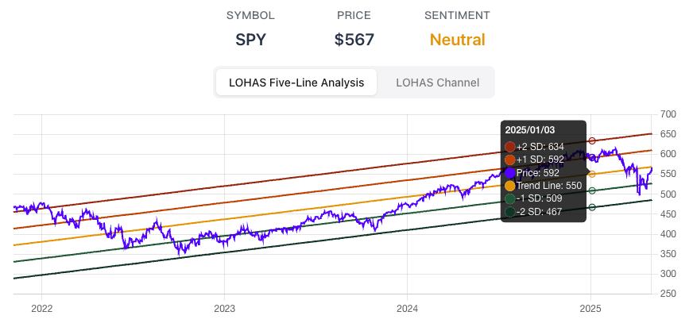
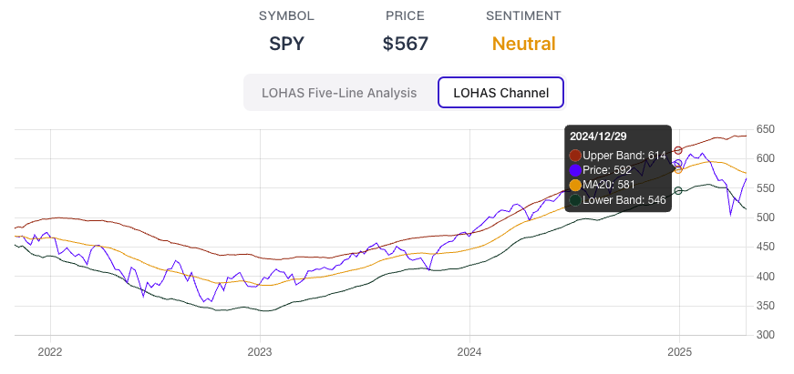
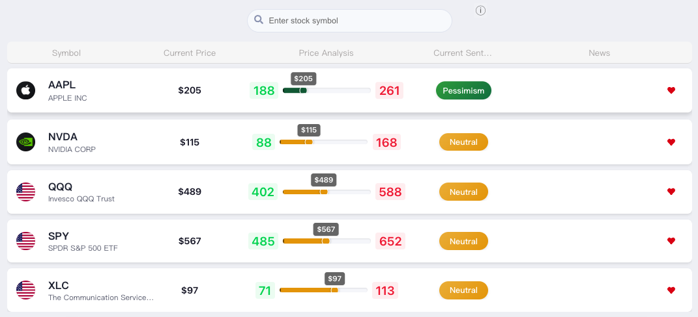

SPY 出现回调时，你想知道的是：这只是小幅下跌，还是已经明显偏离原有趋势？**乐活五线谱帮助你结合趋势观察价格，再用乐活通道确认价格是否已经突破近期区间。**

打开[乐活五线谱](/zh-CN/priceanalysis)，输入 SPY，并将时间范围设为 3.5 年。先看价格位于哪两条线之间，再检查下方的乐活通道是否出现突破。本文将介绍如何结合这两张图进行判断。

## 目录

1. [用乐活五线谱判断股价趋势与偏离程度](#用乐活五线谱判断股价趋势与偏离程度)
2. [如何解读乐活五线谱？](#如何解读乐活五线谱)
3. [如何使用乐活通道辅助判断？](#如何使用乐活通道辅助判断)
4. [在自选股列表中同时查看多个标的的五线谱位置](#在自选股列表中同时查看多个标的的五线谱位置)
5. [价格、情绪与基本面怎么搭配](#价格情绪与基本面怎么搭配)

## 用乐活五线谱判断股价趋势与偏离程度

乐活五线谱以统计学中的**均值回归**为基础，假设股价长期会围绕某个平均值波动，再利用**标准差**绘制五条线。通过这些线，可以判断当前股价相对于长期趋势的位置，进而观察市场对该股票的乐观或悲观程度。

需要注意的是，乐活五线谱更适合用于具有**稳定上升趋势**的标的，例如台湾股市指数 ETF 0050 或美国市场指数 ETF SPY。这类大型指数 ETF 通常受益于经济长期增长及指数成分定期调整，因此具有结构性的上行动能。如果标的本身没有明确的长期上升趋势，就不宜使用乐活五线谱。

乐活五线谱的五条线分别是：
* **中间的趋势线（Trend Line）：** 根据所选时间范围内的收盘价进行线性回归，作为衡量股价偏离程度的基准。
* **上下各两条标准差线（TL+SD、TL+2SD、TL-SD、TL-2SD）：** 根据股价波动的统计特征计算，用来表示股价偏离长期趋势的程度。

## 如何解读乐活五线谱？

* 股价位于趋势线与上方第一条线（TL+SD）或下方第一条线（TL-SD）之间：属于**中性**区间，通常可以继续持有。

* 股价达到上方第一条线（TL+SD）：属于**贪婪**区间，可以考虑卖出部分持仓。
* 股价达到上方第二条线（TL+2SD）：属于**极度贪婪**区间，说明价格已明显高于趋势；接着确认乐活通道是否也突破上沿。
* 股价达到下方第一条线（TL-SD）：属于**恐惧**区间，可以考虑买入部分仓位。
* 股价达到下方第二条线（TL-2SD）：属于**极度恐惧**区间，说明价格已明显低于趋势；接着确认乐活通道是否也跌破下沿。

> **借助乐活五线谱观察市场情绪，减少恐惧和贪婪对决策的干扰，避免在低点恐慌卖出或在高点追涨。**

## 如何使用乐活通道辅助判断？

乐活五线谱可以显示股价偏离趋势线的程度，但市场波动有时相当剧烈。投资者往往希望避免过早抄底，或过早卖出而错过后续涨幅。这时可以搭配使用**乐活通道**，辅助判断买卖时机。乐活通道根据最近 20 周的最高价和最低价计算上下沿，用来观察当前股价是否已经突破近期价格区间，并为判断市场情绪提供另一项参考。

当股价在乐活五线谱上进入极度贪婪或极度恐惧区间时，可以进一步观察乐活通道：
* 如果股价突破乐活通道上沿，表示价格已经高于最近 20 周的区间，但原有趋势仍可能延续，可以考虑继续持有。
* 如果股价跌破乐活通道下沿，表示价格已经低于最近 20 周的区间，但下跌趋势仍可能延续，可以考虑继续等待。

出现上述情况时，可以等股价重新回到乐活通道内，再考虑是否采取行动。不过，具体做法取决于个人策略：左侧交易者可能倾向于提前买入，右侧交易者则可能等待趋势反转得到确认后再行动。请根据自己的风险承受能力作出判断。

## 在自选股列表中同时查看多个标的的五线谱位置

如果你同时关注多个标的，想快速查看它们目前在乐活五线谱中的位置，可以将它们加入[自选股列表](/zh-CN/watchlist)。加入列表后，每个标的都会自动显示对应的情绪区间，方便横向比较。例如，可以加入不同板块的 ETF，或比较成长型 ETF QQQ 与价值型 ETF DIA，观察市场情绪如何在不同领域之间变化。

## 价格、情绪与基本面怎么搭配

我很喜欢科斯托兰尼的「主人与狗」比喻：基本面像主人，股价则像围绕主人跑动的狗。选择标的时，先根据基本面判断是否值得持有；再用五线谱观察当前价格偏离原有趋势的程度。

市场恐慌时，不必急着跟风卖出；市场情绪高涨时，也要确认自己是否在追高。用同一组基准比较不同日期的表现，比只看当天涨跌更容易检视自己的判断。

**可以先用 SPY 或 0050 试着分析，再将关注的标的加入 Pro 自选股列表，集中比较价格所处的区间。** 如果想了解整体市场情绪，可以继续查看 SIO 的八项信号。

---

下一篇：[用 SIO 恐惧贪婪指标判断买卖时机](/zh-CN/articles/sio-fear-greed-index-buy-sell-timing/)

[查看所有市场情绪指标的最新读数](/zh-CN/sentiment-indicators)
