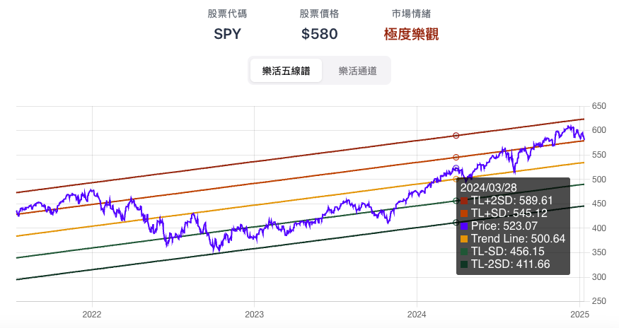
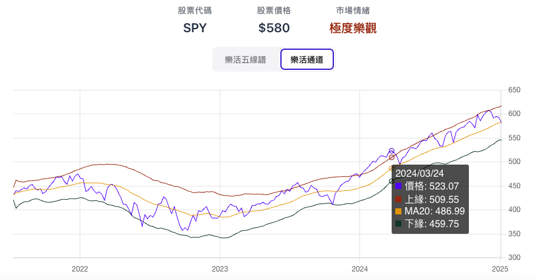
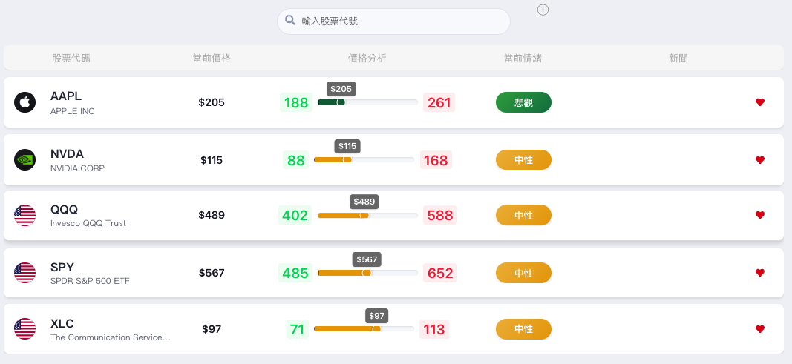

看到 SPY 回調時，你可能想知道：股價只是短暫下跌，還是已偏離原有趨勢？**樂活五線譜讓你從趨勢角度觀察股價，再配合樂活通道，確認價格是否已突破近期區間。**

先開啟[樂活五線譜](/zh-HK/priceanalysis)，輸入 SPY，將觀察期間設為 3.5 年。接著查看股價落在哪兩條線之間，以及下方的樂活通道是否被突破。以下會透過這兩張圖示範判讀方法。

## 目錄

1. [用樂活五線譜確認股價趨勢及偏離幅度](#用樂活五線譜確認股價趨勢及偏離幅度)
2. [如何解讀樂活五線譜？](#如何解讀樂活五線譜)
3. [如何使用樂活通道輔助判斷？](#如何使用樂活通道輔助判斷)
4. [利用自選清單同時比較多項資產的五線譜位置](#利用自選清單同時比較多項資產的五線譜位置)
5. [如何結合價格、情緒與基本因素](#如何結合價格情緒與基本因素)

## 用樂活五線譜確認股價趨勢及偏離幅度

樂活五線譜以統計學中的**均值回歸**為基礎，假設股價長期會圍繞平均值上下波動，再配合**標準差**繪出五條線，協助判斷現價相對長期趨勢的位置，從而觀察市場對該股票的樂觀或悲觀程度。

要注意，樂活五線譜較適合用於長期走勢相對穩定、長期趨勢向上的資產，例如台灣股票指數 ETF 0050 或美股指數 ETF SPY。這類大型指數 ETF 受惠於經濟長期增長，以及指數定期調整成份股的機制，通常具有較明確的長期升勢；若資產本身沒有清晰的長期上升趨勢，便不宜使用樂活五線譜。

樂活五線譜的五條線分別是：
*   **中間的趨勢線 (Trend Line)：** 由所選期間的收市價進行線性迴歸，作為衡量股價偏離程度的基準。
*   **上下各兩條標準差線 (TL+SD, TL+2SD, TL-SD, TL-2SD)：** 根據股價波動的統計特性計算，反映股價偏離長期趨勢的程度。

## 如何解讀樂活五線譜？

*   股價位於趨勢線與上方第一條線 (TL+SD)，或下方第一條線 (TL-SD)之間：屬於**中性**區間，可考慮繼續持有。

*   股價觸及上方第一條線 (TL+SD) 時：屬於**貪婪**區間，可考慮沽出部分持股。
*   股價觸及上方第二條線 (TL+2SD) 時：屬於**極度貪婪**區間，代表股價已明顯高於趨勢，接著可確認樂活通道是否也突破上緣。
*   股價觸及下方第一條線 (TL-SD) 時：屬於**恐懼**區間，可考慮買入部分持股。
*   股價觸及下方第二條線 (TL-2SD) 時：屬於**極度恐懼**區間，代表股價已明顯低於趨勢，接著可確認樂活通道是否也跌破下緣。

> **運用樂活五線譜觀察市場情緒，避免因恐懼而低位沽出，或因貪婪而高位追入。**

## 如何使用樂活通道輔助判斷？

雖然樂活五線譜能顯示股價偏離趨勢線的程度，但市場波幅有時相當大，投資者難免希望避免在跌勢未止時買入，或過早沽出而錯過其後升勢。此時可配合「**樂活通道**」使用，避免過早作出買賣決定。樂活通道根據最近 20 週的最高價及最低價計算上下緣，用來判斷現價是否已突破近期價格區間，作為觀察市場情緒的輔助工具。

當股價進入樂活五線譜的極度貪婪或極度恐懼區間時，可以同時留意樂活通道的變化：
*   如果股價同時突破樂活通道上緣：代表升勢已超出最近 20 週的價格區間，但趨勢仍可能持續，可考慮繼續持有。
*   如果股價同時跌破樂活通道下緣：代表跌勢已超出最近 20 週的價格區間，但下跌趨勢仍可能持續，可考慮暫時觀望。

出現上述情況時，可等待股價重新回到樂活通道內，再考慮採取行動。實際做法視乎投資策略而定：偏向左側交易的投資者可能選擇提早買入；偏向右側交易的投資者則可能等待趨勢出現轉折後才行動。每個人的風險承受能力不同，應按自身情況作決定。

## 利用自選清單同時比較多項資產的五線譜位置

如果你想同時觀察多項資產，可將它們加入[自選清單](/zh-HK/watchlist)。加入後，每項資產都會自動顯示其五線譜位置，方便比較。你亦可加入不同板塊的 ETF，或比較 QQQ 與 DIA 等指數 ETF 的相對表現，觀察市場資金在不同板塊之間的輪動。

## 如何結合價格、情緒與基本因素

科斯托蘭尼曾以「主人與狗」作比喻：基本因素像主人，股價則像一隻來回奔跑的狗。選擇投資資產時，先看基本因素，判斷是否值得持有；五線譜則用來觀察現價偏離原有趨勢的程度。

市場恐慌時，不必急於跟隨沽售；市場過度亢奮時，也應先確認自己是否正在追價。以同一套基準回看不同日期，會比單憑當日升跌更容易檢視自己的判斷。

**先用 SPY 或 0050 試用，再把關注的資產加入 Pro 自選清單，集中比較股價位置。** 想了解整體市場情緒，可接著查看 SIO 的八項訊號。

---

下一篇：[如何利用 SIO 恐懼與貪婪指標判斷買賣時機](/zh-HK/articles/2.用市場情緒綜合指數判斷買賣時機)

[查看所有市場情緒指標的最新讀數](/zh-HK/sentiment-indicators)
