前回の記事[LOHAS Five-Line（5線チャート）で株価トレンドと市場心理を分析する](/ja-JP/articles/lohas-five-line-analysis-price-trends-and-sentiment)では、LOHAS Five-Lineで株価トレンドと乖離を確認する方法を紹介しました。では、価格以外に、市場全体が極端な心理状態にあるかどうかを判断する方法はあるのでしょうか。この記事では、いくつかの重要なデータを紹介し、Sentiment Inside Outの恐怖・強欲指数（以下、SIO恐怖・強欲指数）を使って売買タイミングを考える方法を説明します。

## 目次

1. [現在の市場心理を知る理由](#現在の市場心理を知る理由)
2. [代表的な市場心理指標の長所と短所](#代表的な市場心理指標の長所と短所)
3. [SIO恐怖・強欲指数：長期的な市場心理を測る指標](#sio恐怖強欲指数長期的な市場心理を測る指標)
4. [各市場心理指標を読み解く](#各市場心理指標を読み解く)
   - [AAII投資家センチメント調査](#1-aaii投資家センチメント調査-the-aaii-investor-sentiment-survey)
   - [CBOE Put/Call Ratio](#2-cboe-putcall-ratio-cboe-putcall-ratio-5-day-avg)
   - [市場モメンタム](#3-市場モメンタム-market-momentum)
   - [VIX恐怖指数](#4-vix恐怖指数-vix-ma50)
   - [安全資産への逃避需要](#5-安全資産への逃避需要-safe-haven-demand)
   - [ハイイールド債スプレッド](#6-ハイイールド債スプレッド-junk-bond-spread)
   - [S&P 500先物投機筋ネットポジション指数](#7-sp-500先物投機筋ネットポジション指数-sp-500-cot-index)
   - [NAAIMエクスポージャー指数](#8-naaimエクスポージャー指数-naaim-exposure-index)
5. [SIO恐怖・強欲指数の読み方](#sio恐怖強欲指数の読み方)

## 現在の市場心理を知る理由

相場が大きく下落すると売りたくなり、急上昇すると乗り遅れるのが怖くなる。私自身も、こうした感情に悩まされることがあります。SIOでは、個人投資家の見方、オプション、機関投資家のポジション、信用市場をまとめて確認します。相場が大きく動いているときにも、一定の基準を使って判断できます。

同じ悲観でも、個人投資家調査だけが弱気なのか、先物ポジションや信用スプレッドまで守りに傾いているのかによって状況は異なります。**まず総合スコアを確認し、次に各シグナルを開いて、恐怖がどの領域に表れているのか、ほかの領域にも広がっているのかを確認してください。**

2020年3月23日にSPYが底を付けた時点で、SIOはすでに約1.5まで低下していました。2022年10月3日には約4.2まで低下し、SPYの10月の安値に近い水準でした。**市場の恐怖が最も強い局面は、長期投資家が投資機会を探すタイミングになることがあります。** [BofA Bull & Bear指標ページのSIO過去事例](/ja-JP/sentiment-indicators/bofa-bull-bear#sio-history-examples)で、市場心理スコアと価格推移を直接比較できます。

## 代表的な市場心理指標の長所と短所

市場にはCNN Fear & Greed IndexやBofA Bull & Bear Indicatorなど、さまざまな市場心理指標があります。BofAの指標は一般の投資家が入手しにくく、時折公開される情報を待つ必要があります。一方、CNNの指標は公開されているため、目にする機会も多いでしょう。

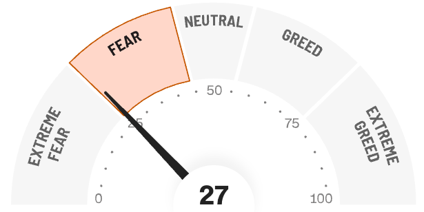

*(CNN Fear & Greed Index)*

ただし、CNN指数には値動きが頻繁で大きいという弱点があります。SPYを使ってバックテストすると、指数が極度の恐怖を示していても、株価がさらに大きく下落できる局面があることが分かります。そのため、どちらかといえば短期売買に適しています。また、CNN指数に含まれる指標の数は多くありません。私がよく確認する米国の個人投資家調査であるAAII（後ほど紹介します）が含まれていない点も、物足りなく感じます。AAIIは、個人投資家の見方を示す逆張り指標として使われることもあります。

> **CNN恐怖・強欲指数は広く知られていますが、反応が敏感なため、短期売買に向いています。**

関連記事：[CNN恐怖・強欲指数の読み方](/ja-JP/sentiment-indicators/cnn-fear-greed)｜[BofA Bull & Bear指標の読み方](/ja-JP/sentiment-indicators/bofa-bull-bear)

## SIO恐怖・強欲指数：長期的な市場心理を測る指標

CNN指数とは異なり、[SIO恐怖・強欲指数](/ja-JP/market-sentiment/)は長期的な市場全体の恐怖と強欲を捉えるために設計されています（下図）。複数の市場心理指標を統合し、それぞれの特性に応じて調整することで、個々の指標の変動をならした総合スコアを算出します。現在の市場心理を直感的に確認できます。SPY（S&P 500に連動する米国ETF）を使った過去の検証では、大幅な下落局面でスコアが5前後まで低下した後、株価が回復したケースが見られました。

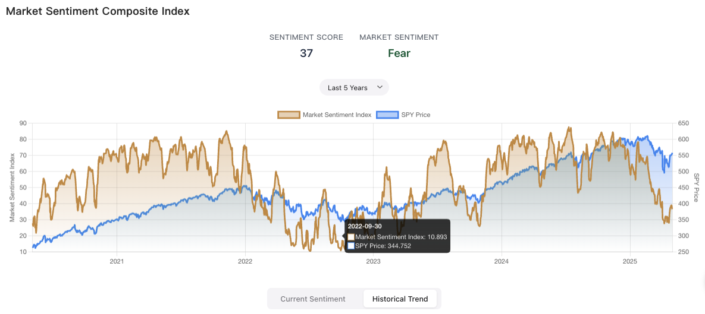

> **市場心理指数は長期的な市場心理を見るための指標です。スコアが5前後に達した局面は、長期的に非常に良い買い場となることがありました。**

## 各市場心理指標を読み解く

ここでは、SIO恐怖・強欲指数に含まれる重要な市場心理指標と、その意味を説明します。

### 1. AAII投資家センチメント調査（The AAII Investor Sentiment Survey）

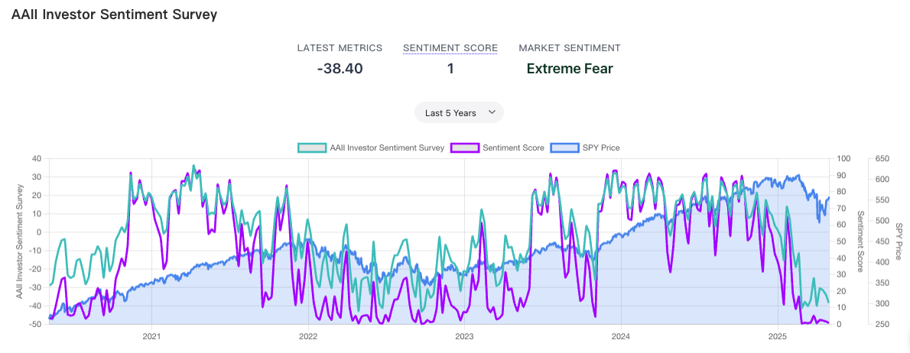

**概要：** AAII（米国個人投資家協会）の投資家センチメント調査は、個人投資家が今後の市場をどの程度楽観または悲観しているかを測る指標です。会員に今後6カ月の株式市場の見通しを毎週尋ね、その集計結果を公表します。

**計算方法と読み方：**
毎週、回答者には、今後6カ月の株式市場の見通しについて、強気（Bullish）、弱気（Bearish）、中立（Neutral）の3つから選んでもらいます。よく使われる計算方法は、AAII Bull-Bear Spread（強気・弱気差）＝強気の割合 − 弱気の割合です。

- **プラス値：** 強気の投資家が弱気の投資家を上回り、市場心理は楽観に傾いています。
- **マイナス値：** 弱気の投資家が強気の投資家を上回り、市場心理は悲観に傾いています。
- **極端な値：** 一般に差が20ポイント以上になると、市場心理が極端な水準に達しており、相場が反転する可能性が高いとされます。

AAIIは逆張り指標として使われることがあります。個人投資家が過度に楽観的な場合は市場が下落する可能性を、過度に悲観的な場合は市場が上昇する可能性を示唆することがあります。

関連記事：[AAII個人投資家センチメント調査の詳しい解説](/ja-JP/sentiment-indicators/aaii-sentiment-survey)

### 2. CBOE Put/Call Ratio（CBOE Put/Call Ratio 5-Day Avg）

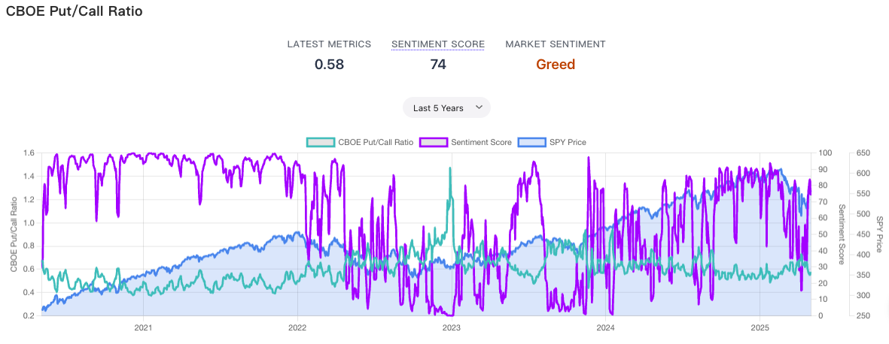

**概要：** CBOE（シカゴ・オプション取引所）のPut/Call Ratioは、投資家が購入するプット（Put）とコール（Call）の比率を測る指標です。市場参加者が将来の相場をどう見ているかを反映します。

**計算方法と読み方：**
プットの出来高をコールの出来高で割って計算します。短期的な変動を平滑化するため、通常は5日または10日の平均値を使います。

- **比率が高い：** プットの出来高がコールを上回り、市場心理は悲観に傾いています。投資家はポートフォリオを守るため、プットを買う傾向があります。
- **比率が低い：** コールの出来高がプットを上回り、市場心理は楽観に傾いています。投資家は利益を得るためにコールを買う傾向があります。
- **極端な値：** 平滑化の方法や対象オプションによって異なります。当サイトでは、おおむね0.4（極度の強欲）〜0.8（極度の恐怖）の範囲にあります。

CBOE Put/Call Ratioは逆張り指標として使われます。比率が極端に高い場合は市場の反発を、極端に低い場合は市場の下落を示唆することがあります。

関連記事：[CBOE Put/Call Ratioの詳しい解説](/ja-JP/sentiment-indicators/cboe-put-call-ratio)

### 3. 市場モメンタム（Market Momentum）

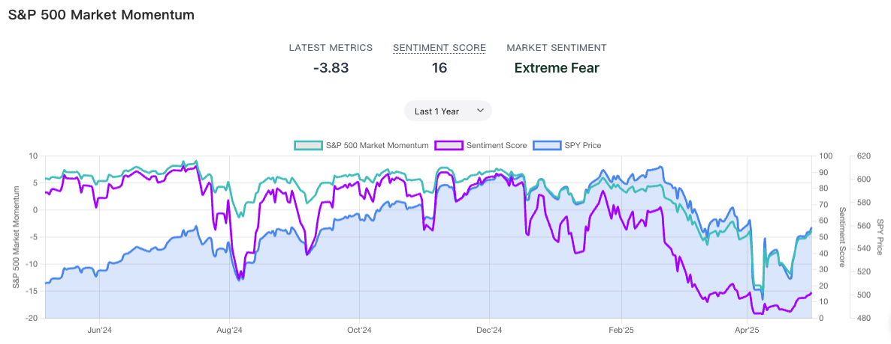

**概要：** S&P 500指数の値動きの勢いを測り、市場トレンドの強さを判断するための指標です。

**計算方法と読み方：**
S&P 500指数と125日移動平均線を比較し、現在の価格が長期平均からどれほど離れているかを計算します。

- **プラス値：** モメンタムが強く、トレンドは楽観的です。
- **マイナス値：** モメンタムが弱く、トレンドは悲観的です。
- **極端な値：** 通常は−10〜10の範囲ですが、市場が極度の恐怖に陥った際には−20〜−30まで低下したこともあります。

市場モメンタムは逆張り指標として使われます。モメンタムが高すぎる場合は市場の下落を、低すぎる場合は市場の上昇を示唆することがあります。

### 4. VIX恐怖指数（VIX MA50）

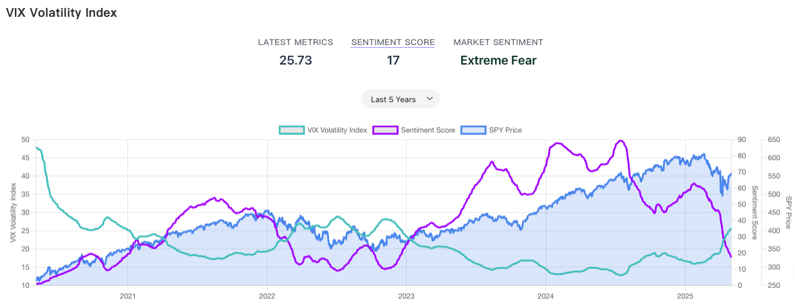

**概要：** VIX（CBOEボラティリティ指数）は、今後30日間のS&P 500指数の予想変動率を示します。相場が下落すると急上昇することが多いため、「恐怖指数」とも呼ばれます。

**計算方法と読み方：**
VIXは、市場の恐怖を測る温度計のようなものです。主にS&P 500指数のオプション価格に基づいて計算されます。

簡単に説明すると、VIXは次の手順で算出されます。

1. **今後1カ月のオプションを見る：** 満期まで約30日のS&P 500指数のコールオプションとプットオプションの価格を使います。
2. **さまざまな権利行使価格のオプションを考慮する：** 異なる権利行使価格（Strike Price）のコールとプットを使います。市場が将来の価格変動をどう見込んでいるかを幅広く捉えるため、イン・ザ・マネーとアウト・オブ・ザ・マネーのオプションも対象になります。
3. **ボラティリティを計算する：** オプション価格をインプライド・ボラティリティ（Implied Volatility）に変換し、加重計算して全体のボラティリティを推定します。
   - **現在価格に近いオプションほど寄与が大きい：** S&P 500の現在値に近い権利行使価格のオプション（アット・ザ・マネー）は、市場変動への感応度が高いため、ボラティリティへの寄与が大きくなります。
4. **ボラティリティに変換する：** 加重したオプション価格から、市場が今後30日間に予想する価格変動の大きさを算出します。
   - **予想変動の標準偏差：** VIXは、市場が予想する今後30日間のS&P 500指数の価格変動の「標準偏差」を表します。数値が高いほど、大きな変動が予想されています。

少し難しく感じるかもしれませんが、要点はシンプルです。VIXが高いほど、市場の緊張や投資家の警戒感が強いことを示します。

当サイトのVIX指標では、長期的な市場心理を判断するために、VIXの変動を平滑化する50日移動平均（MA50）も使用します。

- **数値が高い：** 市場が今後のボラティリティ拡大を予想し、投資家の恐怖が強まっています。
- **数値が低い：** 市場が今後のボラティリティ低下を予想し、投資家の強欲が強まっています。
- **極端な値：** 通常は10〜30の範囲ですが、市場が極度の恐怖に陥った際には50〜60まで上昇したこともあります。

VIX恐怖指数は逆張り指標として使われます。VIXが高すぎる場合は市場の反発を、低すぎる場合は市場の下落を示唆することがあります。

### 5. 安全資産への逃避需要（Safe Haven Demand）

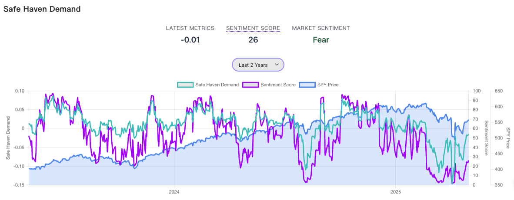

**概要：** 安全資産への逃避需要は、株式市場と債券市場の間で資金がどのように移動しているかを測ります。市場リスクが高まると、投資家は資金を株式から相対的に安全な債券へ移すことが多く、その逆もあります。

**計算方法と読み方：**
株式市場の代表としてSPY（SPDR S&P 500 ETF Trust）、債券市場の代表としてIEF（iShares 7-10 Year Treasury Bond ETF）を使い、過去20取引日の価格変動率の差を計算します。

- **プラス値が大きい：** 株式市場のパフォーマンスが債券市場を上回り、安全資産への逃避需要は低くなっています。投資家はリスクに対して楽観的で、資金が債券市場から株式市場へ流れています。
- **マイナス値が大きい：** 株式市場のパフォーマンスが債券市場を下回り、安全資産への逃避需要が高まっています。投資家の懸念が強く、資金が株式市場から債券市場へ流れています。
- **極端な値：** 通常は−0.1〜+0.1の範囲ですが、市場が極度の恐怖に陥った際には−0.2〜−0.3まで低下したこともあります。

安全資産への逃避需要は、逆張りの観点からも使われます。逃避需要が極端に高い場合は市場の反発を、極端に低い場合は市場の下落を示唆することがあります。

### 6. ハイイールド債スプレッド（Junk Bond Spread）

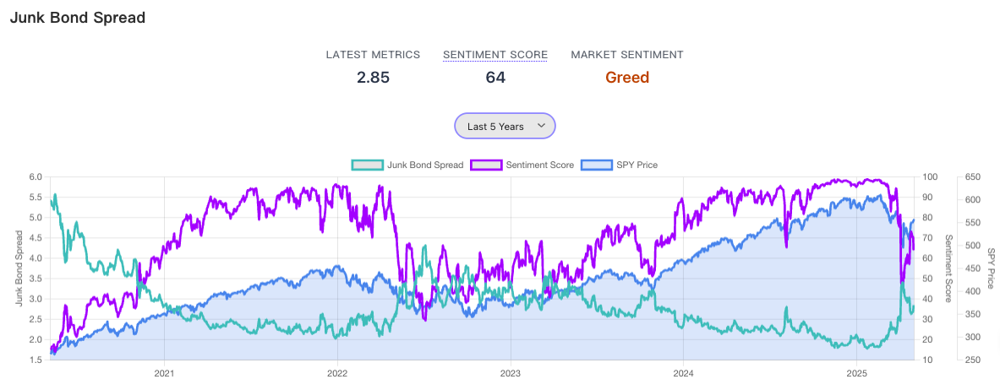

**概要：** ハイイールド債スプレッド（Junk Bond Spread）は、投資家のリスク選好を測る指標です。ハイイールド債（一般に「ジャンク債」と呼ばれます）と投資適格社債の信用スプレッドを比較し、市場がどの程度の信用リスクを受け入れているかを確認します。

**計算方法と読み方：**
FREDが公表するハイイールド債と投資適格社債のデータを使い、それぞれの米国債に対するオプション調整後スプレッド（OAS）を比較します。その差は、より高い信用リスクを取るために市場が求める追加的な補償を表します。

- **数値が高い：** 2種類の債券の信用スプレッドの差が拡大し、投資家はハイイールド債のリスクを取るために、より大きな補償を求めています。
- **数値が低い：** 信用スプレッドの差が縮小し、投資家はリスクを取りやすくなり、追加的な補償が少なくても受け入れています。これはハイイールド債の利回りが投資適格債を下回るという意味ではありません。
- **極端な値：** 通常は2〜4の範囲ですが、市場が極度の恐怖に陥った際には6を超えたこともあります。

データ定義：[FRED ハイイールド債 OAS](https://fred.stlouisfed.org/series/BAMLH0A0HYM2)｜[投資適格社債 OAS](https://fred.stlouisfed.org/series/BAMLC0A0CM)

ハイイールド債スプレッドは逆張り指標として使われます。スプレッドが高すぎる場合は市場の反発を、低すぎる場合は市場の下落を示唆することがあります。

### 7. S&P 500先物投機筋ネットポジション指数（S&P 500 COT Index）

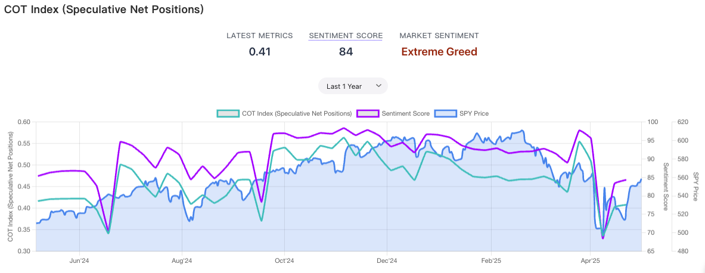

**概要：** S&P 500先物投機筋ネットポジション指数（S&P 500 COT Index）は、先物市場の投機筋の心理を測る指標です。米商品先物取引委員会（CFTC）の建玉報告（COT Report）に基づき、S&P 500指数に対する投機筋の見方を把握します。

**計算方法と読み方：**
CFTCの建玉報告（COT Report）に基づき、レバレッジド・ファンドと資産運用会社の買い建玉の合計から売り建玉の合計を差し引き、投機筋のネットポジションを算出します。次に、ディーラーの買い建玉から売り建玉を差し引き、ヘッジャーのネットポジションを算出します。それぞれのネットポジションが総未決済建玉に占める割合を計算し、両者の差を求めます。

- **数値が高い：** 投機筋の買い建玉が売り建玉を上回り、市場心理は楽観に傾いています。
- **数値が低い：** 投機筋の売り建玉が買い建玉を上回り、市場心理は悲観に傾いています。
- **極端な値：** 通常は0〜0.4の範囲ですが、市場が極度の恐怖に陥った際には0を下回ったこともあります。

S&P 500先物投機筋ネットポジション指数は逆張り指標として使われます。投機筋が過度に楽観的な場合は市場の下落を、過度に悲観的な場合は市場の上昇を示唆することがあります。

関連記事：[COT建玉報告の詳しい解説](/ja-JP/sentiment-indicators/cot-sp500-index)

### 8. NAAIMエクスポージャー指数（NAAIM Exposure Index）

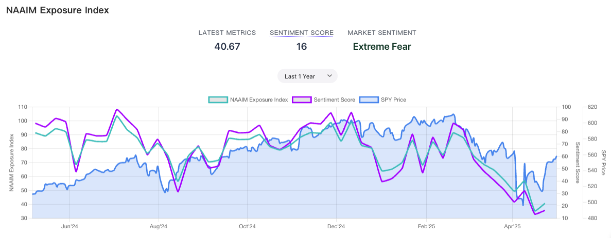

**概要：** NAAIM（全米アクティブ投資運用者協会）のエクスポージャー指数は、プロの運用者が株式市場にどの程度の資金を投じているかを示します。会員に毎週、株式ポートフォリオの比率を尋ねてデータを集計します。

**計算方法と読み方：**
会員に株式ポートフォリオの比率を尋ね、その平均値を計算します。

- **数値が高い：** 専門の投資マネージャーが株式市場へのエクスポージャーを高めており、市場心理は楽観に傾いています。
- **数値が低い：** 専門の投資マネージャーが株式市場へのエクスポージャーを下げており、市場心理は悲観に傾いています。
- **極端な値：** 通常は20〜100の範囲ですが、市場が極度の恐怖に陥った際には20を下回ったこともあります。

NAAIMエクスポージャー指数は逆張り指標として使われます。専門の投資マネージャーが過度に楽観的な場合は市場の下落を、過度に悲観的な場合は市場の上昇を示唆することがあります。

> **市場心理は抽象的に見えても、データを使って測定し、読み解くことができます。**

関連記事：[NAAIMエクスポージャー指数の詳しい解説](/ja-JP/sentiment-indicators/naaim-exposure-index)

## SIO恐怖・強欲指数の読み方

ここまで多くの指標を見てきました。S&P 500指数と照らし合わせると、個別指標の中には高値や安値を捉えられるものもありますが、精度が十分とは言えないものもあります。だからこそ、1つの指標だけに頼らず、すべての指標を総合して判断する必要があります。

各指標には異なる基準があるため、そのまま横並びに比較することはできません。当サイトでは、すべての指標を0〜100の恐怖・強欲スコアに変換し、データが示す心理状態を直感的に理解できるようにしています。さらに「SIO恐怖・強欲指数」では、これらの指標を総合して0〜100のスコアを算出し、次の5段階に分類します。

- **0〜20：極度の恐怖（Extreme Fear）：** 市場が非常に悲観的な状態です。押し目買いを検討する局面になることがあります。
- **21〜40：恐怖（Fear）：** 市場が悲観的な状態です。段階的な投資を始めることを検討できます。
- **41〜60：中立（Neutral）：** 市場心理に明確な方向性がありません。
- **61〜80：強欲（Greed）：** 市場が楽観的な状態です。レバレッジの引き下げやポジション縮小を検討する必要があります。
- **81〜100：極度の強欲（Extreme Greed）：** 市場が過度に楽観的で、バブルの可能性があります。大幅なポジション縮小を検討する局面です。

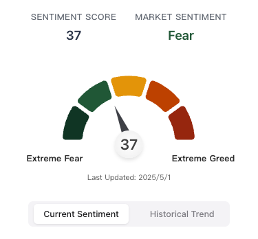

個別指標を1つずつ分析する時間がない場合は、まず総合指数を確認してください。上記の指標を統合しているため、市場心理をすばやく把握できます。

「過去のように指数が5を下回るほど恐怖が極端に強まってから買えばよいのでは」と考えるかもしれません。

その方法もありますが、ほかの投資機会を逃す可能性があります。市場が恐怖に包まれるたびに、指数が5を下回るわけではありません。例えば2011年と2025年の市場不安では、指数は5を下回りませんでした。

より現実的なのは、段階的に投資する方法です。筆者が現在進めているバックテストでは、指数が15を下回った時点で段階的に買い始めることができます（例えば、目標ポジションの50%を先に構築します）。5を下回った場合は残りの資金を投入し、ポジションを100%まで増やします。実際の投資割合は、短期的な損失にどの程度耐えられるかに応じて判断してください。

> **過去のデータを見ると、市場が極度の恐怖にあるときは、長期的には買いの機会となることが多くありました。**

まず[SIO米国株の市場心理](/ja-JP/market-sentiment)で総合スコアを確認し、過去の推移と各シグナルを比較してください。観察したい日付を見つけたら、[LOHAS Five-Line](/ja-JP/priceanalysis)で当時のSPYの価格水準を振り返ることもできます。

**無料版では2カ月前までの市場データを確認できます。現在の市場をこの方法で分析したい場合は、Proで米国株・台湾株の最新市場心理と直近の変化を確認できます。**

---

[市場心理指標の最新値を見る](/ja-JP/sentiment-indicators)
