이전 글 [LOHAS 5선 차트로 가격 추세와 시장 심리 분석하기](/ko-KR/articles/lohas-five-line-analysis-price-trends-and-sentiment)에 이어, LOHAS 도구로 가격 추세와 이탈 정도를 확인하는 방법을 살펴봤습니다. 그렇다면 개별 종목의 가격을 넘어 *시장 전체*가 극단적인 심리 상태에 있는지는 어떻게 판단할 수 있을까요? 이 글에서는 주요 시장 심리 지표를 소개하고, SIO 공포·탐욕 지수로 매수·매도 시점을 판단하는 방법을 설명합니다.

## 목차

1. [현재 시장 심리를 알아야 하는 이유](#현재-시장-심리를-알아야-하는-이유)
2. [대표적인 시장 심리 지표의 장단점](#대표적인-시장-심리-지표의-장단점)
3. [SIO 공포·탐욕 지수: 장기 시장 심리 지표](#sio-공포탐욕-지수-장기-시장-심리-지표)
4. [개별 시장 심리 지표 살펴보기](#개별-시장-심리-지표-살펴보기)
   - [AAII 투자자 심리 조사](#1-aaii-투자자-심리-조사-the-aaii-investor-sentiment-survey)
   - [CBOE 풋콜 비율](#2-cboe-풋콜-비율-cboe-putcall-ratio-5-day-avg)
   - [시장 모멘텀](#3-시장-모멘텀)
   - [VIX 변동성 지수](#4-vix-변동성-지수-vix-ma50)
   - [안전자산 수요](#5-안전자산-수요)
   - [하이일드 채권 스프레드](#6-하이일드-채권-스프레드)
   - [S&P 500 COT 지수](#7-sp-500-cot-지수-sp-500-cot-index)
   - [NAAIM Exposure Index](#8-naaim-exposure-index-naaim-exposure-index)
5. [SIO 공포·탐욕 지수 해석하기](#sio-공포탐욕-지수-해석하기)

## 현재 시장 심리를 알아야 하는 이유

시장이 급락할 때 팔고 싶거나 급등할 때 기회를 놓칠까 걱정하는 것은 저 역시 겪는 문제입니다. SIO는 개인 투자자의 견해, 옵션, 기관 포지션, 신용시장 데이터를 함께 살펴 시장이 혼란스러울 때도 일관된 판단 기준을 제공합니다.

개인 투자자 설문만 약세를 보이는 경우와 선물 포지션 및 신용 스프레드까지 방어적으로 바뀌는 경우는 다릅니다. **먼저 종합 점수를 확인한 다음 개별 신호를 열어 공포가 어디에 집중되어 있고 다른 영역으로 확산되고 있는지 살펴보세요.**

2020년 3월 23일 SPY가 저점을 기록했을 때 SIO는 이미 약 1.5점을 기록했습니다. 2022년 10월 3일에는 SIO가 약 4.2점까지 하락해 SPY의 10월 저점 부근에 다시 도달했습니다. **시장 공포가 극심한 시기는 장기 투자자가 포지션을 구축할 기회가 될 수 있습니다.** [BofA 지표 페이지의 SIO 과거 사례](/ko-KR/sentiment-indicators/bofa-bull-bear#sio-history-examples)에서 심리 점수와 가격을 비교해 보세요.

## 대표적인 시장 심리 지표의 장단점

CNN 공포·탐욕 지수나 Bank of America Bull & Bear 지수 같은 시장 심리 지표를 들어 보셨을 것입니다. 후자는 일반 투자자가 쉽게 접하기 어렵고, 간헐적으로 공개되는 보고서를 통해서만 확인할 수 있습니다. 반면 CNN 지수는 공개되어 있어 비교적 쉽게 접할 수 있습니다.

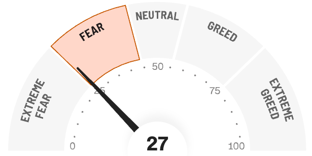

*(CNN 공포·탐욕 지수)*

하지만 CNN 지수에는 단점이 있습니다. 변동이 잦고 등락 폭도 큽니다. SPY와 비교해 백테스트해 보면 지수가 ‘극도의 공포’에 도달한 뒤에도 시장이 상당 폭 더 하락할 수 있습니다. 따라서 단기 매매에 더 적합하다고 볼 수 있습니다. 또한 CNN 지수에는 몇 가지 중요한 지표가 빠져 있습니다. 특히 아래에서 소개할 AAII 개인 투자자 심리 조사가 포함되지 않았다는 점은 아쉽습니다. 개인 투자자 심리는 흔히 역발상 지표로 여겨지기 때문입니다.

> **CNN 공포·탐욕 지수는 널리 알려져 있지만 민감하게 움직이는 편이어서 단기 매매에 더 적합하다고 볼 수 있습니다.**

더 읽어보기: [CNN 공포·탐욕 지수 해석 방법](/ko-KR/sentiment-indicators/cnn-fear-greed) · [BofA Bull & Bear 지수 해석 방법](/ko-KR/sentiment-indicators/bofa-bull-bear)

## SIO 공포·탐욕 지수: 장기 시장 심리 지표

CNN 지수와 달리 [SIO 공포·탐욕 지수](/ko-KR/market-sentiment)(아래 그림)는 *장기적인* 시장 전체의 공포와 탐욕을 반영하도록 특별히 설계되었습니다. 여러 시장 심리 지표를 통합하고 각 지표의 특성에 맞춰 조정해 잡음을 줄인 뒤, 현재 시장의 전반적인 심리를 직관적으로 보여 주는 종합 점수를 계산합니다. S&P 500 ETF(SPY)와 비교한 백테스트에서는 심리 지수가 5 부근 또는 그 이하였던 주요 저점 구간이 장기 투자에 매우 좋은 매수 기회였음을 보여 줍니다.

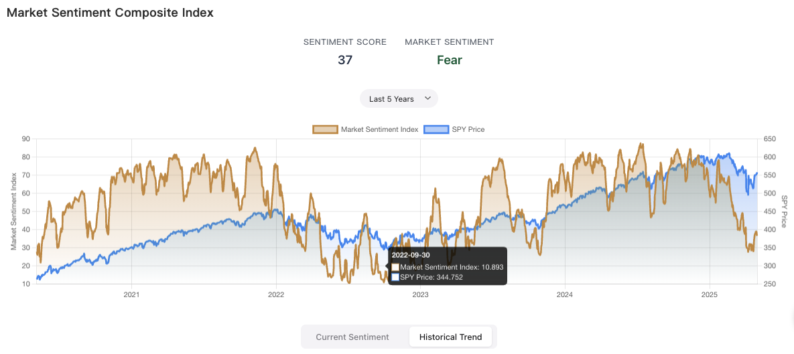

> **SIO 공포·탐욕 지수는 장기 지표입니다. 과거에는 지수가 5 부근 또는 그 이하일 때 장기 매수 기회가 매우 좋았습니다.**

## 개별 시장 심리 지표 살펴보기

아래에서는 SIO 종합 지수에 포함된 주요 시장 심리 지표의 의미를 하나씩 살펴보겠습니다.

### 1. AAII 투자자 심리 조사 (The AAII Investor Sentiment Survey)

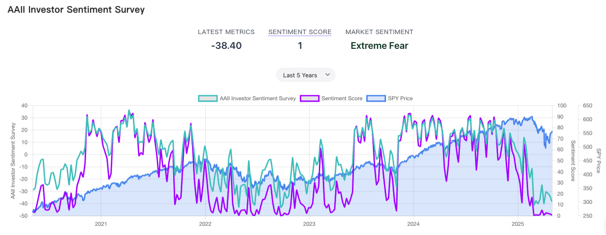

개요: AAII(American Association of Individual Investors, 미국 개인 투자자 협회) 심리 조사는 개인 투자자가 향후 6개월 동안 시장 방향을 얼마나 낙관적 또는 비관적으로 보는지 측정합니다. 회원을 대상으로 매주 설문을 실시합니다.

계산 및 해석:

회원들을 대상으로 향후 6개월간의 시장 전망을 매주 조사하며, 응답은 강세(Bullish), 약세(Bearish), 중립(Neutral)으로 나뉩니다. 널리 사용되는 지표는 AAII Bull-Bear Spread(강세·약세 스프레드)로, 다음과 같이 계산합니다.

강세 응답 비율 − 약세 응답 비율

양수: 강세 응답자가 약세 응답자보다 많아 심리가 낙관적입니다.
음수: 약세 응답자가 강세 응답자보다 많아 심리가 비관적입니다.
극단값: 일반적으로 스프레드가 ±20%를 넘으면 심리가 극단적인 수준이며, 시장 반전 가능성이 커졌음을 시사합니다.

AAII는 역발상 지표로 여겨집니다. 개인 투자자의 낙관이 지나치면 하락이 임박했다는 신호일 수 있고, 비관이 지나치면 상승이 다가온다는 신호일 수 있습니다.

더 읽어보기: [AAII 투자자 심리 조사 상세 가이드](/ko-KR/sentiment-indicators/aaii-sentiment-survey)

### 2. CBOE 풋콜 비율 (CBOE Put/Call Ratio 5-Day Avg)

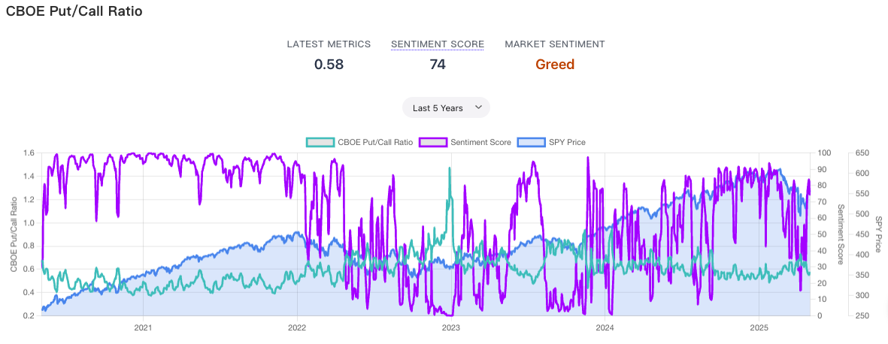

개요: CBOE(Chicago Board Options Exchange, 시카고옵션거래소) 풋콜 비율은 거래된 풋옵션(하락 베팅 또는 헤지)과 콜옵션(상승 베팅)의 비율을 측정합니다. 시장 참여자의 기대를 반영합니다.

계산 및 해석:

풋옵션 거래량을 콜옵션 거래량으로 나누어 계산합니다. 단기 잡음을 줄이기 위해 일반적으로 5일 또는 10일 이동평균을 사용합니다.

비율이 높을 때: 콜옵션보다 풋옵션 거래가 많다는 뜻입니다. 투자자가 보호 수단을 매수하므로 심리가 비관적인 쪽으로 기웁니다.
비율이 낮을 때: 풋옵션보다 콜옵션 거래가 많다는 뜻입니다. 투자자가 상승에 베팅하므로 심리가 낙관적인 쪽으로 기웁니다.
극단값: 평활화 방식과 옵션 시리즈에 따라 다르지만, 이 사이트의 기준으로는 대체로 0.4(극도의 탐욕)에서 0.8(극도의 공포) 사이입니다.

CBOE 풋콜 비율은 역발상 지표입니다. 비율이 매우 높으면 반등이 임박했을 수 있고, 매우 낮으면 조정이 임박했을 수 있습니다.

더 읽어보기: [CBOE 풋콜 비율 상세 가이드](/ko-KR/sentiment-indicators/cboe-put-call-ratio)

### 3. 시장 모멘텀

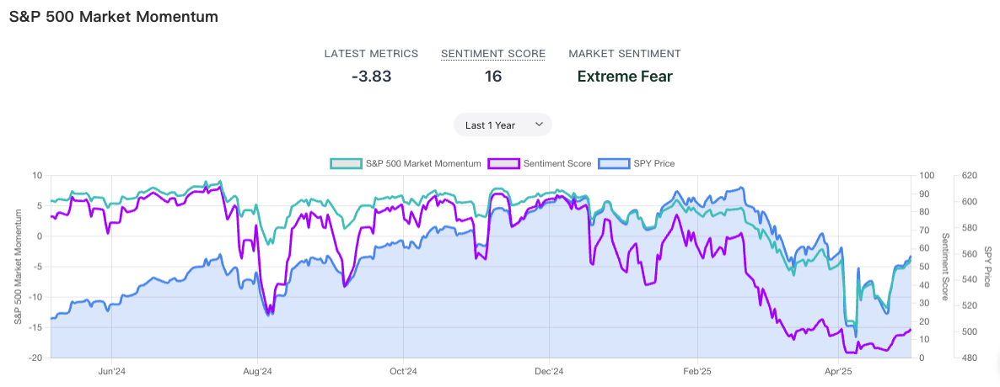

개요: S&P 500 지수 가격 움직임의 속도와 강도를 측정해 추세의 강도를 파악합니다.

계산 및 해석:

S&P 500 지수와 125일 이동평균을 비교해 현재 가격이 장기 평균에서 얼마나 벗어났는지 계산합니다.

양수: 상승 모멘텀이 강하고 추세가 낙관적입니다.
음수: 모멘텀이 약하고 추세가 비관적입니다.
극단값: 일반적으로 −10에서 +10 사이지만, 극심한 패닉 때는 −20~-30까지 내려간 적도 있습니다.

시장 모멘텀은 극단적인 구간에서 역발상 지표로 해석되기도 합니다. 모멘텀이 지나치게 높으면 하락이 임박했을 수 있고, 매우 낮으면 상승이 다가올 수 있습니다.

### 4. VIX 변동성 지수 (VIX MA50)

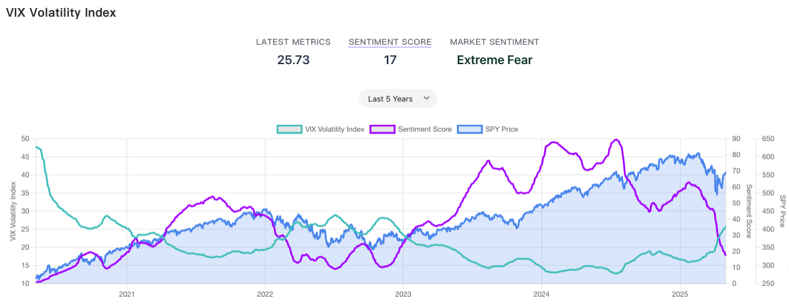

개요: VIX(CBOE 변동성 지수)는 시장이 예상하는 향후 30일 변동성을 측정합니다. 시장이 하락할 때 급등하는 경향이 있어 흔히 ‘공포 지수’라고 불립니다.

계산 및 해석 개념:

VIX를 시장의 불안 수준을 측정하는 지표라고 생각하면 됩니다. 약 30일 후 만기인 S&P 500 옵션 가격을 사용해 계산합니다.

1. **단기 만기 옵션에 집중:** 만기까지 약 30일 남은 콜옵션과 풋옵션의 가격을 사용합니다.
2. **다양한 행사가 반영:** 내가격 옵션과 외가격 옵션을 포함해 여러 행사가의 옵션을 반영함으로써 미래 가격 움직임에 대한 폭넓은 기대를 포착합니다.
3. **내재변동성 계산:** 옵션 가격으로 내재변동성을 도출한 뒤 가중치를 적용합니다. 현재 지수 가격에 가까운 등가격 옵션은 변동성 변화에 더 민감하므로 더 높은 가중치를 받습니다.
4. **미래 변동성 추정:** 최종 VIX 수치는 향후 30일 동안 S&P 500 가격 변동의 연율화 표준편차에 대한 시장의 기대를 나타냅니다.

간단히 말해 VIX가 높을수록 시장은 더 큰 가격 변동을 예상하며, 공포와 불확실성이 크다는 뜻입니다.

이 사이트에서는 장기 심리를 분석하기 위해 VIX 수치를 50일 이동평균(MA50)으로 평활화합니다.

높은 값: 시장이 미래의 높은 변동성을 예상하며 투자자의 공포가 큽니다.
낮은 값: 시장이 미래의 낮은 변동성을 예상하며 투자자가 안심하거나 탐욕적인 상태입니다.
극단값: 일반적으로 10~30 사이지만, 극심한 패닉 때는 50~60까지 급등한 적도 있습니다.

VIX는 역발상 지표입니다. VIX가 극단적으로 높으면 시장 저점(매수 기회)과 겹치는 경우가 많고, 지나치게 낮으면 시장이 안일해져 이후 하락할 가능성을 시사할 수 있습니다.

### 5. 안전자산 수요

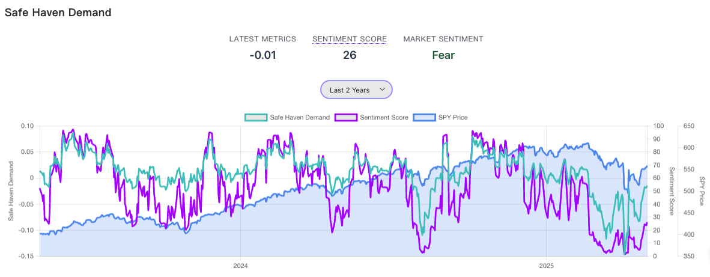

개요: 위험자산인 주식과 상대적으로 안전한 채권 사이의 자금 이동을 측정합니다. 시장의 위험 인식이 커지면 자금이 주식에서 채권으로 이동하는 경향이 있으며, 반대의 경우도 마찬가지입니다.

계산 및 해석:

주식 대표 자산으로 SPY(S&P 500 ETF), 채권 대표 자산으로 IEF(미국 7~10년 만기 국채 ETF)를 사용합니다. 최근 20거래일 동안 두 자산의 수익률 차이를 백분율로 계산합니다.

큰 양수: 주식이 채권보다 크게 앞서며 안전자산 수요가 낮습니다. 심리가 낙관적이고 자금이 채권에서 주식으로 이동하고 있음을 나타냅니다.
큰 음수: 채권이 주식보다 크게 앞서며 안전자산 수요가 높습니다. 투자자가 위험을 우려하고 자금이 주식에서 채권으로 이동하고 있음을 나타냅니다.
극단값: 대체로 −0.1에서 +0.1 사이지만, 극심한 공포 때는 −0.2~-0.3까지 내려간 적도 있습니다.

안전자산 수요는 역발상 지표입니다. 수요가 매우 높으면(큰 음수) 시장 저점이 가까울 수 있고, 매우 낮으면(큰 양수) 조정 전 과도한 낙관을 나타낼 수 있습니다.

### 6. 하이일드 채권 스프레드

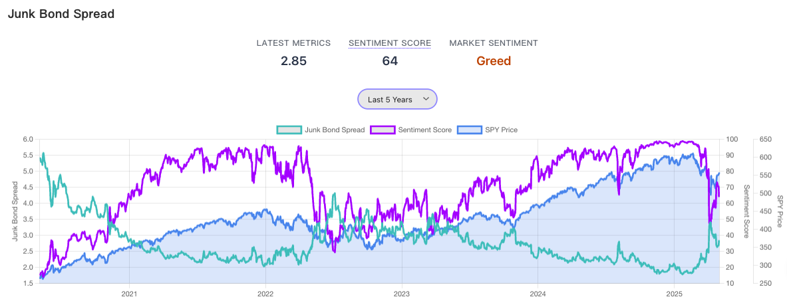

개요: 하이일드 채권 스프레드는 하이일드 채권과 투자등급 회사채의 신용 스프레드를 비교해 투자자의 위험 선호도를 측정합니다.

계산 및 해석:

FRED 데이터를 사용해 고수익 회사채와 투자등급 회사채의 미국 국채 대비 옵션조정 스프레드(OAS)를 비교합니다. 두 스프레드의 차이는 더 높은 신용위험을 감수하는 대가로 시장이 요구하는 추가 보상을 반영합니다.

스프레드가 높을 때: 투자자가 위험을 우려하고 하이일드 채권을 보유하는 대가로 더 큰 프리미엄을 요구합니다. 심리가 공포 쪽으로 기웁니다.
스프레드가 낮을 때: 신용 스프레드 격차가 좁아져 투자자가 위험을 감수하고 더 적은 보상도 받아들입니다. 이는 하이일드 채권 수익률이 투자등급 채권 수익률보다 낮다는 뜻은 아닙니다.
극단값: 대체로 2~4% 사이지만, 시장 스트레스가 극심한 시기에는 6%를 넘기도 했습니다.

데이터 정의: [FRED 하이일드 OAS](https://fred.stlouisfed.org/series/BAMLH0A0HYM2) · [투자등급 OAS](https://fred.stlouisfed.org/series/BAMLC0A0CM)

하이일드 채권 스프레드는 역발상 지표입니다. 스프레드가 매우 넓으면 시장 저점 부근일 때가 많고, 매우 좁으면 시장 고점 부근에서 투자자가 안일해졌다는 신호일 수 있습니다.

### 7. S&P 500 COT 지수 (S&P 500 COT Index)

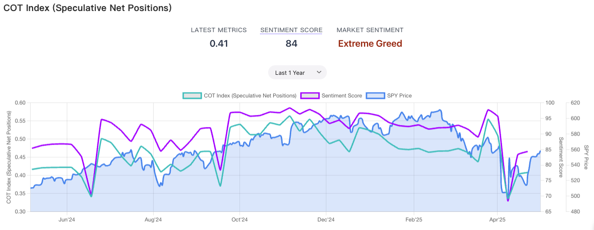

개요: S&P 500 COT(Commitment of Traders, 트레이더 포지션) 지수는 미국 상품선물거래위원회(CFTC)의 주간 COT 보고서를 바탕으로 선물시장의 투기적 거래자 심리를 측정합니다.

계산 및 해석:

CFTC COT 보고서를 바탕으로 레버리지 펀드와 자산운용사의 롱 포지션을 합산한 뒤 숏 포지션을 차감해 투기자 순포지션을 계산합니다. 딜러의 순포지션(헤저)을 별도로 계산합니다. 이 지수는 투기자와 헤저의 순포지션이 전체 미결제약정에서 차지하는 비중 간 차이를 반영합니다.

높은 값: 투기자가 순매수 포지션을 보유하고 있어 시장 심리가 낙관적입니다.
낮은 값: 투기자가 순매도 포지션이거나 순매수 규모가 작아 시장 심리가 비관적입니다.
극단값: 일반적으로 0~0.4 사이지만, 극심한 공포 때는 0 아래로 내려간 적도 있습니다.

COT 지수는 역발상 지표입니다. 투기자의 낙관이 극단적으로 높으면 시장 고점을, 비관이 극단적으로 높으면 시장 저점을 시사할 수 있습니다.

더 읽어보기: [COT 보고서 상세 가이드](/ko-KR/sentiment-indicators/cot-sp500-index)

### 8. NAAIM Exposure Index (NAAIM Exposure Index)

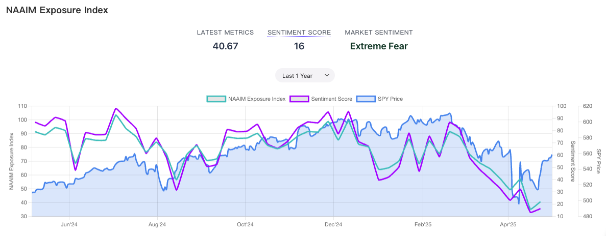

개요: NAAIM(National Association of Active Investment Managers, 미국 액티브 투자운용사 협회) Exposure Index는 전문 액티브 투자운용사가 주간 설문에서 보고한 평균 주식 익스포저 수준을 나타냅니다.

계산 및 해석:

설문에 응답한 회원의 평균 주식 익스포저 비율을 계산합니다(0% = 주식 미보유, 100% = 전액 투자, 100% 초과 = 레버리지 사용).

높은 값: 운용사의 주식 익스포저가 높아 심리가 낙관적임을 나타냅니다.
낮은 값: 운용사의 주식 익스포저가 낮아 심리가 비관적임을 나타냅니다.
극단값: 일반적으로 20~100 사이지만, 극심한 공포 때는 20 아래로 내려간 적도 있습니다.

NAAIM 지수는 역발상 지표입니다. 운용사의 익스포저가 매우 높으면 시장 고점 부근에서 안일해졌음을, 매우 낮으면 시장 저점 부근에서 비관이 과도함을 시사할 수 있습니다.

> **시장 심리는 추상적으로 보일 수 있지만 데이터로 측정하고 해석할 수 있습니다.**

더 읽어보기: [NAAIM Exposure Index 상세 가이드](/ko-KR/sentiment-indicators/naaim-exposure-index)

## SIO 공포·탐욕 지수 해석하기

앞서 살펴본 지표를 S&P 500과 비교하면 일부 지표가 고점이나 저점을 포착하기는 하지만 어느 하나도 완벽하게 신뢰할 수는 없다는 점을 알 수 있습니다. 따라서 단일 지표에 의존하기보다 종합적인 관점이 필요합니다.

각 지표는 척도가 달라 직접 비교하기 어렵습니다. 그래서 웹사이트에서는 각 지표를 0~100의 표준화된 ‘공포·탐욕 점수’로 변환해 현재 데이터가 나타내는 심리 수준을 직관적으로 파악할 수 있도록 합니다. ‘SIO 공포·탐욕 지수’는 여기서 한 단계 더 나아가 개별 점수를 모두 종합해 0~100의 단일 점수로 만들고, 이를 다섯 단계로 구분합니다.

* **0~20: 극도의 공포(Extreme Fear)** — 시장이 극도로 비관적이며, 과거에는 저가 매수 기회가 강하게 나타났던 구간입니다.
* **21~40: 공포(Fear)** — 시장이 비관적인 상태이므로 분할 매수를 시작하는 방안을 고려할 수 있습니다.
* **41~60: 중립(Neutral)** — 시장 심리가 중립적인 상태입니다.
* **61~80: 탐욕(Greed)** — 시장이 낙관적이므로 레버리지를 낮추거나 포지션 일부를 줄이는 방안을 고려할 수 있습니다.
* **81~100: 극도의 탐욕(Extreme Greed)** — 지나친 낙관이나 잠재적 거품을 나타내므로 익스포저를 크게 줄이는 방안을 고려할 수 있습니다.

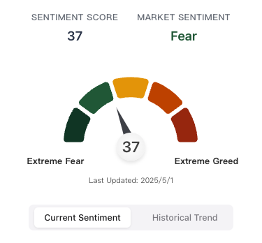

개별 지표를 모두 살펴볼 시간이 없어도 걱정하지 마세요. 이 종합 지수는 각 지표의 결과를 요약해 시장 심리를 빠르게 파악할 수 있도록 도와줍니다.

‘10년에 한 번 올까 말까 한 패닉으로 점수가 5 아래로 떨어질 때까지 기다렸다가 매수하면 되지 않을까?’라고 생각할 수 있습니다.

그렇게 할 수도 있지만 좋은 진입 기회를 놓칠 수도 있습니다. 모든 시장 공포가 지수를 5 아래로 떨어뜨리는 것은 아닙니다. 예를 들어 2011년과 2025년의 패닉은 모두 그 수준을 밑돌지 않았습니다.

가장 나은 접근법은 ‘분할 매수’ 전략으로 포지션을 구축하는 것입니다. 현재까지의 제 백테스트 결과를 기준으로 하면 점수가 15에 도달할 때 진입을 시작해(예: 목표 포지션의 50% 투자), 5 아래로 떨어지면 매수를 마무리해(100%까지 투자) 볼 수 있습니다. 물론 단기 손실을 감내할 수 있는 수준은 사람마다 다르므로 최종 판단은 자신의 기준에 따라야 합니다.

> **과거 데이터를 돌아보면 극도의 공포 구간은 장기 투자자에게 꾸준히 좋은 매수 기회가 되어 왔습니다.**

[SIO 미국 시장 심리](/ko-KR/market-sentiment)를 열어 종합 점수를 확인한 다음 과거 차트와 개별 신호를 비교해 보세요. 살펴보고 싶은 날짜를 선택하고 [LOHAS 5선 분석](/ko-KR/priceanalysis)으로 당시 SPY의 가격 구간을 확인할 수도 있습니다.

**무료 버전에서는 두 달 전까지의 과거 데이터를 살펴볼 수 있습니다. 같은 분석을 현재 시장에 적용하려면 Pro에서 미국과 대만의 최신 심리 지표 및 최근 변화를 확인하세요.**

---

[모든 시장 심리 지표의 최신 수치 보기](/ko-KR/sentiment-indicators)
