上一篇[用乐活五线谱分析价格趋势与情绪](https://sentimentinsideout.com/zh-CN/articles/lohas-five-line-analysis-price-trends-sentiment/)介绍了如何借助乐活五线谱判断股价趋势及其偏离程度。那么，除了价格之外，还有什么方法可以判断整体市场是否处于极端情绪？本文将介绍几项重要数据，并说明如何使用 Sentiment Inside Out 恐惧贪婪指数（简称 SIO 恐惧贪婪指数）辅助判断买卖时机。

## 目录

1. [为什么要知道当前市场情绪？](#为什么要知道当前市场情绪)
2. [常见的市场情绪指标优缺点](#常见的市场情绪指标优缺点)
3. [SIO 恐惧贪婪指数：观察长期市场情绪](#sio-恐惧贪婪指数观察长期市场情绪)
4. [解析各项市场情绪指标](#解析各项市场情绪指标)
   - [AAII 投资者情绪调查](#1-aaii-投资者情绪调查-the-aaii-investor-sentiment-survey)
   - [CBOE 看跌/看涨期权比率](#2-cboe-看跌看涨期权比率-cboe-putcall-ratio-5-day-avg)
   - [市场动能](#3-市场动能-market-momentum)
   - [VIX 恐慌指数](#4-vix-恐慌指数-vix-ma50)
   - [避险需求](#5-避险需求-safe-haven-demand)
   - [高收益债利差](#6-高收益债利差-junk-bond-spread)
   - [S&P 500 期货投机净持仓指数](#7-sp-500-期货投机净持仓指数-sp-500-cot-index)
   - [NAAIM 投资经理人仓位指数](#8-naaim-投资经理人仓位指数-naaim-exposure-index)
5. [如何解读 SIO 恐惧贪婪指数？](#如何解读-sio-恐惧贪婪指数)

## 为什么要知道当前市场情绪？

市场大跌时想卖出，快速上涨时又怕错过机会，这也是我自己经常面对的难题。SIO 将散户情绪、期权交易、机构持仓和信用市场数据放在一起观察，让你在市场波动剧烈时，仍有一套相对稳定的判断依据。

同样是悲观情绪，可能只有散户调查结果偏空，也可能连期货持仓和信用利差都显示市场正在转向防御。**先看综合分数，再查看各项信号，确认恐惧集中在哪些领域，以及是否正在扩散。**

2020 年 3 月 23 日 SPY 触底时，SIO 已降至约 1.5 分；2022 年 10 月 3 日，SIO 降至约 4.2 分，也接近 SPY 当年 10 月的低点。**市场极度恐慌时，往往也是长期投资者开始寻找布局机会的时候。** 可以前往[美银牛熊指标页面中的 SIO 历史案例](/zh-CN/sentiment-indicators/bofa-bull-bear#sio-history-examples)，对照情绪分数与价格走势。

## 常见的市场情绪指标优缺点

市场上有不少情绪指标，例如 CNN Fear & Greed Index 和 BofA Bull & Bear Indicator。后者并不向公众普遍开放，通常只能看到偶尔流出的数据；前者则是公开指标，也是投资者较常接触到的一个。

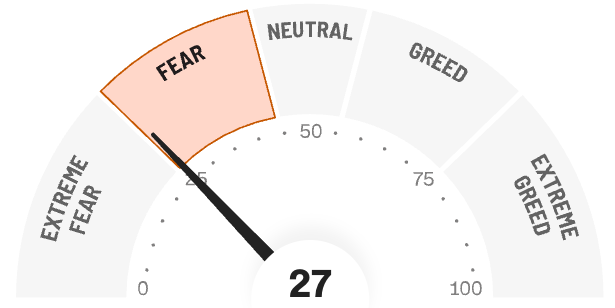

*(CNN Fear & Greed Index)*

不过，CNN 指数的一个缺点是波动频繁且幅度较大。若将它与 SPY 的走势进行回测，会发现即使指数已经进入极度恐惧区间，股市仍可能继续大幅下跌。因此，它可能更适合用于短线观察。此外，CNN 指数纳入的指标不多，也没有包含我经常关注的美国 AAII 个人投资者情绪调查（下文会介绍）。这一点比较可惜，因为散户情绪常被视为反向指标。

> **CNN 恐惧贪婪指数虽然广为人知，但对市场变化较为敏感，可能更适合短线观察。**

延伸阅读：[CNN 恐惧贪婪指数怎么解读](/zh-CN/sentiment-indicators/cnn-fear-greed)｜[美银牛熊指标怎么解读](/zh-CN/sentiment-indicators/bofa-bull-bear)

## SIO 恐惧贪婪指数：观察长期市场情绪

与 CNN 指数不同，[SIO 恐惧贪婪指数](https://sentimentinsideout.com/zh-CN/market-sentiment/)（如下图）旨在反映长期整体市场的恐惧与贪婪情绪。它整合多项市场情绪指标，并根据各项指标的特性进行调整，以减少短期波动，最终计算出一个能够直观呈现市场整体情绪的综合指数。以美国标普 500 指数 ETF SPY 进行回测，在过去几次重大市场崩盘期间，情绪指数接近 5 时都曾出现较好的长期买入机会。

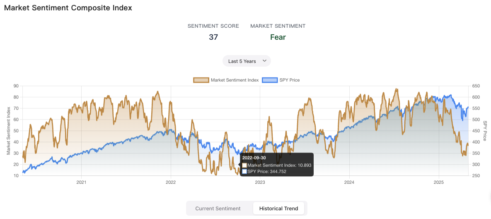

> **SIO 恐惧贪婪指数用于观察长期市场情绪；历史上，指数接近 5 时曾出现较好的长期买入机会。**

## 解析各项市场情绪指标

下面介绍 SIO 恐惧贪婪指数所纳入的几项重要市场情绪指标，以及它们各自代表的含义：

### 1. AAII 投资者情绪调查（The AAII Investor Sentiment Survey）

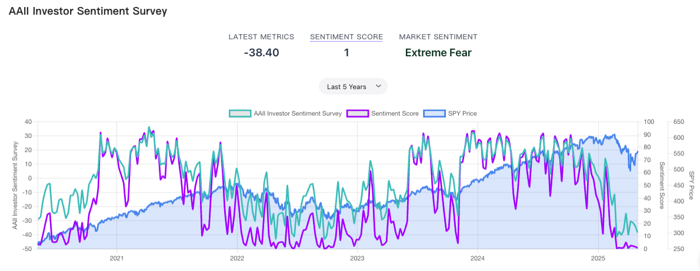

简介：AAII（美国个人投资者协会）投资者情绪调查用于衡量个人投资者对未来市场走势的乐观或悲观程度。该调查每周向会员征询对未来六个月股市走势的预期，并公布统计结果。

计算与解读方式：
调查每周进行一次，询问会员对未来六个月股市走势的看法，选项分为看涨（Bullish）、看跌（Bearish）和中性（Neutral）三种。常见指标为 AAII Bull-Bear Spread（看涨看跌差值），计算方式是看涨比例减去看跌比例。

正值：表示看涨的投资者多于看跌的投资者，市场情绪偏向乐观。

负值：表示看跌的投资者多于看涨的投资者，市场情绪偏向悲观。

极端值：通常差值达到 20% 以上，就表示市场情绪已处于极端水平，市场反转的概率可能随之上升。

AAII 情绪调查常被用作反向指标：当个人投资者过度乐观时，可能暗示市场接近下跌阶段；当他们过度悲观时，则可能暗示市场接近上涨阶段。

延伸阅读：[AAII 散户情绪调查完整解读](/zh-CN/sentiment-indicators/aaii-sentiment-survey)

### 2. CBOE 看跌/看涨期权比率（CBOE Put/Call Ratio 5-Day Avg）

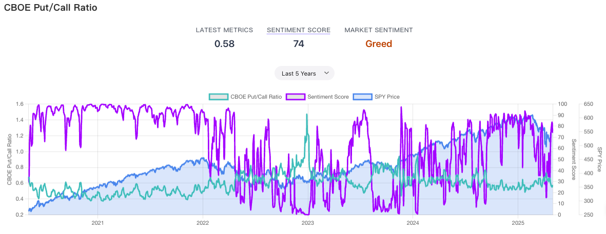

简介：CBOE（芝加哥期权交易所）看跌/看涨期权比率，衡量看跌期权（Put）与看涨期权（Call）的成交量之比，反映市场参与者对未来走势的预期。

计算与解读方式：
用看跌期权成交量除以看涨期权成交量，通常采用 5 日或 10 日平均值，以平滑短期波动。

比率越高：表示看跌期权成交量相对较大，市场情绪偏向悲观，投资者可能倾向于买入看跌期权，为投资组合提供保护。

比率越低：表示看涨期权成交量相对较大，市场情绪偏向乐观，投资者可能倾向于买入看涨期权，以把握价格上涨的机会。

极端值：会因平滑方式及所采用的期权类别而异。就本网站的数据而言，通常介于 0.4（极度贪婪）至 0.8（极度恐惧）之间。

CBOE 看跌/看涨期权比率常被视为反向指标：比率过高时，可能暗示市场接近反弹；比率过低时，则可能暗示市场接近下跌。

延伸阅读：[CBOE Put/Call Ratio 完整解读](/zh-CN/sentiment-indicators/cboe-put-call-ratio)

### 3. 市场动能 (Market Momentum)

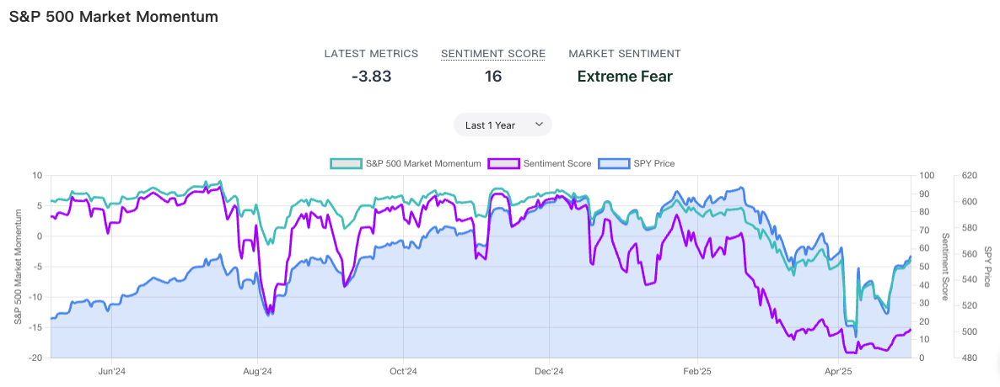

简介：用于衡量 S&P 500 指数价格变动的速度和强度，来判断市场趋势的强弱。

计算及解读方式：
动能指标通过比较 S&P 500 指数与其 125 日移动平均线，计算当前指数点位相对于长期均线的偏离程度。

正值：表示动能强劲，乐观趋势

负值：表示动能疲弱，悲观趋势

极端值：动能指数一般介于-10到10之间，但是当市场出现极度恐慌时，数值也曾经飙到-20到-30。

市场动能作为一个反向指标，当动能过高时，可能暗示市场即将下跌；当动能过低时，可能暗示市场即将上涨。

### 4. VIX 恐慌指数 (VIX MA50)

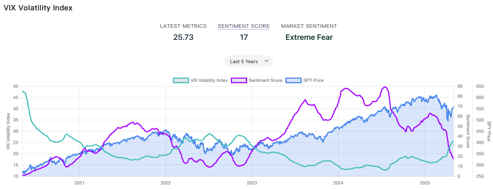

简介：VIX（芝加哥期权交易所波动率指数）衡量市场对未来 30 天波动率的预期。由于它往往会在市场下跌时快速上升，因此通常被称为「恐慌指数」。

计算及解读方式：
VIX 指数可以看作衡量市场紧张程度的温度计，主要根据 S&P 500 指数期权的价格计算。

简单来说，VIX 指数的计算步骤如下：

1. **选取临近到期的期权：** 使用距离到期约 30 天的 S&P 500 指数看涨期权（Call Options）和看跌期权（Put Options）的价格。

2. **纳入不同执行价格的期权：** 计算时会考虑不同「执行价格」（Strike Price）的看涨期权和看跌期权，包括价内（In-the-money）与价外（Out-of-the-money）期权，以尽可能全面地反映市场对未来价格波动的预期。

3. **计算隐含波动率：** 根据期权价格推算隐含波动率（Implied Volatility），再进行加权，得到整体波动率估计。

   * **越接近当前指数点位，权重通常越高：** 执行价格接近当前 S&P 500 指数点位的期权（即平值期权）对波动率估计的影响较大，因为它们对市场波动更敏感。

4. **估算未来波动：** 最后，根据加权后的期权价格，计算市场预期未来 30 天的波动幅度。

   * **预期波动的标准差：** VIX 指数反映市场预期未来 30 天 S&P 500 指数价格波动的年化标准差。指数越高，代表市场预期波动越大，反之亦然。

如果以上计算过程不容易理解，可以先记住一个简单结论：VIX 指数越高，通常代表市场越紧张、越恐慌。

为了用于长期市场情绪分析，网站显示的 VIX 指标额外采用 50 日移动平均线（MA50），以平滑 VIX 本身的波动。

数值越高：表示市场预期未来波动率较高，投资者更为恐惧。

数值越低：表示市场预期未来波动率较低，投资者更为乐观。

极端值：通常介于 10 至 30 之间，但在市场极度恐慌时，数值也曾升至 50 至 60。

VIX 常被视为反向指标：数值过高时，可能暗示市场接近反弹；数值过低时，则可能暗示市场接近下跌。

### 5. 避险需求 (Safe Haven Demand)

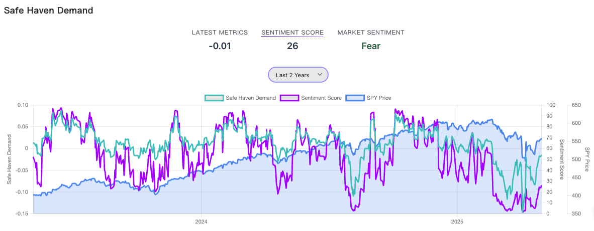

简介：避险需求用于衡量资金在股票市场与债券市场之间的流动。当市场风险上升时，投资者通常会将资金从股票转向相对安全的债券，反之亦然。

计算及解读方式：
使用 SPY（SPDR S&P 500 ETF Trust）和 IEF（iShares 7-10 Year Treasury Bond ETF）分别代表股票市场和债券市场，计算过去 20 个交易日两者价格涨跌幅的差值。

正值越大：表示股票市场表现优于债券市场，避险需求较低。投资者对市场风险较为乐观，资金倾向于从债券市场流向股票市场。

负值越大：表示股票市场表现弱于债券市场，避险需求较高。投资者对市场风险较为担忧，资金倾向于从股票市场流向债券市场。

极端值：通常介于 -0.1 至 +0.1 之间，但在市场极度恐慌时，数值也曾降至 -0.2 至 -0.3。

避险需求常被视为反向指标：避险需求过高时，可能暗示市场接近反弹；避险需求过低时，则可能暗示市场接近下跌。

### 6. 高收益债利差（Junk Bond Spread）

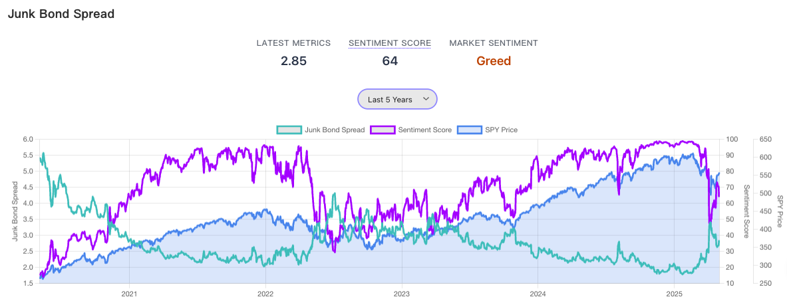

简介：高收益债利差（Junk Bond Spread）用于衡量投资者的风险偏好。它比较高收益债券与投资级公司债的信用利差，以观察市场愿意承担多少信用风险。

计算及解读方式：
使用 FRED 公布的高收益债与投资级公司债数据，比较两者相对于美国国债的期权调整利差（OAS）。两者之间的差值反映市场为承担更高信用风险所要求的额外补偿。

数值越高：两类债券的信用利差差距扩大，表示投资者要求更高的风险补偿，才愿意持有高收益债。

数值越低：信用利差差距收窄，表示投资者更愿意承担风险，接受较低的额外补偿。但这并不代表高收益债的收益率低于投资级债。

极端值：通常介于 2% 至 4% 之间，但在市场极度恐慌时，数值也曾升至 6% 以上。

数据定义：[FRED 高收益债 OAS](https://fred.stlouisfed.org/series/BAMLH0A0HYM2)｜[投资级公司债 OAS](https://fred.stlouisfed.org/series/BAMLC0A0CM)。

高收益债利差常被视为反向指标：利差过高时，可能暗示市场接近反弹；利差过低时，则可能暗示市场接近下跌。

### 7. S&P 500 期货投机净持仓指数 (S&P 500 COT Index)

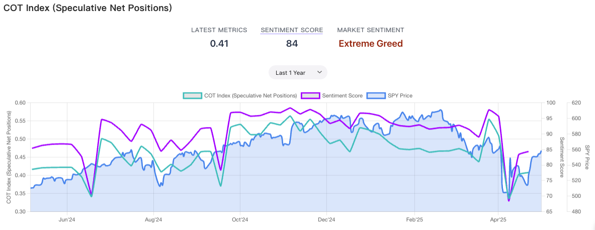

简介：S&P 500 期货投机净持仓指数（S&P 500 COT Index）用于衡量期货市场中投机者的情绪。该指标基于美国商品期货交易委员会（CFTC）的持仓报告（COT Report），帮助我们了解投机者对 S&P 500 指数的整体看法。

计算及解读方式：
根据美国商品期货交易委员会（CFTC）的持仓报告（COT Report），先将杠杆基金和资产管理机构的多头持仓合计减去空头持仓，得到投机者净持仓；再以交易商的多头持仓减去空头持仓，得到套期保值者净持仓。分别计算两者净持仓占未平仓合约总量的比例，再将两者相减。

数值越高：表示投机者的净多头仓位较高，市场情绪偏向乐观。

数值越低：表示投机者的净空头仓位较高，市场情绪偏向悲观。

极端值：通常介于 0 至 0.4 之间，但在市场极度恐慌时，数值也曾低于 0。

S&P 500 期货投机净持仓指数常被视为反向指标：投机者过度乐观时，可能暗示市场接近下跌阶段；过度悲观时，则可能暗示市场接近上涨阶段。

延伸阅读：[COT 持仓报告完整解读](/zh-CN/sentiment-indicators/cot-sp500-index)

### 8. NAAIM 投资经理人仓位指数（NAAIM Exposure Index）

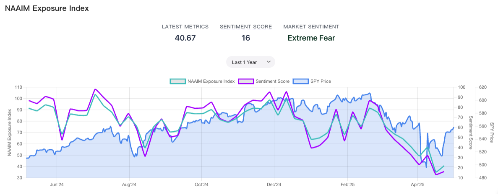

简介：NAAIM（美国主动投资经理人协会）投资经理人仓位指数反映专业投资经理人的股票仓位水平，通过每周调查会员的股票投资组合比例收集数据。

计算及解读方式：
调查会询问会员的股票投资组合比例，计算会员股票投资组合比例的平均值。

数值越高：表示专业投资经理人的股票仓位较高，市场情绪偏向乐观。

数值越低：表示专业投资经理人的股票仓位较低，市场情绪偏向悲观。

极端值：通常介于 20% 至 100% 之间，但在市场极度恐慌时，数值也曾低于 20%。

NAAIM 投资经理人仓位指数常被视为反向指标：当专业投资经理人的股票仓位过高时，可能暗示市场接近下跌阶段；仓位过低时，则可能暗示市场接近上涨阶段。

> **市场情绪看似抽象，但仍然可以通过数据进行衡量和分析。**

延伸阅读：[NAAIM 仓位指数完整解读](/zh-CN/sentiment-indicators/naaim-exposure-index)

## 如何解读 SIO 恐惧贪婪指数？

看过上述指标，再对照 S&P 500 指数就会发现，有些指标虽然能够捕捉市场高点或低点，但准确度并不总是理想。因此，我们不应依赖单一指标，而应综合考虑多项指标。

由于上述指标各有不同的计量尺度，无法直接比较，网站会先将它们分别转换为 0–100 的恐惧贪婪分数，方便直观了解数据所反映的情绪状态。随后，「SIO 恐惧贪婪指数」再将这些分数综合计算为一个 0–100 的总分，并划分为五个等级：

* **0–20：极度恐惧**（Extreme Fear）：表示市场极度悲观，可以考虑逢低分批买入。
* **21–40：恐惧**（Fear）：表示市场偏向悲观，可以考虑开始分批布局。
* **41–60：中性**（Neutral）：表示市场情绪处于中性水平。
* **61–80：贪婪**（Greed）：表示市场偏向乐观，可以考虑降低杠杆或减少仓位。
* **81–100：极度贪婪**（Extreme Greed）：表示市场过度乐观，可能存在泡沫，可以考虑大幅降低仓位。

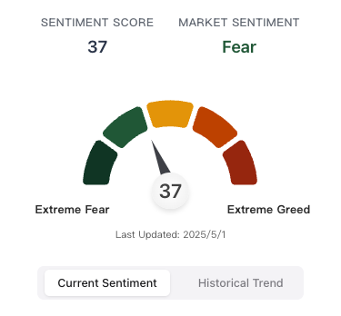

如果没有时间逐项研究这些指标，也可以先看综合指数。它汇总了上述指标的信息，帮助你快速了解当前市场情绪。

你可能会想：是否只要等到指数跌破 5 分、出现历史级别的恐慌时再买入就好？

这样做当然可以，但也可能错过其他买入机会。并非每次市场恐慌都会让指数跌破 5 分，例如 2011 年和 2025 年的恐慌时期都没有低于这一水平。

更可取的做法是分批布局。根据作者目前的回测结果，指数低于 15 分时可以开始分批买入（例如投入计划仓位的 50%）；低于 5 分时，则可以考虑完成建仓（达到计划仓位的 100%）。当然，具体比例仍应根据个人承受短期亏损的能力自行判断。

> **从历史数据来看，市场处于极度恐惧时，长期投资者往往能找到较好的买入机会。**

前往 [SIO 美股市场情绪](/zh-CN/market-sentiment)，先查看综合分数，再对照历史走势和各项信号。选定想研究的日期后，也可以使用[乐活五线谱](/zh-CN/priceanalysis)回看当时 SPY 所处的价格区间。

**免费版可以查看截至两个月前的历史行情；如果想将这套方法用于当前市场，Pro 可查看最新的美股和台湾股市情绪数据及近期变化。**

---

[查看所有市场情绪指标的最新读数](/zh-CN/sentiment-indicators)
