上一篇[用樂活五線譜分析股價趨勢與市場情緒](/zh-HK/articles/1.%E7%94%A8%E6%A8%82%E6%B4%BB%E4%BA%94%E7%B7%9A%E8%AD%9C%E5%88%86%E6%9E%90%E5%83%B9%E6%A0%BC%E8%B6%A8%E5%8B%A2%E8%88%87%E6%83%85%E7%B7%92/)介紹了如何利用樂活五線譜觀察股價趨勢及偏離幅度。除了價格，還有甚麼方法可以判斷整體市場是否出現極端情緒？本文會介紹幾項重要指標，並示範如何利用 Sentiment Inside Out 的恐懼與貪婪指標（以下簡稱 SIO 指標）評估買賣時機。

## 目錄

1. [為什麼要知道當前市場情緒？](#為什麼要知道當前市場情緒)
2. [常見的市場情緒指標優缺點](#常見的市場情緒指標優缺點)
3. [SIO 恐懼與貪婪指標：觀察長期市場情緒](#SIO-恐懼與貪婪指標觀察長期市場情緒)
4. [解析個別情緒指標](#解析個別情緒指標)
   - [AAII 投資者情緒調查](#1-aaii-投資者情緒調查the-aaii-investor-sentiment-survey)
   - [CBOE 認沽／認購期權比率](#2-cboe-認沽認購期權比率cboe-putcall-ratio-5-day-average)
   - [市場動能](#3-市場動能market-momentum)
   - [VIX 波幅指數](#4-vix-波幅指數vix-ma50)
   - [避險需求](#5-避險需求safe-haven-demand)
   - [高孳息債券信貸息差](#6-高孳息債券信貸息差junk-bond-spread)
   - [S&P 500 期貨投機淨持倉指數](#7-sp-500-期貨投機淨持倉指數sp-500-cot-index)
   - [NAAIM 投資經理股票持倉指數](#8-naaim-投資經理股票持倉指數naaim-exposure-index)
5. [如何解讀 SIO 恐懼與貪婪指標？](#如何解讀-sio-恐懼與貪婪指標)

## 為什麼要知道當前市場情緒？

市場大跌時想沽出，急升時又怕錯過升勢，是投資者常遇到的難題。SIO 將散戶情緒、期權市場、機構持倉及信貸市場的訊號整合分析，讓你在市況波動劇烈時，仍有一套一致的參考基準。

同樣是市場情緒悲觀，可能只有散戶調查轉淡，也可能連期貨持倉及信貸息差都反映避險情緒升溫。**先看綜合分數，再查看各項訊號，了解恐懼集中在哪些市場，以及是否正在擴散。**

2020 年 3 月 23 日 SPY 落底時，SIO 已降至約 1.5 分；2022 年 10 月 3 日 SIO 降至約 4.2 分，也接近 SPY 的 10 月低點。**市場恐慌最嚴重時，往往也是長期投資者開始尋找部署機會的時候。** 到[美銀牛熊指標頁的 SIO 歷史案例](/zh-HK/sentiment-indicators/bofa-bull-bear#sio-history-examples)，直接對照情緒分數與價格走勢。

## 常見的市場情緒指標優缺點

市場上有不少市場情緒指標，例如 CNN Fear & Greed Index 及 BofA Bull & Bear Indicator。BofA 指標的完整數據一般不會免費公開；CNN 指標則較容易查閱，因此較常被投資者引用。

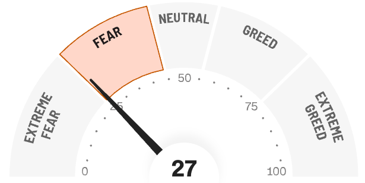

*(CNN Fear & Greed Index)*

不過，CNN 指數的波動較頻繁，有時即使讀數已進入極度恐懼區間，股市仍可能進一步下跌。以 SPY 進行歷史回測時，便可觀察到這種情況，因此它較適合用作短線情緒參考。此外，CNN 指數涵蓋的指標數目有限，並未包括我經常參考的美國個人投資者協會（AAII）情緒調查。散戶情緒有時會被視為反向指標，但這種解讀並非每次都成立。

> **CNN 恐懼與貪婪指數較為敏感，較適合作為短線市場情緒的參考。**

延伸閱讀：[CNN 恐懼貪婪指數怎麼解讀](/zh-HK/sentiment-indicators/cnn-fear-greed)｜[美銀牛熊指標怎麼解讀](/zh-HK/sentiment-indicators/bofa-bull-bear)

## SIO 恐懼與貪婪指標：觀察長期市場情緒

相較於 CNN 指數，[SIO 恐懼與貪婪指標](/zh-HK/market-sentiment/)旨在反映市場的長期整體情緒。它整合多項市場情緒指標，並按各指標的特性作平滑處理，計算出綜合分數，讓投資者更直觀地掌握市場情緒。若以追蹤美國 S&P 500 指數的 ETF SPY 進行歷史回測，在過往幾次大型市場崩盤期間，情緒分數曾降至 5 分附近。

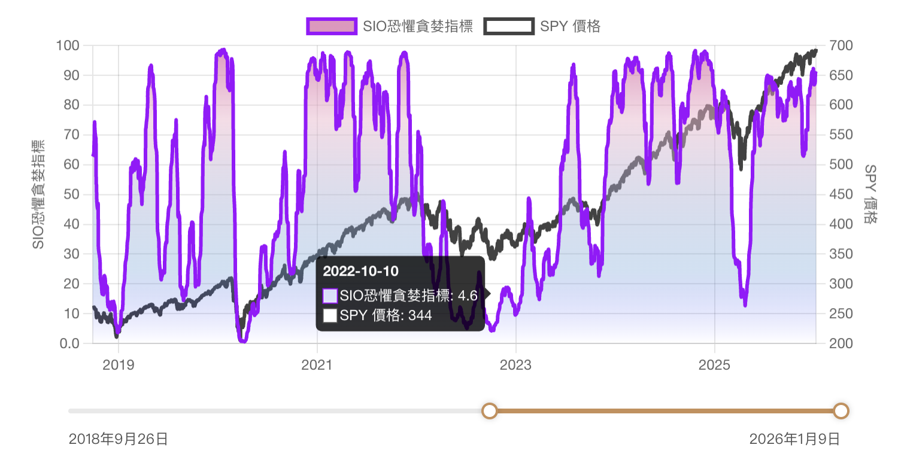

> **市場情緒指數適合觀察長期情緒；歷史數據顯示，指數跌至 5 分附近時，曾出現值得留意的長線買入時機。**

## 解析個別情緒指標

以下會介紹 SIO 指標所涵蓋的各項市場情緒指標，以及它們各自反映的市場訊息：

### 1. AAII 投資者情緒調查（The AAII Investor Sentiment Survey）

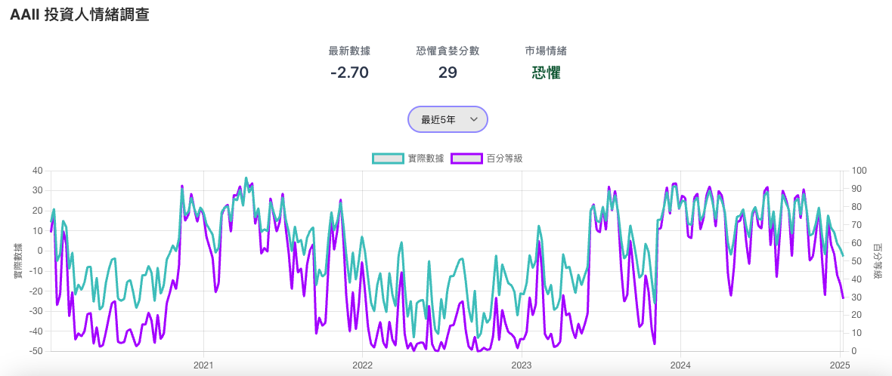

簡介：AAII（美國個人投資者協會）的投資者情緒調查，用來衡量散戶對未來市場走勢的看好或看淡程度。協會每週邀請會員回答對未來六個月股市走勢的看法，再公布統計結果。

計算及解讀方法：
調查每週進行一次，會員須選擇看好（Bullish）、看淡（Bearish）或中性（Neutral）。常見的計算方式是 AAII Bull-Bear Spread（看好與看淡比例差）：看好的會員百分比減去看淡的會員百分比。

正值：代表看好的投資者多於看淡的投資者，市場情緒較為樂觀。

負值：代表看淡的投資者多於看好的投資者，市場情緒較為悲觀。

極端值：差值達到 20 個百分點以上時，一般可視為市場情緒處於極端水平，但並不代表市場必然即時反轉。

AAII 可作為反向情緒參考：散戶過度看好時，市場或有回調風險；過度看淡時，則值得留意潛在反彈機會。

延伸閱讀：[AAII 散戶情緒調查完整解讀](/zh-HK/sentiment-indicators/aaii-sentiment-survey)

### 2. CBOE 認沽／認購期權比率（CBOE Put/Call Ratio 5-Day Average）

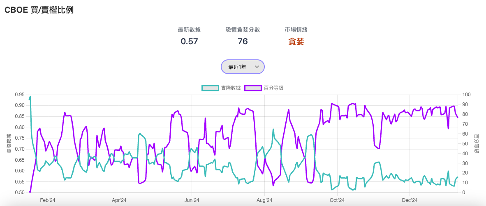

簡介：CBOE（芝加哥期權交易所）的認沽／認購期權比率，衡量認沽期權（Put）與認購期權（Call）的成交量比例，反映市場參與者對後市的預期。

計算及解讀方法：
計算認沽期權與認購期權的成交量比率，通常採用 5 日或 10 日平均值，以減低短期波幅的影響。

比率愈高：代表認沽期權的成交量高於認購期權，市場情緒較為悲觀，投資者可能透過買入認沽期權為投資組合對沖風險。

比率愈低：代表認購期權的成交量高於認沽期權，市場情緒較為樂觀，投資者可能透過買入認購期權捕捉潛在升幅。

極端值：會因平滑方法及期權類別而異；本網站所用的序列通常介乎 0.4（極度貪婪）至 0.8（極度恐懼）。

認沽／認購期權比率可作反向情緒參考：比率過高時，市場或已累積較多看淡情緒；比率過低時，則可能反映市場過度樂觀。

延伸閱讀：[CBOE Put/Call Ratio 完整解讀](/zh-HK/sentiment-indicators/cboe-put-call-ratio)

### 3. 市場動能（Market Momentum）

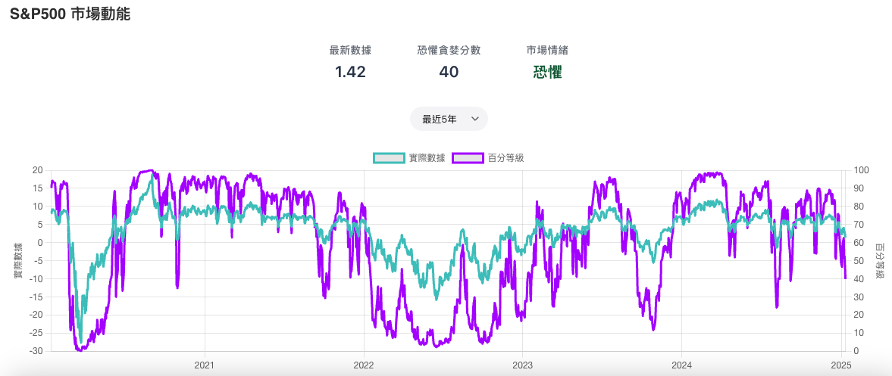

簡介：市場動能用來衡量 S&P 500 指數價格變動的速度及強度，從而判斷市場趨勢的強弱。

計算及解讀方法：
動能指標透過比較 S&P 500 指數與其 125 日移動平均線，計算目前價格相對長期平均水平的差異。

正值：代表動能強勁，市場趨勢較樂觀。

負值：代表動能疲弱，市場趨勢較悲觀。

極端值：動能指數一般介乎 −10 至 +10；但當市場出現極度恐慌時，數值亦曾跌至 −20 至 −30。

市場動能作為反向指標，當動能過高時，可能暗示市場即將下跌；當動能過低時，則可能暗示市場即將上升。

### 4. VIX 波幅指數（VIX MA50）

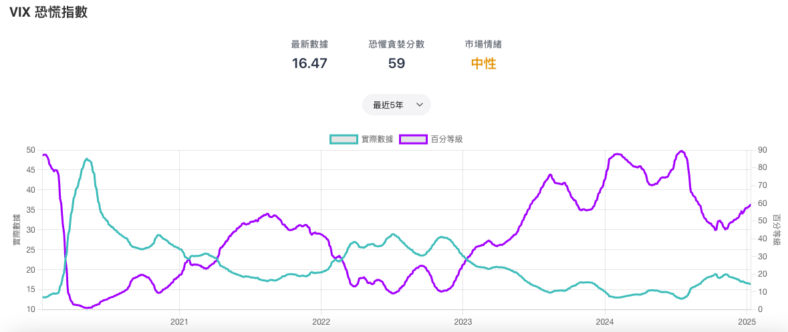

簡介：VIX（芝加哥期權交易所波幅指數）衡量市場對未來 30 天波幅的預期。它通常被稱為「恐慌指數」，因為市場下跌時，VIX 往往會急升。

計算及解讀方法：
VIX 指數就像市場恐慌程度的溫度計，主要根據 S&P 500 指數期權的價格計算。

簡單來說，VIX 指數的計算步驟如下：

1. **查看未來一個月到期的期權：** 採用 S&P 500 指數未來約 30 天到期的認購期權（Call Options）及認沽期權（Put Options）價格。

2. **考慮不同價格的期權：** 計算時會用到不同行使價（Strike Price）的認購期權（Call）及認沽期權（Put），特別涵蓋價內（In-the-money）及價外（Out-of-the-money）的期權，以全面反映市場對未來價格變動的預期。

3. **計算波幅：** 將這些期權價格轉換成引伸波幅（Implied Volatility），再作加權計算，得出整體波幅估算。

    * **越接近目前價格的期權，影響越大：** 特別是行使價接近目前 S&P 500 指數的期權（即平價期權），對波幅的貢獻較大，因為這些期權對市場波動較敏感。

4. **換算成波幅：** 最後，根據加權平均後的期權價格，計算市場預期未來 30 天的波幅幅度。

    * **預期波幅的標準差：** VIX 指數其實就是市場預期未來 30 天 S&P 500 指數價格波動的「標準差」。指數愈高，代表市場預期未來波動愈大，反之亦然。

如果以上內容較難理解，簡單來說，VIX 指數愈高，代表市場愈緊張、愈恐慌。

網站上的 VIX 指標為了用於長期市場情緒判讀，額外採用 50 日移動平均值（MA50），以平滑 VIX 指數的波動。

數值愈高：代表市場預期未來波幅較高，投資者對市場感到恐懼。

數值愈低：代表市場預期未來波幅較低，投資者對市場感到貪婪。

極端值：大多介乎 10 至 30；但當市場出現極度恐慌時，數值亦曾升至 50 至 60。

VIX 恐慌指數作為反向指標，當 VIX 恐慌指數過高時，可能暗示市場即將反彈；當 VIX 恐慌指數過低時，則可能暗示市場即將下跌。

### 5. 避險需求（Safe Haven Demand）

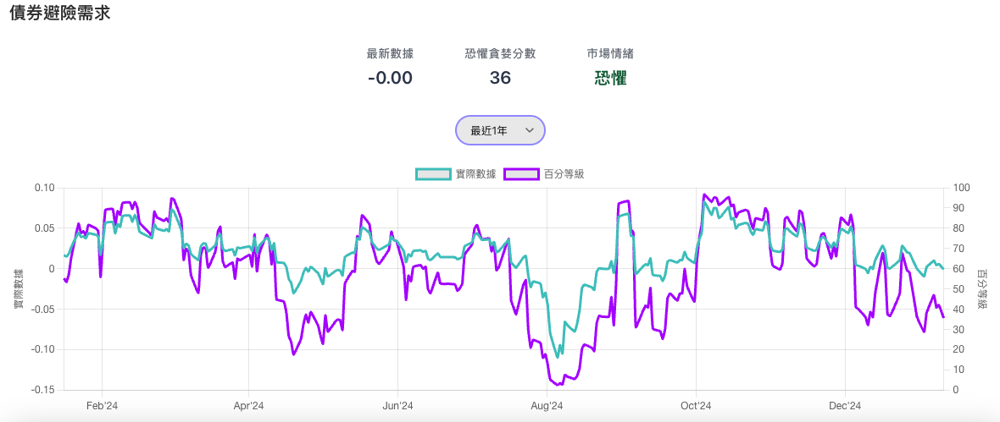

簡介：避險需求衡量資金在股票市場與債券市場之間的流動。當市場風險增加時，投資者通常會將資金由股票市場轉移至相對安全的債券市場，反之亦然。

計算及解讀方法：
使用 SPY（SPDR S&P 500 ETF Trust）及 IEF（iShares 7–10 Year Treasury Bond ETF）分別代表股票市場及債券市場，計算過去 20 個交易日的價格變動百分比差異。

正值愈大：代表股票市場相對債券市場的表現愈好，避險需求愈低。投資者對市場風險較樂觀，資金由債券市場流向股票市場。

負值愈大：代表股票市場相對債券市場的表現愈差，避險需求愈高。投資者對市場風險感到擔憂，資金由股票市場流向債券市場。

極端值：平時大多介乎 −0.1 至 +0.1；但當市場出現極度恐慌時，數值亦曾跌至 −0.2 至 −0.3。

避險需求作為反向指標，當避險需求過高時，可能暗示市場即將反彈；當避險需求過低時，則可能暗示市場即將下跌。

### 6. 高孳息債券信貸息差（Junk Bond Spread）

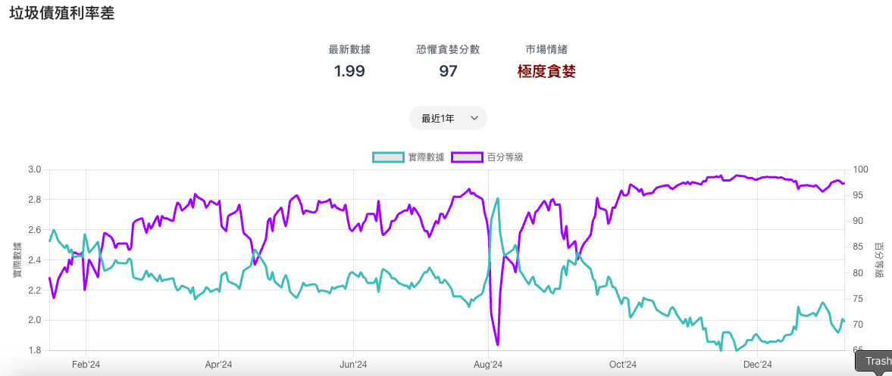

簡介：高孳息債券信貸息差（Junk Bond Spread）是衡量投資者風險偏好程度的指標。它比較高孳息債券（通常稱為「垃圾債」）與投資級別企業債券的信貸息差，觀察市場願意承擔多少信貸風險。

計算及解讀方法：
使用 FRED 公布的高孳息債券及投資級別企業債券資料，比較兩者各自相對美國國債的期權調整息差（OAS）。兩者差距反映市場對較高信貸風險所要求的額外補償。

數值愈高：兩類債券的信貸息差差距擴大，投資者要求更多補償，才願意承擔高孳息債券的風險。

數值愈低：信貸息差差距收窄，投資者較願意承擔風險，接受較少額外補償。這不代表高孳息債券的孳息率低於投資級別債券。

極端值：平時大多介乎 2 至 4；但當市場出現極度恐慌時，數值亦曾升至 6 以上。

資料定義：[FRED 高孳息債券 OAS](https://fred.stlouisfed.org/series/BAMLH0A0HYM2)｜[投資級別企業債券 OAS](https://fred.stlouisfed.org/series/BAMLC0A0CM)。

高孳息債券信貸息差作為反向指標，當高孳息債券信貸息差過高時，可能暗示市場即將反彈；當高孳息債券信貸息差過低時，則可能暗示市場即將下跌。

### 7. S&P 500 期貨投機淨持倉指數（S&P 500 COT Index）

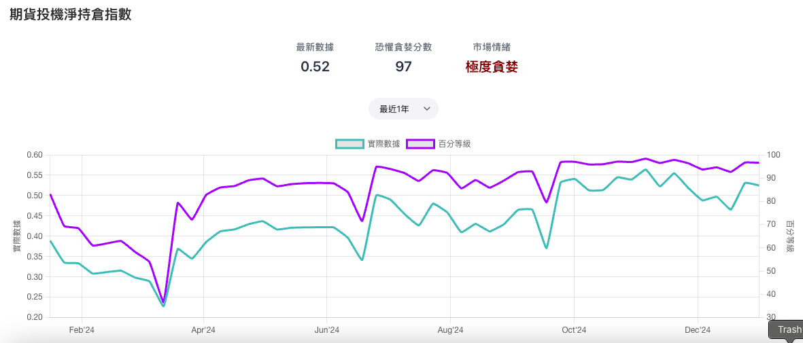

簡介：S&P 500 期貨投機淨持倉指數（S&P 500 COT Index）用來觀察期貨市場投機者的情緒。指標根據美國商品期貨交易委員會（CFTC）公布的交易者持倉報告（Commitments of Traders Report，COT）編製，反映市場參與者對 S&P 500 指數的持倉取向。

計算及解讀方法：
根據 CFTC 的交易者持倉報告，先計算槓桿基金及資產管理公司的好倉減淡倉，得出相關組別的淨持倉；再計算交易商的好倉減淡倉，得出交易商淨持倉。接著分別計算兩組淨持倉佔未平倉合約總數的比例，再將兩個比例相減。

數值愈高：代表投機者持有的好倉相對較多，市場情緒較為樂觀。

數值愈低：代表投機者持有的淡倉相對較多，市場情緒較為悲觀。

極端值：一般介乎 0 至 0.4；市場極度恐慌時，數值亦曾低於 0。

S&P 500 期貨投機淨持倉指數可作為反向情緒參考：投機者持倉過度偏向好倉時，市場或已累積較多樂觀情緒；持倉過度偏向淡倉時，則可能反映市場情緒過度悲觀。

延伸閱讀：[COT 持倉報告完整解讀](/zh-HK/sentiment-indicators/cot-sp500-index)

### 8. NAAIM 投資經理股票持倉指數（NAAIM Exposure Index）

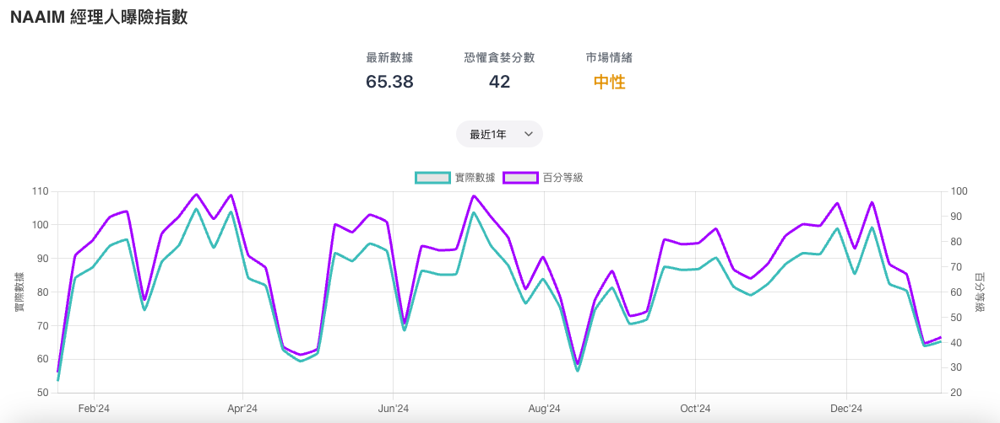

簡介：NAAIM（美國主動投資經理協會）投資經理股票持倉指數，反映專業投資經理在股票市場的持倉比重。協會每週向會員收集其投資組合的股票配置比例。

計算及解讀方法：
調查會收集會員股票投資組合中的持倉比重，並計算平均值。

數值愈高：代表專業投資經理的股票持倉比重較高，市場情緒可能較為樂觀。

數值愈低：代表專業投資經理的股票持倉比重較低，市場情緒可能較為悲觀。

極端值：一般介乎 20 至 100；市場極度恐慌時，數值亦曾低於 20。

NAAIM 指數可作為市場情緒的反向參考：當投資經理的股票持倉比重處於極高水平時，市場可能過度樂觀；持倉比重極低時，則可能反映市場過度悲觀。

> **市場情緒看似抽象，其實仍然可以透過數據衡量和解讀。**

延伸閱讀：[NAAIM 投資經理股票持倉指數完整解讀](/zh-HK/sentiment-indicators/naaim-exposure-index)

## 如何解讀 SIO 恐懼與貪婪指標？

對照 S&P 500 指數後可以發現，部分指標雖然有助辨認市場高低位，但單靠任何一項指標都未必足夠。因此，不宜只依賴單一訊號，而應綜合考慮多項指標。

由於上述指標各有不同的計算基準，不能直接互相比較，因此網站先將它們轉換為 0 至 100 分的恐懼與貪婪讀數，方便理解各項數據反映的情緒。「SIO 恐懼與貪婪指標」再將各項讀數整合為一個 0 至 100 分的綜合分數，並劃分為五個級別：

* **0–20：極度恐懼**（Extreme Fear）：代表市場情緒極度悲觀，可配合估值及個人風險承受能力，評估是否分批買入。
* **21–40：恐懼**（Fear）：代表市場情緒偏悲觀，可考慮分批部署。
* **41–60：中性**（Neutral）：代表市場情緒大致中性。
* **61–80：貪婪**（Greed）：代表市場情緒偏樂觀，可重新檢視槓桿水平及持倉比例。
* **81–100：極度貪婪**（Extreme Greed）：代表市場情緒過度樂觀，可能出現估值過高的情況，宜審慎檢視持倉風險。

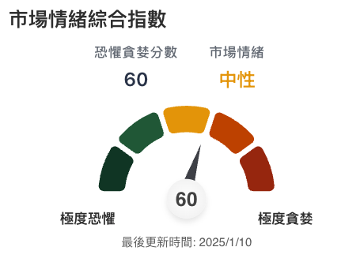

如果你沒時間研究個別指標也沒關係，這個綜合指數就是以上一切指標的綜合結果，可以幫助你一秒了解市場情緒。

你可能會問：是否只需等到 5 分以下、出現歷史級別的恐慌時才買入？
這樣做固然可行，但亦可能錯過部分買入時機。並非每次市場恐慌都會跌至 5 分以下（例如 2011 年及 2025 年的恐慌讀數均未低於 5 分）。
最好的做法還是分批部署，
按作者目前的回測結果，指數低於 15 分時可開始分批入市（例如先投入 50% 資金）；低於 5 分時，則可考慮投入餘下資金（累計至 100%）。
實際部署仍須視乎個人的短期虧損承受能力及投資期限，投資者應自行評估。

> **歷史數據顯示，市場處於極度恐懼時，長線投資者可特別留意估值及分批買入的機會。**

先到 [SIO 美股市場情緒](/zh-HK/market-sentiment)，看綜合分數，再對照歷史走勢與各項訊號。找到想觀察的行情日期，也可以用[樂活五線譜](/zh-HK/priceanalysis)回看當時的 SPY 價格位階。

**免費版可以先回看兩個月前的行情；想把這套判讀用在現在，Pro 提供最新台美股情緒與近期變化。**

---

[查看所有市場情緒指標的最新讀數](/zh-HK/sentiment-indicators)
