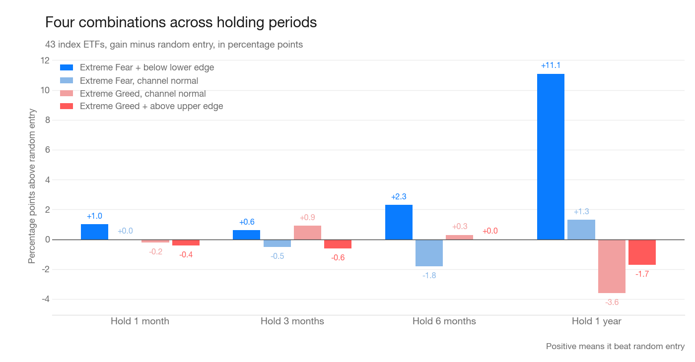
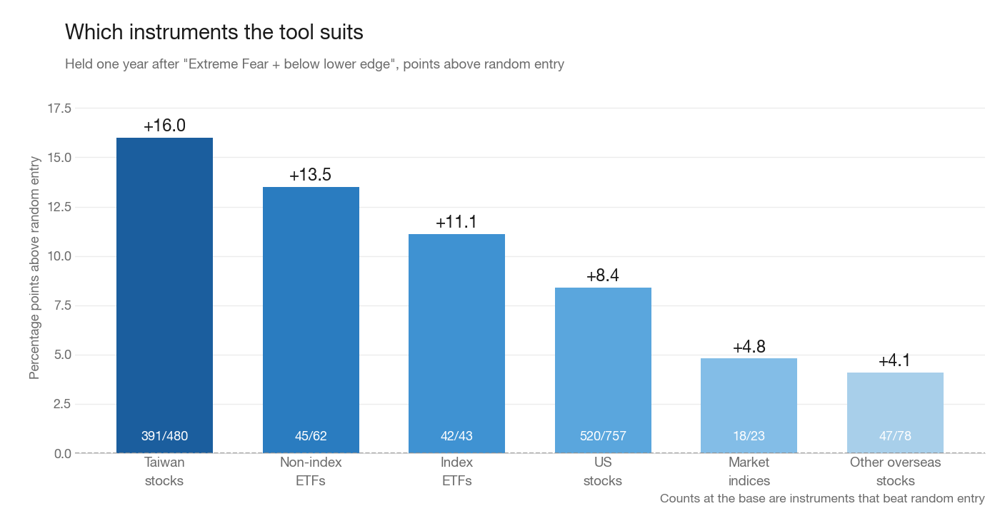
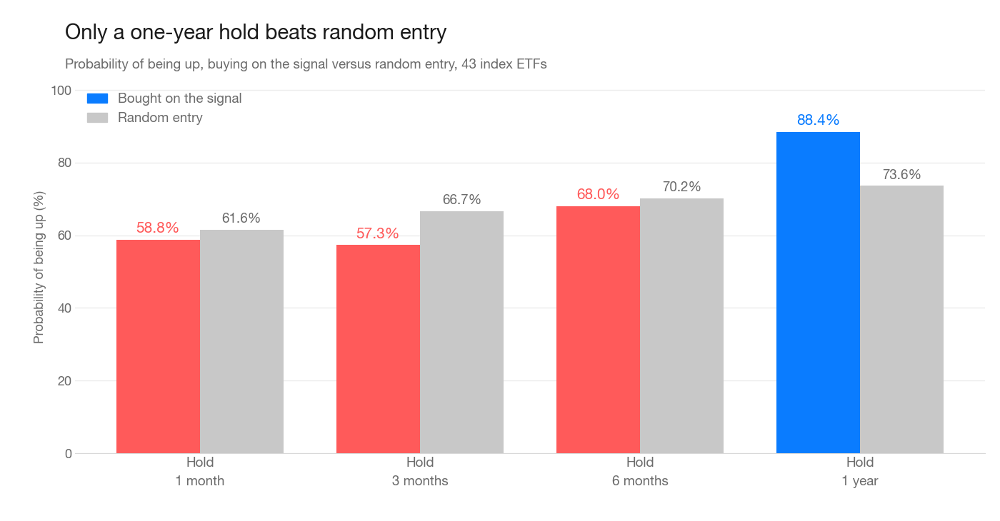
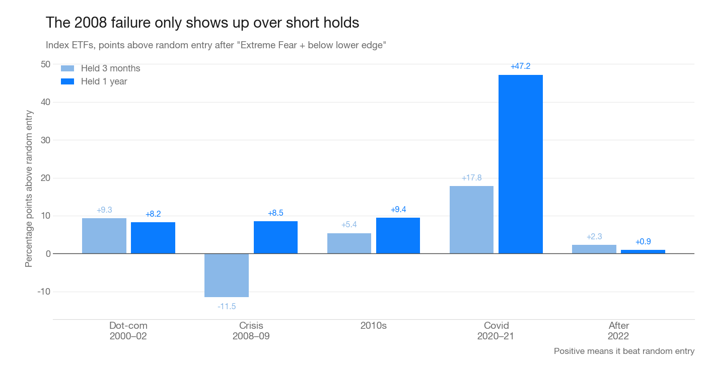

これまでLOHAS Five-Lineを使い続ける中で、いくつか疑問が浮かんできました。サイトでは[基本的な使い方を紹介しています](/ja-JP/articles/lohas-five-line-analysis-price-trends-and-sentiment)。

「極度の強欲」はどのくらいの頻度で現れるのでしょうか。LOHAS Five-LineとLOHASチャネルをページ上で並べると、異なる情報を示しているのでしょうか。「極度の恐怖」が表示された後、通常は何が起きるのでしょうか。

もう一つ、実際の売買に関わる疑問があります。LOHASチャネルの考案者は「下限を割り込んだ直後には売買せず、価格がチャネル内に戻るまで待つ」ことを勧めています。本当にそうなのでしょうか。

今回は1,449銘柄、1,156万件の日足データをすべて検証しました。最も古いデータは1927年までさかのぼります。

## 要点

1. 「極度の恐怖」だけが現れる日は年間約16日です。その日に買った場合、3カ月後と6カ月後のリターンは、ランダムエントリーを下回りました。LOHASチャネルも同時に下限を割り込む日は、年間約5日です。
2. チャネルを下抜けた後も、価格は下落を続けることが多くあります。価格がチャネル内に戻るまで待ってから買う方法は、6つの銘柄グループと4つの保有期間のすべてで、例外なく良い結果となりました。
3. 今回の指数型ETFのサンプルでは、1年間保有した場合、ランダムエントリーを11.1パーセントポイント上回りました。一方、1カ月では1.0ポイントの差にとどまりました。年代による違いも大きく、2022年以降の1年の差はわずか+0.9ポイントでした。
4. 売りでも同じルールが当てはまりました。「極度の強欲＋上限突破」が現れた後、価格がチャネル内に戻るまで待ってから売ると、6つの銘柄グループすべてで、その後の下落を回避できました。

## 目次

1. [2つのチャートを組み合わせて見る理由](#2つのチャートを組み合わせて見る理由)
2. [4つの組み合わせのうち、どれが最も良い結果だったか](#4つの組み合わせのうちどれが最も良い結果だったか)
3. [いつ買うか](#いつ買うか)
4. [いつ売るか](#いつ売るか)
5. [補足：金融危機の例外は短期に限られる](#補足金融危機の例外は短期に限られる)
6. [補足：RSI、MACD、出来高を加える意味はあるか](#補足rsi-macd出来高を加える意味はあるか)

## 2つのチャートを組み合わせて見る理由

画面にはLOHAS Five-LineとLOHASチャネルの2つのチャートがあります。この記事の数値は、どれも2つを組み合わせて算出しています。理由は2つあります。

1つ目の理由は、LOHAS Five-Lineだけで判定すると、極端な状態が比較的頻繁に現れることです。5本のラインで区分した5つの状態が、全日数に占める割合は次のとおりです。

| 銘柄グループ | 極度の恐怖 | 恐怖 | 中立 | 強欲 | 極度の強欲 |
|---|---:|---:|---:|---:|---:|
| 指数型ETF | 9.5% | 12.8% | 40.7% | 26.3% | 10.2% |
| 市場指数 | 8.4% | 13.1% | 45.2% | 23.0% | 10.5% |
| 非指数型ETF | 7.8% | 13.5% | 44.5% | 23.8% | 10.1% |
| 米国株個別銘柄 | 7.7% | 14.9% | 45.2% | 20.2% | 12.0% |
| 台湾株個別銘柄 | 5.8% | 17.4% | 48.9% | 16.6% | 10.9% |
| その他の海外個別銘柄 | 6.0% | 15.4% | 47.5% | 17.9% | 12.2% |

価格の乖離が正規分布（釣鐘型の分布）に従うと仮定した場合、±2標準偏差の外側に入るデータは、理論上、全体の約5%です。ところが実際には、両側を合わせると17〜22%に達し、理論値の約4倍でした。株価が極端な水準に達する頻度は理論値より高く、トレンドも継続しやすいためです。上がりすぎた後も上昇が続き、数週間にわたって「極度の強欲」が表示されることがあります。

そのため、LOHAS Five-Lineだけでは「極度の強欲」が約10日に1回現れます。このチャートだけを見ると、思ったほど情報量が多くありません。

2つ目は、2つのチャートの判定が異なることが多い点です。市場心理がすでに極度の恐怖または極度の強欲に達した日のうち、LOHASチャネルも同時に上下限を突破していた割合は次のとおりです。

| 銘柄グループ | 市場心理が極端な日に、チャネルも同時に突破した割合 |
|---|---:|
| 市場指数 | 49% |
| 台湾株個別銘柄 | 45% |
| 非指数型ETF | 42% |
| 米国株個別銘柄 | 41% |
| 指数型ETF | 40% |
| その他の海外個別銘柄 | 36% |

およそ4割です。つまり、約6割のケースでは、どちらか一方のチャートはまだ通常の範囲にあります。

この結果は、予想以上に有用でした。2つのチャートがほぼ完全に重なるなら、2つ目を使う意味はありません。反対に、まったく関係がないなら組み合わせても意味がありません。4割で重なるということは、共通する情報がある一方、それぞれが相手にはない情報も含んでいることを意味します。

そこで、次の分析では両極端の状態に絞って検証します。LOHAS Five-Lineが「極度の恐怖」または「極度の強欲」に達した日を、LOHASチャネルも突破している場合と、まだチャネル内にある場合に分けます。恐怖と強欲それぞれに2つのチャネル状態を組み合わせ、合計4つのパターンを比較します。

## 4つの組み合わせのうち、どれが最も良い結果だったか

まずは指数型ETF（0050、SPY、QQQなど）を例にします。

表の数値は、該当する組み合わせが現れた日に買い、その後の一定期間保有した場合、任意の日に買うより何パーセントポイント多く稼げたかを示します。任意の日に買う方法を「ランダムエントリー」と呼びます。シグナルを使わずに投資した場合の成績を比較するための基準です。パーセントポイントは2つのリターンの差です。例えば、シグナルに従って買った場合の1年リターンが20%、ランダムエントリーが9%なら、差は11パーセントポイントです。

| チャートに表示される状態（ランダムエントリー比） | 年間発生日数 | 1カ月保有 | 3カ月保有 | 6カ月保有 | 1年保有 |
|---|---:|---:|---:|---:|---:|
| **極度の恐怖＋チャネル下限割れ** | 5 | +1.0 | +0.6 | +2.3 | **+11.1** |
| 極度の恐怖、チャネルは正常 | 16 | +0.0 | −0.5 | −1.8 | +1.3 |
| 極度の強欲、チャネルは正常 | 9 | −0.2 | +0.9 | +0.3 | −3.6 |
| 極度の強欲＋チャネル上限突破 | 12 | −0.4 | −0.6 | −0.0 | −1.7 |

注：1,449銘柄、11,556,801本の日足データ、1927〜2026年。各銘柄について個別に計算してから中央値を取っているため、少数の大幅上昇銘柄が結果を左右しません。ただし、同じ市場暴落で複数の銘柄が同時にシグナルを出すため、データ数は多くても、互いに独立した極端なイベントは数十回程度と考えられます。第5節ではデータを5つの期間に分けて、この点を検証します。

4つの組み合わせのうち、4つの保有期間すべてでプラスだったのは最初のパターンだけです。今回の指数型ETFサンプルでは、1年間保有した場合に初めて明確な差が開き、11.1パーセントポイント上回りました。1カ月では1.0ポイントの差にすぎず、ほとんど違いはありません。

この指数型ETFサンプルでは、残り3つの組み合わせに同じような1年リターンの優位性はありませんでした。「極度の恐怖だがチャネルは正常」の発生日数は最初のパターンの3倍であり、3カ月と6カ月ではランダムエントリーを下回りました。2種類の「極度の強欲」は、8つの数値のうち5つがマイナスでした。1年間保有すると、それぞれ3.6ポイントと1.7ポイント下回りました。売るタイミングについては別の問題なので、第4節で扱います。

## いつ買うか

今回の検証で買い側において特に注目すべき組み合わせは、「極度の恐怖＋チャネル下限割れ」でした。

### どの銘柄に適しているか

数値の読み方は前の表と同じです。シグナルが現れた日に買うと、ランダムエントリーより何パーセントポイント多く稼げたかを示します。

最後の列も併せて確認してください。超過リターンは中央値なので、特に強かった数銘柄に引き上げられている可能性があります。最後の列は、その銘柄グループのうち、同じ傾向が見られた銘柄数を示します。

| 銘柄グループ（ランダムエントリー比） | 1カ月保有 | 3カ月保有 | 6カ月保有 | 1年保有 | 1年保有でも同じ結果だった銘柄数 |
|---|---:|---:|---:|---:|---:|
| 市場指数 | +2.0 | +2.2 | +1.8 | +4.8 | 18/23 |
| 指数型ETF | +1.0 | +0.6 | +2.3 | +11.1 | **42/43** |
| 非指数型ETF | +1.7 | +2.0 | +3.5 | +13.5 | 45/62 |
| 米国株個別銘柄 | +1.3 | +2.7 | +2.8 | +8.4 | 520/757 |
| 台湾株個別銘柄 | +0.7 | +1.1 | +5.8 | **+16.0** | 391/480 |
| その他の海外個別銘柄 | +2.4 | +3.0 | +2.9 | +4.1 | 47/78 |

今回のサンプルでは、指数連動型ETFで最も一貫した結果が見られました。43銘柄中42銘柄で同じ傾向が確認できました。台湾株個別銘柄は超過リターンが最大で16.0ポイント、480銘柄中391銘柄が同じ結果でした。市場指数は4.8ポイントにとどまりました。指数はもともと値動きが比較的安定しており、極端な下落が起こりにくいためです。その他の海外個別銘柄では78銘柄中47銘柄に同じ結果が見られたため、このグループでは慎重に使う必要があります。

この銘柄数の解釈には注意が必要です。同じ市場暴落で、あるグループの銘柄全体が同時にシグナルを出すことがあります。2008年には43銘柄の指数型ETFが一斉に下落しました。そのため42/43という数値は、異なる銘柄間で結果が比較的一貫していたことを示しますが、独立した43回の検証を意味するわけではありません。異なる年代でも成り立つかを確認するため、第5節でデータを5つの期間に分けて検証します。

### いつ買うか

LOHASチャネルの原作者は、価格が下限を割り込んだ直後には買わず、チャネル内に戻るまで待つことを勧めています。そこで、価格がチャネルを下抜けた各期間を抽出し、その期間中に市場心理も極度の恐怖に達したケースだけを残して、同じ下落期間の2つの時点を比較しました。

この表では、価格がチャネル内に戻ってから買う方法と、下限を割り込んだ当日に買う方法を比較しています。前者が後者を何パーセントポイント上回ったかを示します。

| 銘柄グループ（チャネル内に戻ってから買う vs 下抜け当日に買う） | 1カ月保有 | 3カ月保有 | 6カ月保有 | 1年保有 | 1年保有でも同じ結果だった銘柄数 |
|---|---:|---:|---:|---:|---:|
| 市場指数 | +8.7 | +6.4 | +9.7 | +9.2 | **19/19** |
| 指数型ETF | +8.3 | +6.6 | +7.7 | +8.6 | 41/43 |
| 非指数型ETF | +7.9 | +7.1 | +6.8 | +9.2 | **51/51** |
| 米国株個別銘柄 | +12.4 | +12.4 | +14.0 | +14.7 | 722/732 |
| 台湾株個別銘柄 | +11.6 | +11.7 | +12.9 | +15.5 | 414/423 |
| その他の海外個別銘柄 | +11.2 | +9.4 | +10.0 | +9.7 | 59/62 |

6つの銘柄グループと4つの保有期間のすべてで、チャネル内に戻るまで待った方が良い結果でした。各グループで95%以上の銘柄が同じ結果でした。下抜けた当日に買った場合、6グループすべてで1カ月リターンがマイナスでした。

価格がチャネルの外側にあるということは、その下落がまだ続いていることを意味します。そのタイミングで買うのは、下落に逆らうことになります。価格がチャネル内に戻れば、少なくともその下落局面がいったん止まったことを示します。

### どのくらい保有するか

1年間保有した場合に限り、6グループすべてでランダムエントリーを明確に上回りました。指数型ETFを例にすると、1カ月保有では1.0ポイント、3カ月では0.6ポイント、6カ月では2.3ポイントの超過リターンでした。1年になって初めて11.1ポイントまで広がります。最初の3つはいずれも2.5ポイント未満です。

上昇した銘柄の割合を見ても、同じ傾向が確認できます。シグナルに従って買った場合、指数型ETFの1年後の上昇確率は88%、ランダムエントリーでは74%でした。しかし3カ月保有では、シグナルに従った場合は57%にとどまり、ランダムエントリーの67%を下回りました。

### リスクも確認する

これは、買った翌日に株価が上昇するという意味ではありません。指数型ETFでは、シグナルが現れてから3カ月間に、株価がさらに最大10.0%下落することがありました。ランダムエントリーの場合は4.6%の下落でした。この2つは実際の下落率であり、前の表のようなリターン差ではありません。シグナルが出た直後に大きなポジションを取ると、その途中の下落に耐えにくくなる可能性があります。

## いつ売るか

売却では、売った後の下落をどれだけ避けられたかを確認します。

比較対象は今回もランダムに選んだ日ですが、今回は売却なので「ランダム売却」と呼びます。数値が大きいほど良い点は同じですが、この場合は回避できた下落幅が大きいことを意味します。

売却日は、「極度の強欲＋チャネル上限突破」の期間が終わり、価格がチャネル内に戻った日としました。シグナルが現れてからその日までの期間は、中央値で10取引日、約2週間でした。なぜ突破当日ではなく、この日を使うのかは次の小節で検証します。

### どの銘柄に適しているか

表の数値は、シグナルが現れた後に売却した場合、その後の一定期間における株価の下落幅が、ランダム売却より何パーセントポイント大きかったかを示します。下落幅が大きいほど、そのタイミングで売ったことによって回避できた下落が大きかったことになります。

| 銘柄グループ（ランダム売却比） | 売却後1カ月 | 売却後3カ月 | 売却後6カ月 | 売却後1年 | 売却後1カ月で同じ結果だった銘柄数 |
|---|---:|---:|---:|---:|---:|
| 市場指数 | +1.7 | +2.0 | +0.9 | +3.2 | **23/23** |
| 指数型ETF | +1.7 | +1.3 | +0.1 | +2.8 | 40/43 |
| 非指数型ETF | +2.1 | +2.8 | +2.1 | +3.2 | 55/58 |
| 米国株個別銘柄 | +2.9 | +3.7 | +3.8 | +4.9 | 728/759 |
| 台湾株個別銘柄 | **+3.7** | +4.0 | +4.0 | **+7.6** | 439/480 |
| その他の海外個別銘柄 | +3.4 | +3.6 | +4.0 | +5.5 | 75/78 |

注：売却ポイントは35,160件、対象銘柄は1,441銘柄です。全体では1,441銘柄中1,360銘柄で同じ結果が得られました。

6つのグループすべてで、下落を回避できました。台湾株個別銘柄が最も大きく、このタイミングで売却した場合、ランダムに売却した場合と比べて、下落を3.7パーセントポイント多く回避できました。市場指数は23銘柄すべてで同じ結果でしたが、差は1.7ポイントでした。

個別株の方がETFや指数より効果が大きくなりました。3つの個別株グループは2.9〜3.7ポイントだったのに対し、3つの指数・ETFグループは1.7〜2.1ポイントでした。これは買い側とは逆の結果です。買いの比較では指数型ETFが最も一貫していました。

回避できた下落は主に1カ月の期間に限られます。売却後1カ月で株価が下落した確率は61%で、ランダム売却では44%でした。このタイミングで売ると、実際に下落の一部を避けられたことになります。

ただし、その効果は長く続きません。6カ月後には株価が戻っていることが多く、売却のメリットはランダム売却より損失を少し抑えられた程度で、明確に下落を回避したとは言いにくくなります。

### いつ売るか

買いのときと同じ疑問があります。チャネル上限を突破した当日に売るべきか、それとも価格がチャネル内に戻るまで待ってから売るべきでしょうか。

この表では、価格がチャネル内に戻ってから売る方法と、上限を突破した当日に売る方法を比較し、どちらがより多くの下落を回避できたかを示します。

| 銘柄グループ（チャネル内に戻ってから売る vs 突破当日に売る） | 売却後1カ月 | 売却後3カ月 | 売却後6カ月 | 売却後1年 | 売却後1カ月で同じ結果だった銘柄数 |
|---|---:|---:|---:|---:|---:|
| 市場指数 | +3.0 | +3.4 | +1.9 | +3.7 | **23/23** |
| 指数型ETF | +1.4 | +1.4 | +1.8 | +3.5 | **43/43** |
| 非指数型ETF | +2.9 | +3.1 | +1.5 | +3.5 | 57/58 |
| 米国株個別銘柄 | +4.5 | +5.0 | +4.7 | +5.2 | 753/759 |
| 台湾株個別銘柄 | **+7.0** | +7.7 | +6.7 | +8.2 | 473/480 |
| その他の海外個別銘柄 | +5.5 | +4.9 | +7.4 | +6.5 | 76/78 |

この比較でも、チャネル内に戻るまで待つ方が良い結果となりました。突破当日に売った場合、その後1カ月も株価が上昇し続け、6グループ中5グループではランダム売却よりも上昇しました。つまり、上昇の途中で売ってしまったことになります。

原作者の助言は、買い側と売り側の両方で成り立ち、4つの保有期間すべてで同じ結果になりました。

### 下落を避けることと利益を得ることは同じではない

売却後に現金のまま保有し、株式を買い戻さなければ、長期的に市場が上昇した場合、1年後には最初から保有し続けた人より成績が悪くなる可能性があります。この記事では「いつ買い戻すか」は検証していません。それは別の課題です。

## 補足：金融危機の例外は短期に限られる

ここまでの結果は、対象期間全体をまとめて集計したものです。あるシグナルが特定の期間だけ有効なら、偶然の可能性があります。そのため、データを複数の期間に分けて確認しました。この節は、異なる年代でも結論が成り立つかを確かめるためのものです。使い方だけ知りたい場合は読み飛ばしても構いません。

2008年と2020年のデータは除外していません。市場暴落は現実に起きる出来事です。2022年も1年を通じて下落したため、この2つだけを除外する理由はありません。

表の数値は、その期間にシグナルに従って買った場合、ランダムエントリーより何パーセントポイント多く稼げたかを示します（指数型ETFのみ）。

| 期間（ランダムエントリー比） | 1カ月保有 | 3カ月保有 | 6カ月保有 | 1年保有 |
|---|---:|---:|---:|---:|
| ドットコム・バブル 2000〜02 | +6.4 | +9.3 | +12.0 | +8.2 |
| **金融危機 2008〜09** | **−6.0** | **−11.5** | −6.2 | **+8.5** |
| 2010年代 | +2.0 | +5.4 | +5.5 | +9.4 |
| パンデミックと反発 2020〜21 | +8.5 | +17.8 | +22.5 | +47.2 |
| 2022年以降 | +2.6 | +2.3 | −1.5 | +0.9 |

注：1990年代と2003〜2007年の上昇相場は含めていません。これらの期間では、条件を満たす指数型ETFがそれぞれ1銘柄と3銘柄しかなく、数値に代表性がないためです。

金融危機は確かに例外でしたが、その影響は短期に限られました。1カ月保有では6.0ポイント、3カ月では11.5ポイント下回りました。下落が深く長く続いたため、3カ月では価格が戻りきりませんでした。

一方、1年保有では2008年も8.5ポイント上回りました。5つの期間すべてで1年の比較はプラスでしたが、その幅は大きく異なります。パンデミックと反発の期間が最も顕著で、2022年以降は+0.9ポイントとほぼ横ばいでした。

5つの期間すべてで、1年保有時の比較結果はプラスでした。ただし、その差には大きな開きがあります。結果は保有期間だけでなく、エントリーした時期によっても異なります。

## 補足：RSI、MACD、出来高を加える意味はあるか

KD、RSI、MACDなどの指標を追加すべきかという質問をよく受けます。ここでは、より実践的な問いに置き換えて検証します。「極度の恐怖」が現れた日に、どの条件を追加すると、その後1カ月の成績が最も良くなるでしょうか。

表の数値は、条件を追加した場合、何も追加しなかった場合より何パーセントポイント多く稼げたかを示します。

| 追加条件（何も追加しない場合との比較） | 指数型ETF | 市場指数 | 非指数型ETF | 米国株個別銘柄 | 台湾株個別銘柄 |
|---|---:|---:|---:|---:|---:|
| RSI 30未満 | **+1.9** | +0.8 | **+0.6** | **+0.5** | +0.6 |
| ボラティリティが過去1年の高水準 | +1.3 | **+1.9** | +0.5 | +0.3 | **+0.7** |
| MACDヒストグラムがプラスに転じる | +0.7 | +0.0 | −0.2 | −0.0 | −0.0 |
| LOHASチャネルも下限を割り込む | +0.4 | +1.0 | −0.0 | +0.0 | −0.3 |
| 出来高が1.5倍以上に増加 | −0.9 | −0.3 | −0.5 | +0.1 | +0.5 |

1カ月の期間では、RSI 30未満を追加する方がLOHASチャネルより良い結果でした。5グループ中3グループで最も良く、残り2グループでも上位2位に入りました。次に良かったのは、ボラティリティが過去1年の高水準にあることでしたが、差は大きくありません。LOHASチャネルは市場指数で2位でしたが、ほかの4グループでは中位以下で、台湾株個別銘柄では何も追加しない場合を下回りました。

2つの指標は異なる期間を捉えています。LOHASチャネルの価値は1年の保有期間に現れ、11.1パーセントポイント上回りました。一方、RSIは1カ月程度の反発を捉えるのに適していました。

出来高を追加しても、ほとんど効果はありませんでした。指数型ETFでは、出来高の増加を条件に加えると、かえって0.9ポイント下回りました。多くの人は、出来高を伴う下落を投げ売りのサインと考えますが、今回のデータはその見方を裏付けていません。
