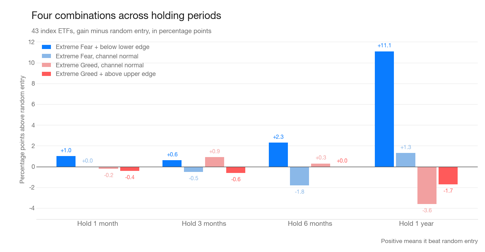
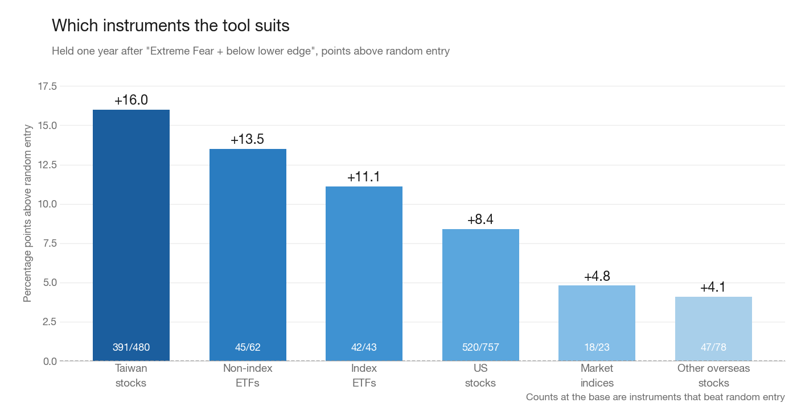
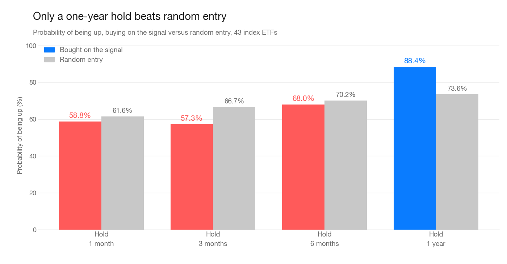
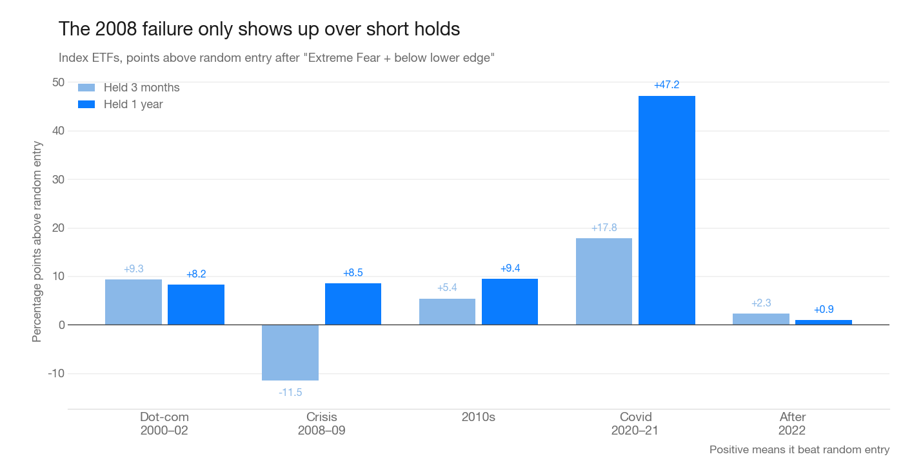

우리는 오랫동안 LOHAS 5선 차트를 사용해 왔고, 사이트에도 [차트 해석 방법](/ko-KR/articles/lohas-five-line-analysis-price-trends-and-sentiment)을 소개했습니다. 오래 사용하다 보면 몇 가지 의문이 생깁니다.

‘극도의 탐욕’은 실제로 얼마나 자주 나타날까요? 시장 심리와 LOHAS 채널은 페이지의 서로 다른 영역에 표시되는데, 서로 다른 정보를 제공할까요? ‘극도의 공포’를 확인한 뒤에는 보통 어떤 일이 일어날까요?

실용적인 질문이 하나 더 있습니다. 원저자는 가격이 채널 하단을 이탈한 뒤 채널 안으로 돌아올 때까지 기다리라고 권합니다. 실제 데이터도 이를 뒷받침할까요?

이번에는 1,449개 종목과 1,156만 건의 일봉 데이터를 분석했으며, 가장 오래된 데이터는 1927년까지 거슬러 올라갑니다.

핵심 결과

1. ‘극도의 공포’만 나타나는 날은 연간 약 16일입니다. 이때 매수하면 3개월 및 6개월 수익률 모두 무작위 진입보다 낮았습니다. LOHAS 채널도 하단을 이탈한 경우만 기다리면 연간 약 5일로 줄어듭니다.
2. 하단 이탈 이후에도 가격은 대체로 계속 하락합니다. 채널 안으로 돌아올 때까지 기다리면 6개 종목 그룹의 4개 보유 기간 모두에서 예외 없이 더 나은 결과를 보였습니다.
3. 이번 지수형 ETF 표본에서는 1년 수익률이 무작위 진입보다 11.1%포인트 높았지만, 한 달 차이는 1.0%포인트였습니다. 시대별 차이도 컸으며 2022년 이후의 1년 차이는 +0.9에 그쳤습니다.
4. 매도에도 같은 규칙이 적용됩니다. ‘극도의 탐욕 + 상단 돌파’ 이후 가격이 채널 안으로 돌아올 때까지 기다리면 6개 그룹 모두에서 이후 하락을 피할 수 있었습니다.

## 목차

1. [두 차트를 함께 읽어야 하는 이유](#두-차트를-함께-읽어야-하는-이유)
2. [네 가지 조합: 백테스트에서 두드러진 결과](#네-가지-조합-백테스트에서-두드러진-결과)
3. [매수 시점](#매수-시점)
4. [매도 시점](#매도-시점)
5. [추가 분석: 2008년의 예외는 단기 보유에서만 나타납니다](#추가-분석-2008년의-예외는-단기-보유에서만-나타납니다)
6. [추가 분석: RSI, MACD, 거래량을 더하면 도움이 될까요?](#추가-분석-rsi-macd-거래량을-더하면-도움이-될까요)

## 두 차트를 함께 읽어야 하는 이유

페이지에는 LOHAS 5선 차트와 LOHAS 채널, 두 개의 차트가 있습니다. 이 글의 모든 수치는 두 차트를 함께 분석해 산출했습니다. 이유는 두 가지입니다.

첫째, 5선 차트만 보면 극단 상태가 너무 자주 나타납니다. 다섯 구간이 차지하는 일수의 비율은 다음과 같습니다.

| 그룹 | 극도의 공포 | 공포 | 중립 | 탐욕 | 극도의 탐욕 |
|---|---|---|---|---|---|
| 지수형 ETF | 9.5% | 12.8% | 40.7% | 26.3% | 10.2% |
| 시장 지수 | 8.4% | 13.1% | 45.2% | 23.0% | 10.5% |
| 비지수형 ETF | 7.8% | 13.5% | 44.5% | 23.8% | 10.1% |
| 미국 개별 주식 | 7.7% | 14.9% | 45.2% | 20.2% | 12.0% |
| 대만 개별 주식 | 5.8% | 17.4% | 48.9% | 16.6% | 10.9% |
| 기타 해외 개별 주식 | 6.0% | 15.4% | 47.5% | 17.9% | 12.2% |

가격의 추세 이탈 정도가 실제로 정규분포를 따른다면 ±2 표준편차 범위를 벗어나는 날은 전체 거래일의 5% 미만이어야 합니다. 그러나 실제로는 양쪽 극단을 합하면 17~22%로 이론값의 네 배에 이릅니다. 가격은 이론보다 더 자주 극단에 도달하고 추세도 이어집니다. 과열된 뒤에도 가격이 계속 오르는 경우가 많아 ‘극도의 탐욕’ 상태가 몇 주 동안 지속되기도 합니다.

따라서 5선 차트에서 ‘극도의 탐욕’은 대략 열흘에 한 번 나타납니다. 이 차트만 보면 신호의 정보량은 생각보다 적습니다.

둘째, 두 차트는 서로 다른 신호를 보이는 경우가 많습니다. 시장 심리가 이미 극도의 공포 또는 극도의 탐욕에 도달했을 때 LOHAS 채널도 상·하단을 돌파한 비율은 얼마나 될까요?

| 그룹 | 심리가 극단인 날 중 채널도 돌파한 비율 |
|---|---|
| 시장 지수 | 49% |
| 대만 개별 주식 | 45% |
| 비지수형 ETF | 42% |
| 미국 개별 주식 | 41% |
| 지수형 ETF | 40% |
| 기타 해외 개별 주식 | 36% |

약 10번 중 4번입니다. 나머지 10번 중 6번은 두 차트 중 하나가 여전히 정상 범위에 있습니다.

이 결과는 두 차트가 서로 보완적인 정보를 제공한다는 점을 보여 줍니다. 두 차트가 거의 완전히 겹친다면 두 번째 차트는 중복일 뿐이고, 서로 무관하다면 함께 보는 의미가 없습니다. 약 40%가 겹친다는 것은 두 차트가 공통된 정보뿐 아니라 각 차트에만 담긴 정보도 제공한다는 뜻입니다.

따라서 여기서는 양 끝 구간만 살펴보겠습니다. 5선 차트가 ‘극도의 공포’ 또는 ‘극도의 탐욕’을 나타내는 날을 각각 LOHAS 채널이 돌파했는지, 아직 채널 안에 있는지로 나눕니다. 두 가지 심리 상태와 두 가지 채널 상태를 조합하면 총 네 가지 경우가 나옵니다.

## 네 가지 조합: 백테스트에서 두드러진 결과

아래 예시는 지수형 ETF(0050, SPY, QQQ 등)를 기준으로 합니다.

표의 수치는 해당 조합이 나타난 날 매수해 각 보유 기간이 끝날 때까지 보유했을 경우, 무작위로 선택한 날 매수했을 때보다 수익률이 얼마나 높았는지를 나타냅니다. 이하에서는 아무 날이나 매수하는 방식을 ‘무작위 진입’이라고 부르며, 이는 신호를 무시했을 때의 결과와 대략 같습니다. 퍼센트포인트는 두 수익률의 차이입니다. 신호에 따라 진입해 20% 수익을 내고 무작위 진입으로 9% 수익을 냈다면 차이는 11%포인트입니다.

| 화면에서 보이는 상태(무작위 진입 대비) | 연간 발생 일수 | 1개월 보유 | 3개월 보유 | 6개월 보유 | 1년 보유 |
|---|---|---|---|---|---|
| **극도의 공포 + 하단 이탈** | 5 | +1.0 | +0.6 | +2.3 | **+11.1** |
| 극도의 공포, 채널은 정상 범위 | 16 | +0.0 | −0.5 | −1.8 | +1.3 |
| 극도의 탐욕, 채널은 정상 범위 | 9 | −0.2 | +0.9 | +0.3 | −3.6 |
| 극도의 탐욕 + 상단 돌파 | 12 | −0.4 | −0.6 | −0.0 | −1.7 |

참고: 1,449개 종목, 11,556,801건의 일봉 데이터, 1927~2026년. 각 종목을 개별적으로 계산한 뒤 중앙값을 사용했으므로 한두 종목의 큰 수익이 결과를 좌우하지 않습니다. 다만 하나의 폭락이 여러 종목에서 동시에 신호를 발생시킬 수 있습니다. 따라서 데이터 건수는 많아도 서로 독립적인 극단 이벤트는 수십 건에 불과합니다. 5절에서는 이 점을 확인하기 위해 데이터를 다섯 시기로 나눠 분석합니다.

네 가지 조합 중 첫 번째만 네 가지 보유 기간 모두에서 양수이며, 1년을 보유해야 11.1%포인트로 차이가 뚜렷해집니다. 한 달 보유 시에는 1.0%포인트 더 벌어 거의 차이가 없습니다.

이번 지수형 ETF 표본에서는 나머지 세 조합에서 같은 수준의 뚜렷한 1년 우위가 나타나지 않았습니다. ‘극도의 공포, 채널은 정상 범위’는 첫 번째 조합보다 세 배 자주 나타나지만, 3개월과 6개월 보유에서는 무작위 진입보다 낮았습니다. 두 ‘극도의 탐욕’ 행은 여덟 개 셀 중 다섯 개가 음수이며, 1년 보유 시 각각 3.6 및 1.7%포인트를 내줍니다. 이 신호가 매도 기회인지는 별개의 문제이며 4절에서 다룹니다.

## 매수 시점

매수 신호는 ‘극도의 공포 + 하단 이탈’입니다.

### 어떤 종목에 적합할까요?

수치는 앞 표와 같은 방식으로 읽습니다. 신호가 나타난 날 매수했을 때 무작위 진입보다 수익률이 몇 퍼센트포인트 높았는지를 보여 줍니다.

마지막 열도 함께 보세요. 초과 수익률은 중앙값이므로 일부 성과가 좋은 종목의 영향을 받을 수 있습니다. 마지막 열은 해당 그룹에서 같은 방향의 결과를 보인 종목 수를 보여 줍니다.

| 그룹(무작위 진입 대비) | 1개월 보유 | 3개월 보유 | 6개월 보유 | 1년 보유 | 1년 보유 시 같은 결과를 보인 종목 수 |
|---|---|---|---|---|---|
| 시장 지수 | +2.0 | +2.2 | +1.8 | +4.8 | 18/23 |
| 지수형 ETF | +1.0 | +0.6 | +2.3 | +11.1 | **42/43** |
| 비지수형 ETF | +1.7 | +2.0 | +3.5 | +13.5 | 45/62 |
| 미국 개별 주식 | +1.3 | +2.7 | +2.8 | +8.4 | 520/757 |
| 대만 개별 주식 | +0.7 | +1.1 | +5.8 | **+16.0** | 391/480 |
| 기타 해외 개별 주식 | +2.4 | +3.0 | +2.9 | +4.1 | 47/78 |

이번 표본에서는 지수형 ETF의 결과가 가장 일관적이었습니다. 43개 중 42개가 같은 결과를 보였습니다. 대만 개별 주식의 초과 수익률은 16.0%포인트로 가장 컸으며, 480개 중 391개가 같은 결과를 보였습니다. 시장 지수는 4.8%포인트에 그쳤는데, 지수는 변동이 상대적으로 작아 그만큼 극단적으로 하락하는 경우가 드물기 때문입니다. 기타 해외 개별 주식은 78개 중 47개만 같은 결과를 보였으므로 이 그룹에서는 더 신중하게 활용하세요.

이 종목 수는 그대로 받아들이기보다 다소 보수적으로 해석할 필요가 있습니다. 하나의 폭락이 같은 그룹의 여러 종목에서 동시에 신호를 발생시킵니다. 43개 지수형 ETF도 2008년에 함께 하락했으므로 42/43은 종목 간 결과가 일관적이라는 뜻이지, 서로 독립적인 검증 43건을 의미하지는 않습니다. 서로 다른 시대에도 결과가 유지되는지 확인하기 위해 5절에서 데이터를 다섯 시기로 나눕니다.

### 언제 매수할까요?

LOHAS 채널의 원저자는 가격이 하단을 이탈한 직후 매수하지 말고 채널 안으로 돌아올 때까지 기다리라고 제안했습니다. 채널 밖에 머문 모든 구간을 추출하고, 그중 심리도 극도의 공포에 도달한 구간만 남겨 동일 구간 안의 두 시점을 비교했습니다.

이 표는 두 시점을 비교합니다. 가격이 채널 안으로 돌아올 때까지 기다려 매수하는 경우와 하단을 이탈한 당일 매수하는 경우입니다.

| 그룹(복귀 대기 매수 vs 이탈 당일 매수) | 1개월 보유 | 3개월 보유 | 6개월 보유 | 1년 보유 | 1년 보유 시 같은 결과를 보인 종목 수 |
|---|---|---|---|---|---|
| 시장 지수 | +8.7 | +6.4 | +9.7 | +9.2 | **19/19** |
| 지수형 ETF | +8.3 | +6.6 | +7.7 | +8.6 | 41/43 |
| 비지수형 ETF | +7.9 | +7.1 | +6.8 | +9.2 | **51/51** |
| 미국 개별 주식 | +12.4 | +12.4 | +14.0 | +14.7 | 722/732 |
| 대만 개별 주식 | +11.6 | +11.7 | +12.9 | +15.5 | 414/423 |
| 기타 해외 개별 주식 | +11.2 | +9.4 | +10.0 | +9.7 | 59/62 |

6개 그룹, 4개 보유 기간에서 예외 없이 기다리는 쪽이 더 나았습니다. 모든 그룹에서 95%가 넘는 종목이 같은 결과를 보였습니다. 하단 이탈 당일 매수하면 6개 그룹 모두 1개월 수익률이 음수입니다.

가격이 채널 밖에 있다는 것은 하락이 아직 진행 중이라는 뜻이며, 그 시점에 매수하면 하락 흐름에 맞서는 셈입니다. 가격이 채널 안으로 돌아오면 적어도 해당 하락세가 멈췄음을 의미합니다.

### 얼마나 오래 보유해야 할까요?

1년 보유에서만 6개 그룹 모두 무작위 진입보다 뚜렷하게 앞섰습니다. 지수형 ETF를 예로 들면 한 달 보유 시 1.0%포인트, 3개월 보유 시 0.6%포인트, 6개월 보유 시 2.3%포인트 더 벌었습니다. 1년 보유 시에야 차이가 11.1%포인트로 커집니다. 앞의 세 기간은 모두 2.5%포인트 미만입니다.

수익이 날 확률도 같은 점을 보여 줍니다. 신호에 따라 매수하면 지수형 ETF는 1년 후 88% 확률로 상승했으며, 무작위 진입은 74%였습니다. 그러나 3개월만 보유하면 신호 진입의 상승 확률은 57%로 무작위 진입의 67%보다 낮았습니다.

### 비용과 위험을 분명히 짚고 넘어가기

신호가 나온 다음 날 바로 상승한다는 뜻은 아닙니다. 신호 발생 후 3개월 동안 지수형 ETF 가격은 저점 기준으로 추가 10.0% 하락했으며, 무작위 진입의 경우에는 4.6% 하락했습니다. 이 두 수치는 실제 하락폭이며, 앞서 사용한 수익률 간 차이와는 다른 개념입니다. 신호가 나타났다고 전액 투자하는 사람은 그 기간의 하락을 견뎌야 합니다.

## 매도 시점

매도에서는 매도 후 하락을 피할 수 있었는지 살펴봅니다.

이번에도 임의로 선택한 날을 비교 기준으로 삼지만, 이번에는 매도 시점을 비교합니다. 이하에서는 이를 ‘무작위 매도’라고 부릅니다. 수치가 클수록 좋다는 점은 같지만, 여기서는 피한 하락폭이 더 크다는 뜻입니다.

매도 시점은 ‘극도의 탐욕 + 상단 돌파’ 구간이 끝나 가격이 채널 안으로 돌아온 날로 정했습니다. 신호 발생일부터 그날까지의 기간은 중앙값 기준 10거래일, 약 2주입니다. 돌파 당일이 아니라 이 날짜를 선택한 이유는 다음 하위 절에서 검증합니다.

### 어떤 종목에 적합할까요?

표의 수치는 신호에 따라 매도했을 때 이후 주가가 무작위 매도 이후보다 얼마나 더 하락했는지를 퍼센트포인트로 나타냅니다. 더 많이 하락할수록 해당 시점의 매도로 더 큰 하락을 피했다는 뜻입니다.

| 그룹(무작위 매도 대비) | 매도 후 1개월 | 매도 후 3개월 | 매도 후 6개월 | 매도 후 1년 | 매도 후 1개월에 같은 결과를 보인 종목 수 |
|---|---|---|---|---|---|
| 시장 지수 | +1.7 | +2.0 | +0.9 | +3.2 | **23/23** |
| 지수형 ETF | +1.7 | +1.3 | +0.1 | +2.8 | 40/43 |
| 비지수형 ETF | +2.1 | +2.8 | +2.1 | +3.2 | 55/58 |
| 미국 개별 주식 | +2.9 | +3.7 | +3.8 | +4.9 | 728/759 |
| 대만 개별 주식 | **+3.7** | +4.0 | +4.0 | **+7.6** | 439/480 |
| 기타 해외 개별 주식 | +3.4 | +3.6 | +4.0 | +5.5 | 75/78 |

참고: 1,441개 종목에서 총 35,160건의 매도 신호가 발생했습니다. 전체 1,441개 중 1,360개 종목에서 같은 결과가 나타났습니다.

6개 그룹 모두 하락을 피했습니다. 대만 개별 주식에서 효과가 가장 컸습니다. 이 시점에 매도하면 임의의 날에 매도하는 것보다 하락폭을 3.7%포인트 더 피할 수 있었습니다. 시장 지수는 23개 모두 같은 결과였지만 차이는 1.7에 그쳤습니다.

이번 분석에서는 개별 주식에서 ETF와 지수보다 효과가 컸습니다. 개별 주식 세 그룹은 2.9~3.7인 반면, 지수와 ETF 세 그룹은 1.7~2.1입니다. 이는 매수 시 지수형 ETF의 결과가 가장 일관적이었던 것과 반대입니다.

피할 수 있었던 하락은 매도 후 첫 한 달에 집중됩니다. 매도 후 한 달 동안 주가가 하락할 확률은 61%로 무작위 매도의 44%보다 높습니다. 따라서 이 시점에 매도하면 실제 하락을 피하는 효과가 있습니다.

하지만 그 효과가 더 오래 지속되지는 않습니다. 6개월이 지나면 주가는 대체로 회복되며, 남는 이점은 무작위 매도보다 손실이 조금 적다는 정도로 사실상 큰 하락을 피했다고 보기 어렵습니다.

### 언제 매도할까요?

매수 때와 같은 질문입니다. 가격이 상단을 돌파한 당일 매도할까요, 아니면 채널 안으로 돌아올 때까지 기다릴까요?

이 표는 가격이 채널 안으로 돌아올 때까지 기다려 매도하는 경우와 상단 돌파 당일 매도하는 경우, 어느 쪽이 하락을 더 많이 피했는지 비교합니다.

| 그룹(복귀 대기 매도 vs 돌파 당일 매도) | 매도 후 1개월 | 매도 후 3개월 | 매도 후 6개월 | 매도 후 1년 | 매도 후 1개월에 같은 결과를 보인 종목 수 |
|---|---|---|---|---|---|
| 시장 지수 | +3.0 | +3.4 | +1.9 | +3.7 | **23/23** |
| 지수형 ETF | +1.4 | +1.4 | +1.8 | +3.5 | **43/43** |
| 비지수형 ETF | +2.9 | +3.1 | +1.5 | +3.5 | 57/58 |
| 미국 개별 주식 | +4.5 | +5.0 | +4.7 | +5.2 | 753/759 |
| 대만 개별 주식 | **+7.0** | +7.7 | +6.7 | +8.2 | 473/480 |
| 기타 해외 개별 주식 | +5.5 | +4.9 | +7.4 | +6.5 | 76/78 |

이번에도 예외 없이 기다리는 편이 더 나았습니다. 돌파 당일 매도하면 이후 한 달 동안 주가는 계속 상승합니다. 6개 그룹 중 5개에서는 무작위 매도 이후보다 더 빠르게 상승해 상승 흐름 한가운데서 매도하는 셈입니다.

원저자의 조언은 매수와 매도 모두에서 네 가지 보유 기간 전체에 걸쳐 유효했습니다.

### 하락을 피하는 것과 수익을 내는 것은 다릅니다

매도한 뒤 현금으로 보유한 채 있으면 시장의 장기 상승으로 인해 1년 후에는 계속 보유한 사람보다 성과가 뒤처질 수 있습니다. 이 글에서는 언제 다시 매수해야 하는지 검증하지 않았으며, 이는 별도의 문제입니다.

## 추가 분석: 2008년의 예외는 단기 보유에서만 나타납니다

지금까지는 모든 연도를 합쳐 계산했습니다. 특정 기간에만 유효한 신호라면 우연일 가능성이 있으므로, 데이터를 여러 시기로 나눠 살펴보겠습니다. 이 절은 앞선 결과가 서로 다른 시대에도 유지되는지 확인합니다. 도구 사용법만 알고 싶다면 건너뛰어도 됩니다.

2008년과 2020년을 데이터에서 제외하지 않았습니다. 폭락은 시장에서 실제로 발생하는 일이며 2022년에도 1년 동안 하락했으므로, 그중 두 번만 없었던 일처럼 취급할 이유는 없습니다.

표의 수치는 해당 시기에 매수했을 때 무작위 진입보다 수익률이 얼마나 높았는지를 퍼센트포인트로 나타냅니다(지수형 ETF만 해당).

| 기간(무작위 진입 대비) | 1개월 보유 | 3개월 보유 | 6개월 보유 | 1년 보유 |
|---|---|---|---|---|
| 닷컴 버블 붕괴 2000–02 | +6.4 | +9.3 | +12.0 | +8.2 |
| **금융위기 2008–09** | **−6.0** | **−11.5** | −6.2 | **+8.5** |
| 2010년대 | +2.0 | +5.4 | +5.5 | +9.4 |
| 팬데믹과 반등 2020–21 | +8.5 | +17.8 | +22.5 | +47.2 |
| 2022년 이후 | +2.6 | +2.3 | −1.5 | +0.9 |

참고: 1990년대와 2003~2007년 강세장은 제외했습니다. 해당 기간에 조건을 충족한 지수형 ETF는 각각 1개와 3개뿐이어서 수치에 의미가 없기 때문입니다.

금융위기는 예외였지만 단기 보유에서만 그랬습니다. 한 달 보유 시 6.0%포인트, 3개월 보유 시 11.5%포인트 낮았습니다. 하락이 깊고 오래 지속되어 3개월은 가격이 회복되기에 충분한 기간이 아니었습니다.

기간을 1년으로 늘리면 2008년은 오히려 8.5%포인트 앞섭니다. 다섯 기간 모두 1년 기준으로 양수였지만, 2022년 이후는 +0.9로 거의 차이가 없었습니다.

다섯 기간의 1년 성과 차이는 모두 양수였지만 폭은 크게 달랐습니다. 팬데믹과 반등 기간이 가장 두드러졌고, 2022년 이후는 손익분기점에 가까웠습니다. 보유 기간뿐 아니라 진입 시점의 시장 환경도 중요합니다.

## 추가 분석: RSI, MACD, 거래량을 더하면 도움이 될까요?

KD, RSI, MACD를 추가해야 하는지 자주 질문을 받습니다. 지표 자체를 비교하기보다 더 실용적인 질문을 살펴보겠습니다. ‘극도의 공포’가 나타난 날에 어떤 조건을 하나 더 추가하면 이후 한 달 성과가 가장 좋을까요?

표의 수치는 해당 조건을 추가했을 때 조건을 추가하지 않은 경우보다 수익률이 얼마나 개선됐는지를 퍼센트포인트로 나타냅니다.

| 추가 조건(조건 없음 대비) | 지수형 ETF | 시장 지수 | 비지수형 ETF | 미국 개별 주식 | 대만 개별 주식 |
|---|---|---|---|---|---|
| RSI 30 미만 | **+1.9** | +0.8 | **+0.6** | **+0.5** | +0.6 |
| 최근 1년 중 변동성이 가장 높은 5분위 | +1.3 | **+1.9** | +0.5 | +0.3 | **+0.7** |
| MACD 히스토그램 양전환 | +0.7 | +0.0 | −0.2 | −0.0 | −0.0 |
| LOHAS 채널도 하단 이탈 | +0.4 | +1.0 | −0.0 | +0.0 | −0.3 |
| 거래량 1.5배 이상 증가 | −0.9 | −0.3 | −0.5 | +0.1 | +0.5 |

한 달 기준으로는 RSI 30 미만이 LOHAS 채널보다 나았습니다. 다섯 그룹 중 세 그룹에서 1위였고 나머지 두 그룹에서도 2위였습니다. 그다음은 변동성이 최근 1년 고점에 도달한 조건으로, 차이는 크지 않았습니다. LOHAS 채널은 시장 지수 그룹에서만 2위였으며 나머지 네 그룹에서는 중간 이하였고, 대만 개별 주식에서는 아무 조건도 추가하지 않은 경우보다 낮았습니다.

두 지표는 서로 다른 시간 범위를 다룹니다. LOHAS 채널의 가치는 1년 보유에서 나타나 11.1%포인트를 더 벌었고, 한 달 반등은 RSI가 더 잘 포착했습니다.

거래량은 거의 도움이 되지 않았습니다. 지수형 ETF에서는 거래량 증가 조건을 추가했을 때 오히려 0.9%포인트 덜 벌었습니다. 많은 사람이 거래량을 동반한 하락을 공포 매도 종료 신호로 해석하지만, 데이터는 이를 뒷받침하지 않습니다.
