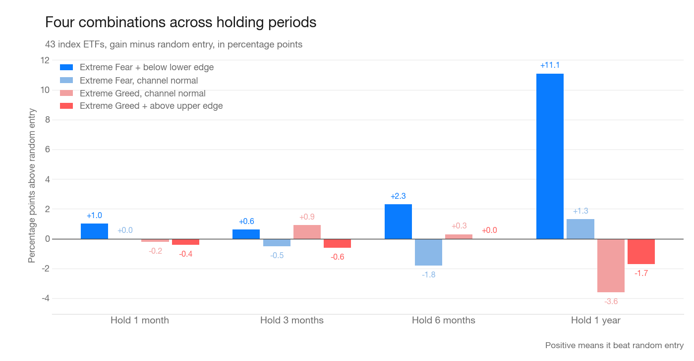
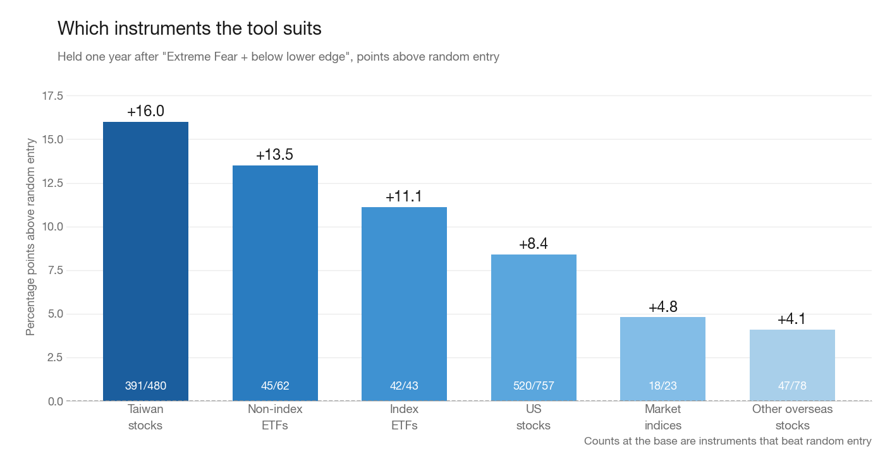
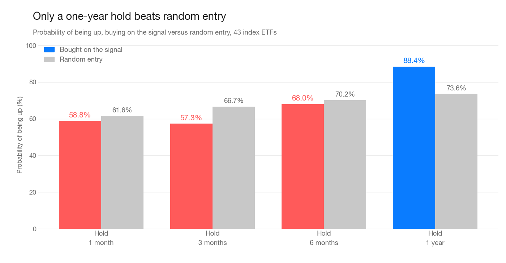
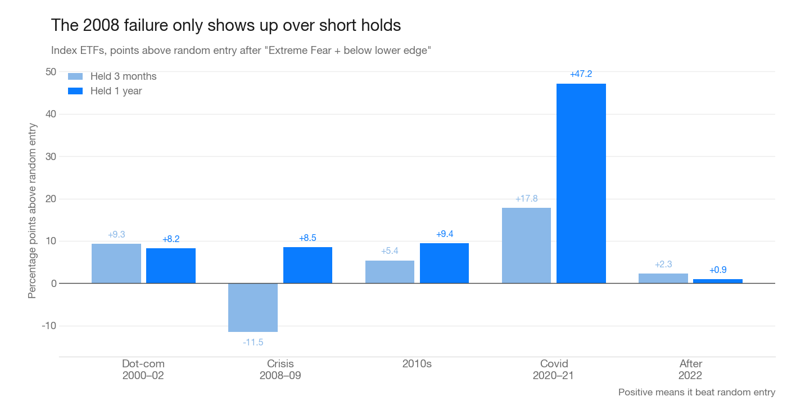

我们使用乐活五线谱已经有一段时间，网站也写过一篇[乐活五线谱使用说明](https://sentimentinsideout.com/zh-CN/articles/lohas-five-line-analysis-price-trends-sentiment/)。实际使用一段时间后，自然会产生几个问题。

「极度贪婪」究竟多久出现一次？乐活五线谱和乐活通道分别显示在页面上，它们提供的是不同信息吗？出现「极度恐惧」时，后续行情通常会如何发展？

还有一个更实际的问题：原作者建议「价格跌破乐活通道后，先等它回到通道内再采取行动」。这个建议是否经得起数据检验？

这次我们分析了 1,449 个标的、1,156 万条日线数据，最早可追溯至 1927 年。

核心结论

1. 单独出现「极度恐惧」的日子，每年约有 16 天。在这些日子入场，持有三个月和六个月的收益都低于随机入场。若乐活通道也同时跌破下沿，符合条件的日子每年约有 5 天。
2. 价格跌破通道后通常仍会继续下跌。等价格回到通道内再入场，六组标的在四种持有期限下的结果都更好，没有例外。
3. 在本次指数型 ETF 样本中，持有一年比随机入场多赚 11.1 个百分点，持有一个月则只多赚 1.0 个百分点。不同年代的结果差异很大：2022 年以来，一年期差距仅为 +0.9 个百分点。
4. 卖出时也适用同一规则。出现「极度贪婪＋突破上沿」后，等价格回到通道内再卖出，六类标的都避开了随后一段下跌。

## 目录

1. [为什么要两张图一起看](#为什么要两张图一起看)
2. [四种信号组合，哪一种历史表现最好](#四种信号组合哪一种历史表现最好)
3. [什么时候买](#什么时候买)
4. [什么时候卖](#什么时候卖)
5. [延伸：全球金融危机的例外只体现在短期](#延伸全球金融危机的例外只体现在短期)
6. [延伸：加 RSI、MACD、成交量有用吗](#延伸加-rsimacd成交量有用吗)

## 为什么要结合两张图判断

页面上的乐活五线谱和乐活通道是两张独立的图表。本文所有统计结果，都是结合这两张图计算得出的，原因有两个。

第一，如果只看乐活五线谱，极端状态出现得过于频繁。五线谱划分的五种状态，各自占据的交易日比例如下：

| 分组 | 极度恐惧 | 恐惧 | 中性 | 贪婪 | 极度贪婪 |
|---|---|---|---|---|---|
| 指数型 ETF | 9.5% | 12.8% | 40.7% | 26.3% | 10.2% |
| 大盘指数 | 8.4% | 13.1% | 45.2% | 23.0% | 10.5% |
| 非指数型 ETF | 7.8% | 13.5% | 44.5% | 23.8% | 10.1% |
| 美股个股 | 7.7% | 14.9% | 45.2% | 20.2% | 12.0% |
| 台湾股市个股 | 5.8% | 17.4% | 48.9% | 16.6% | 10.9% |
| 其他海外个股 | 6.0% | 15.4% | 47.5% | 17.9% | 12.2% |

如果价格偏离程度真的符合钟形曲线分布，落在两个标准差以外的交易日理论上不到 5%。但实际数据中，上下两端合计占 17% 至 22%，约为理论值的四倍。这是因为股价触及极端区间的频率高于理论预期，而且趋势往往会延续：价格大幅上涨后可能继续走高，因此「极度贪婪」状态会连续维持数周。

因此，乐活五线谱单独显示「极度贪婪」的情况，平均每十个交易日左右就会出现一次。只看这一张图，能提供的信息其实有限。

第二，两张图经常给出不同信号。当市场情绪已经进入极度恐惧或极度贪婪区间时，乐活通道同时突破上沿或下沿的比例如下：

| 分组 | 情绪到极端的日子里，通道也跟着突破的比例 |
|---|---|
| 大盘指数 | 49% |
| 台湾股市个股 | 45% |
| 非指数型 ETF | 42% |
| 美股个股 | 41% |
| 指数型 ETF | 40% |
| 其他海外个股 | 36% |

大约只有四成。也就是说，在六成的情况下，其中一张图仍处于正常区间。

这个结果比我们预期的更有参考价值。如果两张图几乎完全重合，第二张图就没有太大必要；如果两者完全无关，结合起来也没有意义。约四成的重合率说明两者既有共同之处，也各自包含对方没有的信息。

因此，接下来只分析两种极端情绪：乐活五线谱进入「极度恐惧」或「极度贪婪」的交易日，再分别判断乐活通道是否也已突破边界。两种情绪状态搭配两种通道状态，共形成四种组合。

## 四种信号组合，哪一种历史表现最好

以下以指数型 ETF（例如 0050、SPY、QQQ）为例。

表格中的数字表示：在某种信号组合出现当天买入并持有指定期限，相比随机选择交易日买入，多获得多少个百分点的收益。下文将随机选择交易日买入称为「随机入场」，可作为不参考信号时的表现基准。百分点是两个收益率相减的结果：例如，按信号入场一年收益为 20%，随机入场收益为 9%，两者相差 11 个百分点。

| 图表上的信号组合（相较随机入场） | 每年出现天数 | 持有一个月 | 持有三个月 | 持有六个月 | 持有一年 |
|---|---|---|---|---|---|
| **极度恐惧＋跌破下沿** | 5 | +1.0 | +0.6 | +2.3 | **+11.1** |
| 极度恐惧，通道仍在正常区间 | 16 | +0.0 | −0.5 | −1.8 | +1.3 |
| 极度贪婪，通道仍在正常区间 | 9 | −0.2 | +0.9 | +0.3 | −3.6 |
| 极度贪婪＋突破上沿 | 12 | −0.4 | −0.6 | −0.0 | −1.7 |

注：样本包含 1,449 个标的、11,556,801 条日线数据，时间范围为 1927–2026 年。每个标的先单独计算，再取中位数，因此少数表现特别好的标的不会主导结果。需要注意的是，同一场市场崩盘可能让多个标的同时触发信号，所以虽然数据条数很多，真正相互独立的极端事件可能只有几十次。第 5 节会将数据划分为五个时期，进一步检验结果。

四种组合中，只有第一种在四种持有期限下的结果都为正。在本次指数型 ETF 样本中，持有一年才出现明显差距，多赚 11.1 个百分点；持有一个月只多赚 1.0 个百分点，差异很小。

另外三种组合在这份指数型 ETF 样本中，没有显示出同样明显的一年期收益优势。「极度恐惧，但通道仍处于正常区间」出现的天数是第一种的三倍，但持有三个月和六个月的表现反而低于随机入场。两种「极度贪婪」组合在八个数据格中有五个为负，持有一年分别少赚 3.6 和 1.7 个百分点。至于是否适合卖出，则是另一个问题，将在第 4 节讨论。

## 什么时候买

这次回测中，买入时最值得关注的信号组合是「极度恐惧＋跌破下沿」。

### 哪些标的适合

表格的读法与上一张相同：在信号出现当天买入，相比随机入场多获得多少个百分点的收益。

还要结合最后一栏来看。收益差距采用中位数，可能受到少数表现特别好的标的影响；最后一栏则显示该组中有多少只标的也呈现相同结果。

| 标的类别（相较随机入场） | 持有一个月 | 持有三个月 | 持有六个月 | 持有一年 | 持有一年时结果相同的数量 |
|---|---|---|---|---|---|
| 大盘指数 | +2.0 | +2.2 | +1.8 | +4.8 | 18/23 |
| 指数型 ETF | +1.0 | +0.6 | +2.3 | +11.1 | **42/43** |
| 非指数型 ETF | +1.7 | +2.0 | +3.5 | +13.5 | 45/62 |
| 美股个股 | +1.3 | +2.7 | +2.8 | +8.4 | 520/757 |
| 台湾股市个股 | +0.7 | +1.1 | +5.8 | **+16.0** | 391/480 |
| 其他海外个股 | +2.4 | +3.0 | +2.9 | +4.1 | 47/78 |

在本次样本中，指数型 ETF 的结果最一致：43 只 ETF 中有 42 只呈现相同结果。台湾股市个股的收益差距最大，比随机入场多 16.0 个百分点；480 只股票中有 391 只也呈现相同结果。大盘指数仅多出 4.8 个百分点，因为指数本身波动相对较小，较少跌至如此极端的水平。其他海外个股中，78 只有 47 只呈现相同结果，因此应用这一信号时应更加谨慎。

这些数量需要谨慎解读。同一场市场崩盘可能让一整类标的同时触发信号，例如 2008 年的下跌就同时影响了 43 只指数型 ETF。因此，42/43 说明这一结果在不同标的之间具有一定一致性，并不代表进行了 43 次相互独立的验证。要判断这一结果在不同年代是否依然成立，第 5 节会将数据划分为五个时期分别计算。

### 什么时候动手

乐活通道的原作者曾建议：价格跌破下沿后不要立即买入，而应等价格回到通道内再考虑。我们找出每一段价格位于通道外的区间，只保留其中市场情绪也达到极度恐惧的区间，再比较同一区间内两个不同时间点的结果。

这张表比较两个入场时点：等价格回到通道内再买入，相比在价格跌破下沿当天买入，多获得多少个百分点的收益。

| 标的类别（回到通道内再买 vs 跌破当天买） | 持有一个月 | 持有三个月 | 持有六个月 | 持有一年 | 持有一年时结果相同的数量 |
|---|---|---|---|---|---|
| 大盘指数 | +8.7 | +6.4 | +9.7 | +9.2 | **19/19** |
| 指数型 ETF | +8.3 | +6.6 | +7.7 | +8.6 | 41/43 |
| 非指数型 ETF | +7.9 | +7.1 | +6.8 | +9.2 | **51/51** |
| 美股个股 | +12.4 | +12.4 | +14.0 | +14.7 | 722/732 |
| 台湾股市个股 | +11.6 | +11.7 | +12.9 | +15.5 | 414/423 |
| 其他海外个股 | +11.2 | +9.4 | +10.0 | +9.7 | 59/62 |

六组标的、四种持有期限，没有任何一组例外：等价格回到通道内再买入，结果都更好。每组中，九成五以上的标的也呈现相同结果。如果在跌破下沿当天就买入，六组标的持有一个月的收益全部为负。

价格仍处于通道外，通常说明这一轮下跌尚未结束，此时买入相当于逆势操作。等价格回到通道内，至少说明这一轮下跌暂时停了下来。

### 持有多久更合适

只有持有一年时，六组标的的表现才都明显优于随机入场。以指数型 ETF 为例，持有一个月多赚 1.0 个百分点，三个月多赚 0.6 个百分点，六个月多赚 2.3 个百分点；持有一年时才明显扩大到 11.1 个百分点。前三种期限的差距都不到 2.5 个百分点。

从上涨概率来看也是如此。按信号入场的指数型 ETF，持有一年后上涨的概率为 88%，随机入场则为 74%。但如果只持有三个月，按信号入场的上涨概率只有 57%，反而低于随机入场的 67%。

### 先说清楚代价

这并不意味着买入后价格马上就会上涨。信号出现后的三个月内，指数型 ETF 的最大跌幅仍可达到 10.0%；随机入场的最大跌幅则为 4.6%。这两个数字是各自实际经历的最大跌幅，并非前文所说的收益率差值。若看到信号就大举买入，期间可能承受相当大的压力。

## 什么时候卖

评估卖出信号时，关键是卖出后是否避开了随后的下跌。

比较基准仍是随机选择一个交易日卖出，下文称为「随机卖出」。数字同样是越大越好，但这里数值越大，代表卖出后避开的跌幅越多。

卖出时点设为「极度贪婪＋突破上沿」这一段行情结束、价格重新回到通道内的当天。从信号出现到这一天，中位数为 10 个交易日，约两周。为什么选择这一天，而不是突破当天，下一小节会进一步检验。

### 哪些标的适合

表格中的数字表示：在信号出现后卖出，与随机卖出相比，之后一段时间股价多下跌了多少个百分点。跌幅差距越大，代表在这个时点卖出所避开的下跌越多。

| 标的类别（相较随机卖出） | 卖出后一个月 | 卖出后三个月 | 卖出后六个月 | 卖出后一年 | 一个月后结果相同的数量 |
|---|---|---|---|---|---|
| 大盘指数 | +1.7 | +2.0 | +0.9 | +3.2 | **23/23** |
| 指数型 ETF | +1.7 | +1.3 | +0.1 | +2.8 | 40/43 |
| 非指数型 ETF | +2.1 | +2.8 | +2.1 | +3.2 | 55/58 |
| 美股个股 | +2.9 | +3.7 | +3.8 | +4.9 | 728/759 |
| 台湾股市个股 | **+3.7** | +4.0 | +4.0 | **+7.6** | 439/480 |
| 其他海外个股 | +3.4 | +3.6 | +4.0 | +5.5 | 75/78 |

注：共包含 35,160 个卖出时点、1,441 个标的。整体来看，在这 1,441 个标的中，有 1,360 个呈现相同结果。

六组标的都避开了部分后续跌幅。台湾股市个股的差距最大：在这个时点卖出，相比随机卖出多避开了 3.7 个百分点的跌幅。23 个大盘指数样本全部呈现相同结果，但差距只有 1.7 个百分点。

这一卖出信号对个股比对 ETF 和指数更有参考价值。三组个股的差距为 2.9 至 3.7 个百分点，三组指数和 ETF 则只有 1.7 至 2.1 个百分点。这与买入时的结果正好相反：在买入比较中，指数型 ETF 的结果最一致。

这种优势主要体现在卖出后的一个月内：卖出后股价下跌的概率为 61%，随机卖出则为 44%。因此，在这个时点卖出，确实避开了一段实际下跌。

但这种优势无法维持太久。到了六个月后，股价通常已经回升，提前卖出的好处只剩下比随机卖出少亏一些，不能算真正避开了长期下跌。

### 什么时候动手

这与买入时面临的问题相同：应该在价格突破上沿当天卖出，还是等价格回到通道内再卖？

这张表比较两个卖出时点：等价格回到通道内再卖，与在突破上沿当天卖出，哪一种能避开更多跌幅。

| 标的类别（回到通道内再卖 vs 突破当天卖） | 卖出后一个月 | 卖出后三个月 | 卖出后六个月 | 卖出后一年 | 一个月后结果相同的数量 |
|---|---|---|---|---|---|
| 大盘指数 | +3.0 | +3.4 | +1.9 | +3.7 | **23/23** |
| 指数型 ETF | +1.4 | +1.4 | +1.8 | +3.5 | **43/43** |
| 非指数型 ETF | +2.9 | +3.1 | +1.5 | +3.5 | 57/58 |
| 美股个股 | +4.5 | +5.0 | +4.7 | +5.2 | 753/759 |
| 台湾股市个股 | **+7.0** | +7.7 | +6.7 | +8.2 | 473/480 |
| 其他海外个股 | +5.5 | +4.9 | +7.4 | +6.5 | 76/78 |

结果同样没有例外，都是等价格回到通道内再卖更好。如果在突破当天就卖出，接下来一个月股价仍可能继续上涨；六组中有五组的涨幅甚至高于随机卖出后的表现，相当于在上涨过程中提前离场。

原作者的建议在买入和卖出两种情境下都成立，而且在四种持有期限的比较中均如此。

### 躲掉下跌不等于赚到钱

卖出后如果一直持有现金，由于市场长期趋势向上，一年后可能反而跑输始终持有的人。本文没有测试「何时买回」，这是另一个需要单独研究的问题。

## 延伸：全球金融危机的例外只体现在短期

前面的结论是将所有年份的数据合并计算得出的。如果某个信号只在特定时期有效，就可能只是偶然现象。因此，我们再按不同历史时期拆分数据，检查前面的结论能否经受不同市场环境的考验。如果你只想了解工具的使用方法，可以跳过本节。

我们没有剔除 2008 年和 2020 年的数据。市场崩盘本来就是可能发生的情况，而且 2022 年也经历了持续一年的下跌，没有理由只排除其中两次危机。

表格中的数字表示，在对应时期按信号买入，相比随机入场多获得多少个百分点的收益（仅统计指数型 ETF）。

| 时期（相较随机入场） | 持有一个月 | 持有三个月 | 持有六个月 | 持有一年 |
|---|---|---|---|---|
| 互联网泡沫 2000–02 | +6.4 | +9.3 | +12.0 | +8.2 |
| **全球金融危机 2008–09** | **−6.0** | **−11.5** | −6.2 | **+8.5** |
| 2010 年代 | +2.0 | +5.4 | +5.5 | +9.4 |
| 疫情与反弹 2020–21 | +8.5 | +17.8 | +22.5 | +47.2 |
| 2022 之后 | +2.6 | +2.3 | −1.5 | +0.9 |

注：表格未列出 1990 年代和 2003–2007 年的牛市阶段，因为这两个时期符合条件的指数型 ETF 分别只有 1 只和 3 只，样本数量不足以提供有代表性的结果。

全球金融危机期间确实出现了例外，但只体现在短期。持有一个月少赚 6.0 个百分点，持有三个月少赚 11.5 个百分点。那一轮下跌既深又持久，三个月不足以等到价格恢复。

将持有期限延长至一年，2008 年的结果反而转为多赚 8.5 个百分点。五个时期的一年期结果均为正数，其中 2022 年以来仅为 +0.9 个百分点，接近持平。

这五个时期的一年期比较结果虽然全为正数，但差距很大：疫情及其后的反弹阶段表现最突出，2022 年以来则接近持平。持有期限很重要，入场所处的市场阶段也同样重要。

## 延伸：加 RSI、MACD、成交量有用吗

经常有人问，是否还应该加入 KD、RSI 或 MACD 等指标。与其单独比较这些指标，不如问一个更实际的问题：在出现「极度恐惧」的交易日，再增加哪项条件，之后一个月的表现会最好？

表格中的数字表示，增加该条件后，相比不增加任何条件，多获得多少个百分点的收益。

| 附加条件（相较不增加条件） | 指数型 ETF | 大盘指数 | 非指数型 ETF | 美股个股 | 台湾股市个股 |
|---|---|---|---|---|---|
| RSI 低于 30 | **+1.9** | +0.8 | **+0.6** | **+0.5** | +0.6 |
| 波动率处于近一年高位 | +1.3 | **+1.9** | +0.5 | +0.3 | **+0.7** |
| MACD 柱状图翻正 | +0.7 | +0.0 | −0.2 | −0.0 | −0.0 |
| 乐活通道也跌破下沿 | +0.4 | +1.0 | −0.0 | +0.0 | −0.3 |
| 成交量放大至 1.5 倍以上 | −0.9 | −0.3 | −0.5 | +0.1 | +0.5 |

从一个月的表现来看，RSI 低于 30 的效果优于乐活通道。在五组标的中，这项条件有三组排名第一，另外两组也排在前两位。其次是波动率升至近一年高位，表现与 RSI 的差距不大。乐活通道只有在大盘指数组中排名第二，在其余四组中都处于中后段；对于台湾股市个股，结果甚至低于不增加任何条件的情况。

这两个指标适用的时间尺度不同。乐活通道的优势体现在一年期，多赚 11.1 个百分点；RSI 则更能捕捉一个月内的反弹表现。

成交量几乎没有带来帮助。对指数型 ETF 而言，加入成交量放大这一条件后，收益反而少了 0.9 个百分点。很多人把放量下跌视为恐慌性抛售接近尾声的信号，但这组数据并不支持这种判断。
