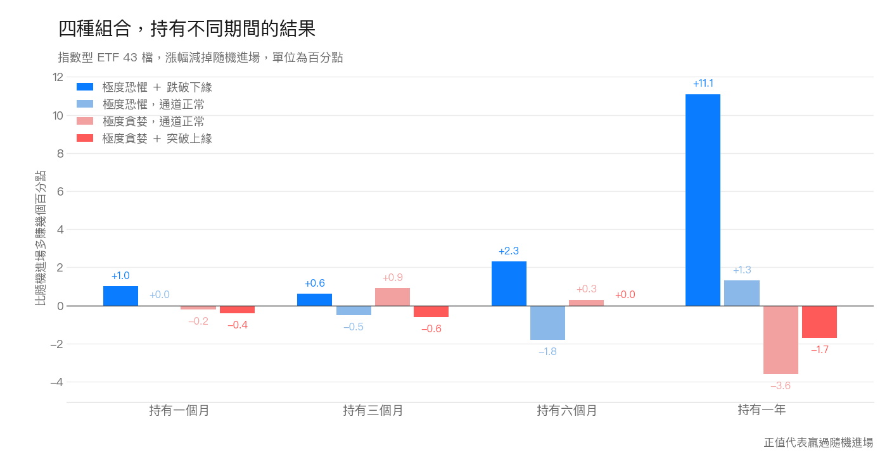
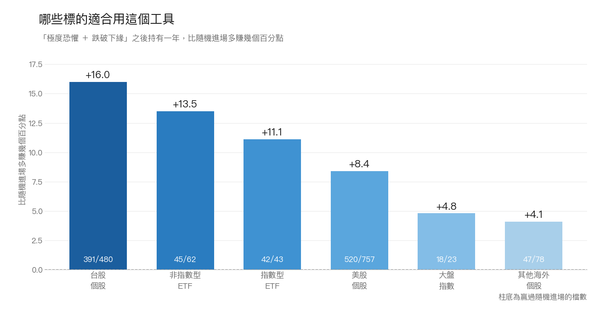
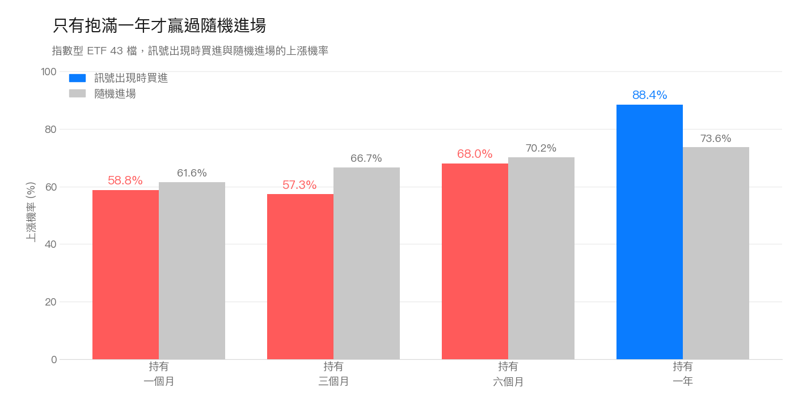
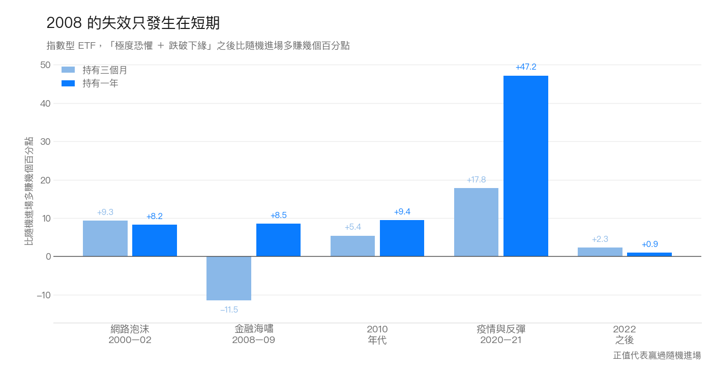

我們已使用樂活五線譜一段時間，網站亦有[使用指南](/zh-HK/articles/1.%E7%94%A8%E6%A8%82%E6%B4%BB%E4%BA%94%E7%B7%9A%E8%AD%9C%E5%88%86%E6%9E%90%E5%83%B9%E6%A0%BC%E8%B6%A8%E5%8B%A2%E8%88%87%E6%83%85%E7%B7%92/)。不過，實際使用時仍有幾個值得深入研究的問題。

「極度貪婪」究竟多久出現一次？樂活五線譜和樂活通道分別顯示在頁面上，兩者提供的是不同資訊嗎？當出現「極度恐懼」訊號後，市場通常會如何發展？

還有一個更實際的問題：原作者建議「跌破樂活通道後，應等價格回到通道內才採取行動」，這個做法是否真的有效？

本次回測涵蓋 1,449 項資產及 1,156 萬筆日線資料，最早追溯至 1927 年。

重點摘要

1. 單獨出現「極度恐懼」訊號的日子，每年約有 16 天。在這些日子買入，持有三個月及六個月的回報均低於隨機入市。若樂活通道亦跌破下緣，符合條件的日子每年約只有 5 天。
2. 跌破之後價格通常還在跌。等回到通道內才入市，六組資產各測試四個持有期間，沒有一組例外。
3. 本次指數型 ETF 樣本中，持有一年比隨機入市多 11.1 個百分點，持有一個月只多 1.0。不同年代差異很大：2022 之後的一年差距僅 +0.9。
4. 沽出時同一套規則亦成立。出現「極度貪婪＋突破上緣」訊號後，等價格回到通道內才沽出，六類資產均避過了其後部分跌幅。

## 目錄

1. [為什麼要兩張圖一起看](#為什麼要兩張圖一起看)
2. [四種組合，哪一種歷史回報最突出](#四種組合，哪一種歷史回報最突出)
3. [何時買入](#何時買入)
4. [何時沽出](#何時沽出)
5. [延伸分析：金融海嘯的例外只出現在短期](#延伸分析金融海嘯的例外只出現在短期)
6. [延伸分析：加入 RSI、MACD 及成交量有用嗎](#延伸分析加入-rsimacd-及成交量有用嗎)

## 為什麼要兩張圖一起看

畫面上的樂活五線譜和樂活通道是兩張圖。本文的每項數據，均是綜合兩張圖的訊號計算所得。原因有兩個。

第一，只看樂活五線譜的話，極端狀態太常出現。五條線分出來的五種狀態各佔多少日子：

| 分組 | 極度恐懼 | 恐懼 | 中性 | 貪婪 | 極度貪婪 |
|---|---|---|---|---|---|
| 指數型 ETF | 9.5% | 12.8% | 40.7% | 26.3% | 10.2% |
| 大市指數 | 8.4% | 13.1% | 45.2% | 23.0% | 10.5% |
| 非指數型 ETF | 7.8% | 13.5% | 44.5% | 23.8% | 10.1% |
| 美國個股 | 7.7% | 14.9% | 45.2% | 20.2% | 12.0% |
| 台灣個股 | 5.8% | 17.4% | 48.9% | 16.6% | 10.9% |
| 其他海外個股 | 6.0% | 15.4% | 47.5% | 17.9% | 12.2% |

兩個標準差以外的區域，如果價格的偏離真的照著鐘形曲線分布，理論上不到 5% 的日子。實際上兩邊加起來有 17% 到 22%，是理論值的四倍。原因是股價衝到極端的次數比理論多，而且趨勢會延續：升勢過急後，升勢往往仍會延續，於是連續好幾週都掛著「極度貪婪」。

因此，樂活五線譜單獨顯示「極度貪婪」的情況，大約每十天便會出現一次。只看這張圖，訊號的辨識力可能不如想像中高。

第二，兩張圖常常不同調。當市場情緒已經到了極度恐懼或極度貪婪，樂活通道同時也突破上下緣的比例：

| 分組 | 情緒到極端的日子裡，通道也跟著突破的比例 |
|---|---|
| 大市指數 | 49% |
| 台灣個股 | 45% |
| 非指數型 ETF | 42% |
| 美國個股 | 41% |
| 指數型 ETF | 40% |
| 其他海外個股 | 36% |

兩者同時突破的比例約為四成；換言之，約六成時間只有其中一張圖顯示極端狀態。

這個結果比預期理想。若兩張圖完全重疊，第二張圖便沒有額外價值；若兩者毫無關聯，合併判讀亦沒有意義。約四成的重疊比例顯示，兩者既有共同訊息，也各自提供另一張圖沒有的資訊。

因此，以下會集中分析兩種極端情緒：當樂活五線譜進入「極度恐懼」或「極度貪婪」時，再按樂活通道是否同步突破上下緣分類。兩種情緒各配合兩種通道狀態，合共形成四種組合。

## 四種組合，哪一種歷史回報最突出

以下以指數型 ETF（例如 0050、SPY 及 QQQ）為例。

表格列出的是：在某個訊號組合出現當日買入並持有至指定期間，較隨機選取交易日買入多出的回報，單位為百分點。下文把隨機選取交易日買入稱為「隨機入市」，作為不參考訊號時的對照。百分點是兩個回報率相減：例如按訊號買入並持有一年，回報為 20%，隨機買入並持有一年，回報為 9%，兩者相差 11 個百分點。

| 你在畫面上看到的（vs 隨機入市） | 一年出現幾天 | 持有一個月 | 持有三個月 | 持有六個月 | 持有一年 |
|---|---|---|---|---|---|
| **極度恐懼 ＋ 跌破下緣** | 5 | +1.0 | +0.6 | +2.3 | **+11.1** |
| 極度恐懼，通道還正常 | 16 | +0.0 | −0.5 | −1.8 | +1.3 |
| 極度貪婪，通道還正常 | 9 | −0.2 | +0.9 | +0.3 | −3.6 |
| 極度貪婪 ＋ 突破上緣 | 12 | −0.4 | −0.6 | −0.0 | −1.7 |

註：涵蓋 1,449 項資產及 11,556,801 筆日線資料，年份由 1927 至 2026 年。每項資產先獨立計算，再取中位數，避免少數大幅上升的資產主導結果。需注意，同一場市場崩盤可能令多項資產同時觸發訊號，因此資料筆數雖多，真正互相獨立的極端事件可能只有數十次。第 5 節會按五個時期分段分析，以檢視結果能否在不同市場環境下維持。

四種組合之中，只有第一種在四個持有期間的回報差距均為正數。以本次指數型 ETF 樣本而言，持有一年才見到較明顯的差距，多出 11.1 個百分點；持有一個月只多出 1.0 個百分點，差異不大。

另外三種在這份指數型 ETF 樣本中，沒有同樣明顯的一年回報優勢。「極度恐懼但通道仍在正常範圍」出現的天數是第一種的三倍，三個月和六個月反而輸給隨機入市。兩種「極度貪婪」組合的八個數據中，有五個是負數，持有一年分別少賺 3.6 和 1.7 個百分點。至於該不該賣，是另一個問題，第 4 節專門處理。

## 何時買入

本次回測中，買入訊號方面最值得留意的組合是「極度恐懼 ＋ 跌破下緣」。

### 各類資產的回測結果

表格數字的解讀方式與上一表相同：在訊號出現當日買入，較隨機入市多出多少個百分點。

最後一欄亦值得留意。回報差距以中位數計算，仍須留意結果會否只由少數表現特別強的資產帶動；最後一欄列出同一類別中，取得相同方向結果的資產數目。

| 分組（vs 隨機入市） | 持有一個月 | 持有三個月 | 持有六個月 | 持有一年 | 持有一年時，結果較佳的資產數目 |
|---|---|---|---|---|---|
| 大市指數 | +2.0 | +2.2 | +1.8 | +4.8 | 18/23 |
| 指數型 ETF | +1.0 | +0.6 | +2.3 | +11.1 | **42/43** |
| 非指數型 ETF | +1.7 | +2.0 | +3.5 | +13.5 | 45/62 |
| 美國個股 | +1.3 | +2.7 | +2.8 | +8.4 | 520/757 |
| 台灣個股 | +0.7 | +1.1 | +5.8 | **+16.0** | 391/480 |
| 其他海外個股 | +2.4 | +3.0 | +2.9 | +4.1 | 47/78 |

在本次樣本中，指數型 ETF 的回測結果最一致，43 隻 ETF 當中有 42 隻呈現相同方向的結果。台灣個股的回報差距最大，多出 16.0 個百分點；480 隻股票當中，有 391 隻亦呈現相同方向的結果。大市指數只多出 4.8 個百分點，反映指數價格相對穩定，較少出現如此極端的跌幅。其他海外個股則只有 78 隻中的 47 隻呈現相同結果，應較審慎地解讀。

不過，這些數字仍須審慎解讀。同一場崩盤會讓一整類資產同時觸發訊號，43 隻指數型 ETF 在 2008 年是一起跌的，所以 42/43 說的是這個結果在不同資產之間相當一致，不代表這是 43 次各自獨立的驗證。要知道它在不同年代撐不撐得住，第 5 節把資料切成五個時期分開算。

### 何時採取行動

樂活通道的原作者建議過：價格跌破下緣之後不要馬上買，等它回到通道內再說。我們把每一段跌出通道的區間抓出來，只留下期間內情緒也到極度恐懼的那些，比較同一段區間的兩個時點。

這張表比較兩個買入時點：等待價格回到通道內才買入，較在跌破下緣當日買入多出多少個百分點。

| 分組（等價格回到通道內才買入 vs 跌破當日買入） | 持有一個月 | 持有三個月 | 持有六個月 | 持有一年 | 持有一年時，結果較佳的資產數目 |
|---|---|---|---|---|---|
| 大市指數 | +8.7 | +6.4 | +9.7 | +9.2 | **19/19** |
| 指數型 ETF | +8.3 | +6.6 | +7.7 | +8.6 | 41/43 |
| 非指數型 ETF | +7.9 | +7.1 | +6.8 | +9.2 | **51/51** |
| 美國個股 | +12.4 | +12.4 | +14.0 | +14.7 | 722/732 |
| 台灣個股 | +11.6 | +11.7 | +12.9 | +15.5 | 414/423 |
| 其他海外個股 | +11.2 | +9.4 | +10.0 | +9.7 | 59/62 |

六組資產、四個持有期間的結果均一致：等待價格回到通道內才買入，表現較佳。每組均有超過九成五的資產呈現相同方向的結果。若在跌破下緣當日買入，六組資產持有一個月的回報全部為負。

當價格仍在通道下方，代表跌勢可能尚未完結，此時買入等於逆勢操作。待價格重新回到通道內，至少表示該輪跌勢可能已暫時停頓。

### 應持有多久

只有持有一年，六組的回報才明顯高於隨機入市。以指數型 ETF 為例，持有一個月多出 1.0 個百分點、三個月多出 0.6 個百分點、六個月多出 2.3 個百分點，至持有一年才升至 11.1 個百分點。前三個持有期的差距均不足 2.5 個百分點。

若比較錄得正回報的機率，結果亦相若。按訊號入市的指數型 ETF，持有一年後錄得正回報的機率為 88%，隨機入市則為 74%。但若只持有三個月，按訊號入市的機率只有 57%，低於隨機入市的 67%。

### 先了解可能承受的風險

這不代表股價翌日便會回升。指數型 ETF 在訊號出現之後三個月，價格最深還會再往下探 10.0%，隨機入市只跌 4.6%。這兩個數字是實際跌幅，並非前文比較兩組回報後得出的差距。若投資者一看到訊號便大手買入，期間可能要承受相當大的帳面虧損。

## 何時沽出

評估沽出訊號時，重點是能否避過其後的跌勢。

對照組同樣是隨機選取交易日，只是這次比較的是沽出時點，下文稱為「隨機沽出」。差距愈大，代表按訊號沽出所避過的跌幅愈多。

沽出時點定為「極度貪婪＋突破上緣」訊號出現後，突破階段結束、價格重新回到通道內的當日。由訊號出現至該日的中位數為 10 個交易日，約兩星期。下一小節會進一步比較選擇這個沽出時點的原因，而不是在突破當日沽出。

### 各類資產的回測結果

表格列出的是：按訊號沽出後，股價在指定期間內較隨機沽出多下跌多少個百分點。差距愈大，代表在這個時點沽出所避過的跌幅愈多。

| 分組（vs 隨機沽出） | 沽出後一個月 | 沽出後三個月 | 沽出後六個月 | 沽出後一年 | 沽出後一個月時，避過跌幅的資產數目 |
|---|---|---|---|---|---|
| 大市指數 | +1.7 | +2.0 | +0.9 | +3.2 | **23/23** |
| 指數型 ETF | +1.7 | +1.3 | +0.1 | +2.8 | 40/43 |
| 非指數型 ETF | +2.1 | +2.8 | +2.1 | +3.2 | 55/58 |
| 美國個股 | +2.9 | +3.7 | +3.8 | +4.9 | 728/759 |
| 台灣個股 | **+3.7** | +4.0 | +4.0 | **+7.6** | 439/480 |
| 其他海外個股 | +3.4 | +3.6 | +4.0 | +5.5 | 75/78 |

註：共 35,160 個沽出訊號，涵蓋 1,441 項投資資產；其中 1,360 項資產呈現相同方向的結果。

六組資產在這個時點沽出後，均避過了其後部分跌幅。台灣個股的差距最大：在此時點沽出，較隨機沽出多避過 3.7 個百分點的跌幅。大市指數的 23 個樣本全部呈現相同方向，但差距只有 1.7 個百分點。

在這項沽出測試中，個股的差距較 ETF 及指數明顯：三組個股介乎 2.9 至 3.7 個百分點，三組指數及 ETF 則介乎 1.7 至 2.1 個百分點。這與買入測試的結果相反；在買入測試中，指數型 ETF 的結果最一致。

這項優勢主要出現在沽出後首個月：股價下跌的機率為 61%，隨機沽出則為 44%。因此，在這個時點沽出，確實避過了其後一段跌勢。

但這個優勢未能維持太久。到六個月後，股價通常已回升，提早沽出的好處只剩下虧損較隨機沽出少，不能算是成功避過長期跌勢。

### 何時採取行動

買入時亦有同樣的問題：突破上緣的當日沽出，還是等價格回到通道內再沽出？

這張表比較兩個沽出時點：等待價格回到通道內才沽出，與在突破上緣當日沽出，哪個時點能避過較多跌幅。

| 分組（等價格回到通道內才沽 vs 突破當日沽出） | 沽出後一個月 | 沽出後三個月 | 沽出後六個月 | 沽出後一年 | 沽出後一個月時，避過跌幅的資產數目 |
|---|---|---|---|---|---|
| 大市指數 | +3.0 | +3.4 | +1.9 | +3.7 | **23/23** |
| 指數型 ETF | +1.4 | +1.4 | +1.8 | +3.5 | **43/43** |
| 非指數型 ETF | +2.9 | +3.1 | +1.5 | +3.5 | 57/58 |
| 美國個股 | +4.5 | +5.0 | +4.7 | +5.2 | 753/759 |
| 台灣個股 | **+7.0** | +7.7 | +6.7 | +8.2 | 473/480 |
| 其他海外個股 | +5.5 | +4.9 | +7.4 | +6.5 | 76/78 |

結果同樣一致：六組資產均以等待價格回到通道內才沽出的表現較佳。若在突破當日沽出，其後一個月股價仍可能上升；六組之中有五組的升幅甚至高於隨機沽出，反映當時升勢可能尚未完結。

回測結果在買入及沽出兩方面、四個持有期間均支持等待價格回到通道內才採取行動的做法。

### 避過下跌不等於賺到錢

沽出後若一直持有現金，由於市場長期傾向上升，一年後的回報可能反而低於一直持有資產的投資者。本次分析並未測試「何時重新買入」，這是另一個研究問題。

## 延伸分析：金融海嘯的例外只出現在短期

前面的結論是合併所有年份的數據後得出的。若某個訊號只在特定時期有效，結果便可能只是偶然。因此，我們再把資料按不同時期分組，檢視結論能否在不同市場環境下成立。若你只關心實際使用方法，可以略過本節。

分析並沒有剔除 2008 年或 2020 年的數據。市場崩盤本來就是可能出現的情況，而 2022 年亦經歷了長時間下跌，沒有理由只把其中兩次危機排除在樣本之外。

表格列出的是在該時期按訊號買入，較隨機入市多出的回報百分點（只包括指數型 ETF）。

| 時期（vs 隨機入市） | 持有一個月 | 持有三個月 | 持有六個月 | 持有一年 |
|---|---|---|---|---|
| 科網泡沫 2000–02 | +6.4 | +9.3 | +12.0 | +8.2 |
| **金融海嘯 2008–09** | **−6.0** | **−11.5** | −6.2 | **+8.5** |
| 2010 年代 | +2.0 | +5.4 | +5.5 | +9.4 |
| 疫情與反彈 2020–21 | +8.5 | +17.8 | +22.5 | +47.2 |
| 2022 之後 | +2.6 | +2.3 | −1.5 | +0.9 |

註：1990 年代及 2003–2007 年的牛市未有列出，因為兩段期間符合條件的指數型 ETF 分別只有 1 隻及 3 隻，樣本數目不足以代表整體情況。

金融海嘯確實是例外，但差異只出現在短期持有期間：持有一個月少 6.0 個百分點，持有三個月少 11.5 個百分點。當年的跌勢既深且持續，三個月的持有期不足以讓價格回升。

把持有期延長至一年，2008 年的結果反而轉為高出 8.5 個百分點。五個時期的一年回報差距均為正數；當中 2022 年以後只有 +0.9 個百分點，接近沒有差別。

五個時期的一年回報差距均為正數，但幅度差異甚大：疫情及其後反彈期間最突出，2022 年以後則僅略高於對照組。持有期及入市時的市場環境同樣重要。

## 延伸分析：加入 RSI、MACD 及成交量有用嗎

不少人會問，是否需要再加入 KD、RSI 或 MACD。與其單獨比較指標，不如問一個更實際的問題：在出現「極度恐懼」訊號的日子，再加入哪項條件，能改善其後一個月的表現？

表格列出的是加入該條件後，較沒有加入額外條件時多出的回報百分點。

| 加上的條件（vs 什麼都不加） | 指數型 ETF | 大市指數 | 非指數型 ETF | 美國個股 | 台灣個股 |
|---|---|---|---|---|---|
| RSI 低於 30 | **+1.9** | +0.8 | **+0.6** | **+0.5** | +0.6 |
| 波幅處於近一年高位 | +1.3 | **+1.9** | +0.5 | +0.3 | **+0.7** |
| MACD 柱狀圖翻正 | +0.7 | +0.0 | −0.2 | −0.0 | −0.0 |
| 樂活通道也跌破下緣 | +0.4 | +1.0 | −0.0 | +0.0 | −0.3 |
| 成交量放大 1.5 倍以上 | −0.9 | −0.3 | −0.5 | +0.1 | +0.5 |

以一個月為觀察期，RSI 低於 30 的效果較樂活通道好。五組裡有三組排第一，另外兩組也排前二。排在後面的是波幅升至近一年高位，差距不大。樂活通道只在大市指數那組排第二，其餘四組都在中後段，台灣個股甚至低於什麼都不加。

兩項指標反映不同時間尺度的市場狀況。樂活通道的優勢主要體現在一年期回報，多出 11.1 個百分點；若只看一個月的反彈，RSI 的辨識效果則較好。

成交量幾乎沒有幫助。指數型 ETF 加上成交量放大反而少賺 0.9 個百分點。不少投資者會把成交量增加、股價下跌視為恐慌沽售訊號，但本次數據並不支持這種解讀。
