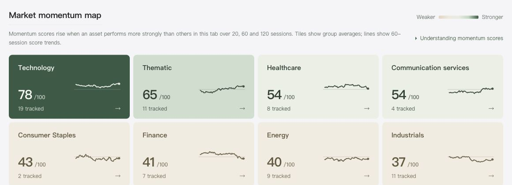

**過去に高いパフォーマンスを示した資産は、中期的にも相対的な強さを保つ傾向があります。** モメンタム投資はこの傾向に着目し、すでに上昇しており、さらに市場を上回っている銘柄を探します。[モメンタム研究](https://doi.org/10.1111/j.1540-6261.1993.tb04702.x)では、株式の3〜12カ月の保有期間にこの傾向が観察されています。

[市場モメンタム・ダッシュボード](/ja-JP/momentum/)では、絞り込みの手順を2段階に分けています。まず強いカテゴリーとETFを見つけ、次にETFの構成銘柄から強い個別株を探します。ETFに投資する場合は最初の2段階を確認すれば十分です。個別株を探す場合は、さらに絞り込んでください。

## モメンタムで銘柄を絞り込む

「モメンタムで銘柄を選ぶ」に切り替え、探したい銘柄に応じて条件を選択します。

- **上昇トレンドの候補：** 強いセクターの中から、最近のパフォーマンスが市場を上回っている銘柄を探します。
- **押し目候補・RSI 40〜60：** 強い銘柄の中から、価格が調整した後に投資を検討したい場合に使います。
- **売られすぎ候補・RSI 30未満：** 最近の下落圧力が強い銘柄を探し、下げ止まるかを観察します。

どの方法でも、まずモメンタムスコアが80以上で、最近も市場を上回っているセクターETFを探し、その構成銘柄から個別株を抽出します。「押し目候補」と「売られすぎ候補」では、最近の価格下落とRSIの条件も確認します。

結果には平均日次売買代金が表示されるため、取引の活発さを比較できます。注文前には売買代金と買値・売値のスプレッドも確認してください。

条件を選んだら「結果を見る」をクリックします。Proでは個別株の詳細を開き、モメンタムスコア、下落率、価格推移を確認しながら、継続して追跡する銘柄を比較できます。「候補個別株」と「出典ETF」は別々に表示され、タブを切り替えても選択状態とスクロール位置が保持されます。出典ETFには、候補に入った個別株を含むETFだけが表示され、条件に合った構成銘柄数も確認できます。個別株の出典ETFを選ぶと、そのETFの詳細を直接開けます。無料版でも同じ条件を使って該当件数を確認できますが、全候補の一覧と詳細を見るにはProが必要です。

次の4つのステップで、強いセクターから個別株を見つけ、エントリーのタイミングを観察する方法を説明します。

## 1. 強いカテゴリーを見つける

「産業・テーマ」を選び、「直近のモメンタム」に切り替えます。カテゴリーの色付きタイルは、含まれる資産の平均モメンタムスコアを示します。スコアが高いカテゴリーから確認してください。横の線は直近60取引日の平均スコアを示します。線が上向きなら、そのカテゴリーの順位は改善しています。

カテゴリーを選ぶと、その中のETFが表示されます。この段階では、カテゴリー内でどのETFが先行しているか、高スコアが一部のETFに集中していないかを確認できます。

ほかの2つのタブも用途に応じて使い分けられます。「主要資産」では米国株、海外市場、債券、コモディティを比較し、「市場構造」では大型株、小型株、均等加重、異なる銘柄選択戦略を比較します。ETFは各タブ内で個別にランキングされるため、まず比較対象の範囲を決めてください。

直近の取引日の市場変化を見たい場合は、「1日の騰落率」に切り替えます。この表示では、各カテゴリー内の騰落率の中央値をタイルに示し、下のランキングでも1日の騰落率で並べ替えられます。

## 2. ETFを比較し、強さが続いているか確認する

「市場概要」でカテゴリー内の高スコアETFから確認します。ETFの行をクリックすると、直近20、60、120取引日のパフォーマンスが表示されます。およそ1、3、6カ月に相当します。

**モメンタムスコアは、対象期間のパフォーマンスが比較対象の中でどの位置にあるかを示します。** 上昇率が高い、または下落率が小さい銘柄ほど高いスコアになります。期間リターンでは実際の騰落を確認できるため、高スコアのETFが上昇中なのか、それとも下落相場で他より下げにくいだけなのかを見分けられます。

「SPYとの比較」には、市場を上回った、または下回った幅が表示されます。SPYはS&P 500に連動するETFです。例えば同じ期間に対象ETFが12%上昇し、SPYが8%上昇した場合、4パーセントポイント上回ったと表示されます。

次に「SPYに対する相対強度線」を確認します。

- **相対強度線が上向き：** この期間のパフォーマンスはSPYを上回っています。下向きの場合は下回っています。
- **線が20日移動平均線より上にあり、移動平均線も上向き：** 最近の優位性が続いているため、今後も観察する候補になります。

相対強度線は、対象銘柄の価格をSPYの価格で割って算出し、チャートの起点を100に設定します。価格水準の異なる銘柄でも、SPYを継続的に上回っているかを同じ方法で確認できます。

## 3. ETFの構成銘柄から個別株を絞り込む

ETFの詳細で「構成銘柄」に切り替えると、銘柄名、保有比率、ランキングが表示されます。Proでは「最低モメンタムスコア」と「最低平均売買代金（百万米ドル）」を使って一覧を絞り込めます。

例えば、モメンタムスコア80以上、平均日次売買代金1,000万米ドル以上の株式を確認したい場合は、2つの欄に **80** と **10** を入力します。これは絞り込み条件の例です。実際の取引規模に合わせて基準を調整できます。

**平均日次売買代金**は取引規模の目安です。売買代金が大きい銘柄ほど、一般に売買しやすくなります。ダッシュボードでは直近20取引日の終値に出来高を掛け、その平均を使用します。実際に注文するときは、その時点の買値・売値のスプレッドと注文板の数量も確認してください。

個別株のスコアは、SPYの構成銘柄や、データを取得できたETFの構成銘柄を含む共通の米国株リスト内で比較します。例えばテクノロジーETFから個別株を開いた場合、その個別株は、当該ETFの構成銘柄だけでなく、システムが対象とする米国株全体の中で比較されています。比較対象の株式数も画面に表示されます。

個別株の行をクリックすると、各期間のリターン、SPYとの差、相対強度線と20日移動平均線を確認できます。こうして強いカテゴリーから、その中で継続的に市場を上回る銘柄を探せます。ETFの構成銘柄一覧に戻って比較を続けても、検索条件とフィルターは保持されます。

一部のETFでは主要な構成銘柄しか取得できないため、画面に「部分リスト」とカバー率が表示されます。保有データの日付と株価データの日付はそれぞれ別に表示されます。データ提供元が構成銘柄データの日付を公表していない場合は、その旨を表示します。現在、構成銘柄リストには米ドル建ての株式保有のみを表示します。

## 4. 強い銘柄が調整したときはRSIで短期の変化を見る

候補銘柄を見つけたら、**14日RSI**で直近の上昇・下落の勢いを確認できます。RSIは0〜100の範囲で、数値が高いほど直近の上昇圧力が強く、低いほど下落圧力が強いことを示します。一般に70超は買われすぎ、30未満は売られすぎと見なされます。[RSIの解説](https://www.fidelity.com/learning-center/trading-investing/technical-analysis/technical-indicator-guide/RSI)

押し目を待ってから検討したい場合は、RSIが高い水準から低下しているときに、モメンタムスコアが高い状態を保っているか、相対強度線が上昇中の移動平均線より上にあるかを確認できます。複数の指標を組み合わせると、短期的な調整後も市場に対する優位性が保たれているかを判断しやすくなります。

**RSIが30未満でも、株価がさらに下落することがあります。** 強い下落トレンドでは、RSIが長期間低い水準にとどまる場合があります。モメンタムスコアには過去数カ月のパフォーマンスが含まれるため、株価が弱くなり始めても高スコアを維持することがあります。「売られすぎ候補」を見るときは、価格が下げ止まっているか、相対強度がさらに低下していないかを確認してからエントリーを検討してください。

継続して追跡する場合は、同じ条件で再スクリーニングできます。モメンタムスコアが低下し、相対強度線も下がり続けている場合は、候補リストに残す必要があるかを再検討してください。エントリー前に、許容できる損失とポジションサイズを決め、計画に沿って保有を管理しましょう。

## モメンタムスコアの計算方法

ダッシュボードでは調整後終値を使って、直近20、60、120取引日のリターンを計算し、それぞれの期間のパフォーマンスを0〜100の順位スコアに変換します。3つの期間のウェイトは **20%、40%、40%** で、加重平均によってモメンタムスコアを算出します。長い期間ほどウェイトを高くすることで、単月の値動きがスコアに与える影響を抑えています。

ETFは各タブのリスト内で順位付けし、個別株は前述の共通米国株リスト内で順位付けします。カテゴリーのタイルは、対象銘柄のスコアの平均です。データが不足している期間は欠損として表示されます。最新の株価データ日と対象範囲はダッシュボードで確認できます。

## 無料版とPro

無料版ではカテゴリー全体のマップと、固定された無料ETFのモメンタムスコア、期間リターン、詳細を確認できます。提供されている株式保有データでは銘柄名と保有比率も確認できます。モメンタムによる銘柄スクリーニングでは条件を設定し、該当件数を確認できます。候補銘柄の完全な一覧はProで利用できます。

Proでは、モメンタムスクリーニングの全結果、ETFの完全なランキングと詳細、個別株のモメンタム、RSI、売買代金、価格チャートを確認できます。

[市場モメンタム・ダッシュボードを開き、強いカテゴリーから絞り込みを始める](/ja-JP/momentum/)
