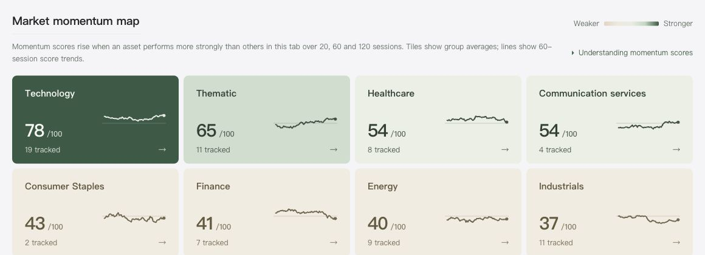

**과거에 강한 성과를 보인 자산은 중기적으로 계속 시장을 주도할 수 있습니다.** 모멘텀 투자는 이러한 경향에서 출발해 이미 강세를 보이고 지속적으로 시장을 웃도는 자산을 찾습니다. [주식 모멘텀 연구](https://doi.org/10.1111/j.1540-6261.1993.tb04702.x)는 3~12개월 보유 기간에서 이러한 효과를 확인했습니다.

[시장 모멘텀 대시보드](/ko-KR/momentum/)는 탐색 과정을 두 단계로 구성합니다. 먼저 강세 업종과 ETF를 찾고, 다음으로 해당 ETF의 편입 종목 중 강세 종목을 찾습니다. ETF 투자자는 앞의 두 단계부터 시작하면 됩니다. 개별 주식을 선별하려면 편입 종목 단계까지 진행하세요.

## 스크리너로 관심 종목 후보 좁히기

‘모멘텀 종목 찾기’로 전환한 다음, 찾고 싶은 주식에 맞춰 조건을 선택하세요.

- **강세 후보:** 강세 업종 중 최근 시장 수익률을 웃돈 주식을 찾습니다.
- **조정 관찰 · RSI 40–60:** 강세 종목이 조정을 받은 뒤 진입할지 검토하려는 경우 사용합니다.
- **과매도 관찰 · RSI <30:** 최근 매도 압력이 강했던 주식을 찾고 하락이 멈추는지 관찰합니다.

세 가지 스크리닝은 모두 모멘텀 점수가 80 이상이고 최근에도 시장을 계속 웃돈 업종 ETF를 먼저 찾은 뒤, 그 ETF의 편입 종목을 선별합니다. 조정 관찰과 과매도 관찰은 최근 가격 조정 여부와 선택한 RSI 구간도 확인합니다.

결과에는 평균 일일 거래대금이 표시되어 거래 규모를 비교할 수 있습니다. 주문을 넣기 전 거래대금과 매수·매도 호가 스프레드를 확인하세요.

준비가 되면 ‘결과 보기’를 선택하세요. Pro 사용자는 종목을 열어 모멘텀 점수, 조정 폭, 차트를 확인한 뒤 어떤 후보를 추적할지 판단할 수 있습니다. 후보 종목과 해당 종목이 포함된 ETF는 별도 탭에 표시되며, 탭을 전환해도 선택 항목과 스크롤 위치가 유지됩니다. ETF 탭에는 편입 종목 중 조건에 맞는 종목이 있는 ETF만 표시되고, 조건에 맞는 편입 종목 수도 함께 표시됩니다. 종목의 출처 ETF를 선택하면 해당 ETF의 상세 정보가 열립니다. 무료 사용자는 동일한 필터를 적용하고 조건에 맞는 종목 수를 볼 수 있으며, Pro로 업그레이드하면 전체 목록과 상세 정보를 확인할 수 있습니다.

아래 네 단계는 업종에서 개별 주식으로 탐색 범위를 좁히고 잠재적인 진입 기회를 살펴보는 과정입니다.

## 1. 강세 업종 찾기

‘업종 및 테마’를 선택한 다음 ‘최근 모멘텀’을 선택하세요. 각 분류 타일에는 해당 자산의 평균 모멘텀 점수가 표시됩니다. 점수가 높은 분류부터 살펴보세요. 아래의 선은 최근 60거래일 동안 해당 분류의 평균 점수 추이를 보여 줍니다. 선이 상승하면 해당 분류의 순위가 개선되고 있다는 뜻입니다.

분류를 선택하면 해당 분류에 속한 ETF를 볼 수 있습니다. 어떤 ETF가 선도하고 있는지, 소수 ETF가 해당 분류의 강세 대부분을 차지하는지 확인할 수 있습니다.

다른 탭은 서로 다른 비교에 사용됩니다. ‘주요 자산’에는 미국 및 해외 주식, 채권, 원자재가 포함됩니다. ‘시장 구조’에는 시가총액별 그룹, 동일가중 펀드, 주식 선별 전략이 포함됩니다. 각 탭은 ETF를 별도로 순위화하므로 먼저 비교 그룹을 선택하세요.

가장 최근 거래일의 움직임을 보려면 ‘일일 변동’으로 전환하세요. 분류 타일에는 구성 자산의 일일 수익률 중앙값이 표시되며, 자산 목록도 일일 변동률로 정렬할 수 있습니다.

## 2. ETF를 비교하고 계속 시장을 주도하는지 확인하기

‘시장 개요’에서 해당 분류의 모멘텀 점수가 높은 ETF 행을 선택하세요. 상세 정보에서는 20·60·120거래일, 대략 1·3·6개월 동안의 성과를 비교할 수 있습니다.

**모멘텀 점수는 자산의 최근 성과가 얼마나 높은 순위에 있는지를 나타냅니다.** 더 많이 상승했거나 덜 하락한 자산일수록 점수가 높습니다. 기간별 수익률은 실제 상승·하락 폭을 보여 주므로, 점수가 높은 ETF가 상승 중인지 아니면 하락장에서 덜 하락했는지 확인할 수 있습니다.

‘SPY 대비’는 해당 자산이 전체 시장보다 얼마나 앞서거나 뒤처졌는지 보여 줍니다. SPY는 S&P 500을 추종합니다. 예를 들어 같은 기간 ETF가 12% 상승하고 SPY가 8% 상승했다면, ETF가 4%포인트 앞선 것입니다.

다음으로 ‘SPY 대비 상대강도’를 확인하세요.

- **상승하는 상대강도선:** 해당 기간 자산이 SPY보다 높은 성과를 냈다는 뜻입니다. 선이 하락하면 SPY보다 부진한 것입니다.
- **상승 중인 20거래일 평균선 위에 있는 상대강도선:** 최근의 초과 성과가 이어지고 있다는 뜻이므로 추적 후보로 고려할 수 있습니다.

상대강도선은 자산 가격을 SPY 가격으로 나눈 값이며, 차트의 시작점은 100입니다. 이를 통해 주가 수준이 서로 다른 자산도 동일한 방식으로 시장 주도력이 지속되는지 확인할 수 있습니다.

## 3. ETF 편입 종목 스크리닝

ETF 상세 정보에서 ‘구성 종목’을 선택하면 주식 이름, 펀드 내 비중, 순위를 확인할 수 있습니다. Pro에서는 ‘최저 모멘텀 점수’와 ‘최저 평균 거래대금(미화 백만 달러)’ 필터를 사용할 수 있습니다.

예를 들어 모멘텀 점수가 80 이상이고 평균 일일 거래대금이 1,000만 달러 이상인 주식을 보려면 두 입력란에 **80**과 **10**을 입력하세요. 이는 필터 설정 예시이며, 기준은 자신의 거래 규모에 맞게 조정하면 됩니다.

**평균 일일 거래대금**은 거래 활동 규모를 측정합니다. 거래대금이 클수록 일반적으로 매매하기 쉽습니다. 대시보드는 최근 20거래일의 일일 종가와 거래량을 곱한 값을 평균합니다. 실제 주문을 넣을 때는 현재 매수·매도 호가 스프레드와 주문 잔량도 확인하세요.

종목 점수는 SPY 구성 종목과 데이터가 제공되는 다른 ETF의 주식 편입 종목을 합친 목록 안에서 비교합니다. 예를 들어 기술주 ETF에서 종목 하나를 열더라도 해당 종목의 점수는 그 ETF 안의 다른 주식뿐 아니라 더 넓은 미국 주식 목록을 기준으로 산출됩니다. 대시보드에는 비교에 포함된 주식 수도 표시됩니다.

종목을 펼치면 기간별 수익률, SPY 대비 초과·미달 성과, 20거래일 평균선과 함께 표시된 상대강도선을 확인할 수 있습니다. 이를 통해 강세 업종에서 계속 시장을 주도하는 개별 주식까지 찾아볼 수 있습니다.

일부 ETF는 현재 상위 편입 종목만 제공합니다. 이러한 목록에는 ‘일부’ 표시와 함께 펀드 전체에서 해당 목록이 차지하는 비중이 표시됩니다. 보유 종목 기준일과 가격 기준일은 별도로 표시되며, 보유 종목 기준일이 없으면 해당 사실이 표시됩니다. 현재 편입 종목 목록에는 미국 달러로 표시된 주식이 포함됩니다.

## 4. RSI로 조정 관찰하기

후보 종목을 찾았다면 **14거래일 RSI**로 최근 매수·매도 강도를 살펴보세요. RSI는 0~100 범위이며, 값이 높을수록 최근 상승 강도가 강하고 낮을수록 하락 강도가 강합니다. 일반적으로 70 초과는 과매수, 30 미만은 과매도로 간주됩니다. [RSI 지표 가이드](https://www.fidelity.com/learning-center/trading-investing/technical-analysis/technical-indicator-guide/RSI)

조정을 기다린 뒤 진입 여부를 판단하고 싶다면 RSI가 높은 수준에서 하락하는 동안 모멘텀 점수가 여전히 높은지, 상대강도선이 상승 중인 평균선 위에 있는지 확인하세요. 이러한 지표를 함께 살펴보면 단기 조정 이후에도 자산이 시장 주도세를 유지하는지 판단하는 데 도움이 됩니다.

**RSI가 30 미만이어도 주가는 계속 하락할 수 있습니다.** 강한 하락 추세에서는 RSI가 장기간 낮은 수준에 머물 수 있습니다. 모멘텀 점수에는 수개월간의 성과가 반영되므로 주식이 약세로 돌아선 직후에도 점수가 높게 유지될 수 있습니다. ‘과매도 관찰’ 종목을 검토할 때는 진입을 판단하기 전에 가격 하락이 멈췄는지, 상대강도가 계속 악화되고 있는지 살펴보세요.

후보를 추적하면서 동일한 스크리닝 과정을 반복하세요. 모멘텀 점수가 하락하고 상대강도선도 계속 약해진다면 해당 자산을 목록에 유지할지 다시 평가하세요. 진입 전에 감당할 수 있는 손실과 포지션 규모를 정해 보유 자산을 관리할 계획을 세우세요.

## 모멘텀 점수 계산 방식

대시보드는 수정 종가를 사용해 최근 20·60·120거래일 수익률을 계산한 다음, 각 기간의 성과를 0~100 순위 점수로 변환합니다. 세 기간의 가중치는 각각 **20%, 40%, 40%**입니다. 장기 기간에 더 높은 가중치를 부여해 단일 월의 움직임이 미치는 영향을 줄입니다.

ETF는 각 탭의 관심 종목 목록 내에서 순위를 매깁니다. 주식은 앞서 설명한 공통 미국 주식 목록 내에서 순위를 매깁니다. 분류 타일에는 구성 자산 점수의 평균이 표시됩니다. 데이터가 충분하지 않은 기간은 결측값으로 표시됩니다. 최신 가격 기준일과 데이터 커버리지는 대시보드에서 확인하세요.

## 무료 버전과 Pro

무료 버전에서는 전체 분류 지도, 모멘텀 점수, 기간별 수익률과 정해진 ETF 목록의 상세 정보를 확인할 수 있습니다. 제공되는 주식 편입 종목의 이름과 펀드 내 비중도 볼 수 있습니다. 무료 사용자는 스크리닝 조건을 적용하고 조건에 맞는 종목 수를 확인할 수 있으며, 전체 후보 목록은 Pro에서 제공합니다.

Pro에는 전체 스크리닝 결과, 전체 ETF 순위와 상세 정보, 그리고 개별 주식의 모멘텀·RSI·거래대금·주가 차트가 포함됩니다.

[시장 모멘텀 대시보드를 열고 강세 업종부터 살펴보세요.](/ko-KR/momentum/)
