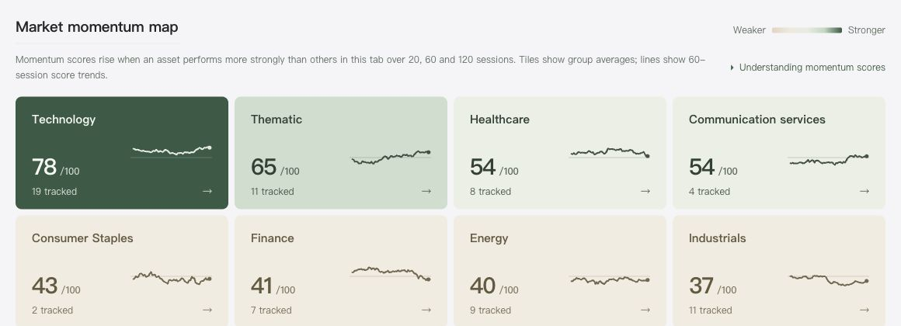

**过去表现较强的资产，在中期内可能继续领先。** 动能投资正是基于这一现象，寻找已经走强并持续跑赢市场的资产。[相关动能研究](https://doi.org/10.1111/j.1540-6261.1993.tb04702.x)曾在股票 3 至 12 个月的持有期内观察到这种现象。

[市场动能仪表板](/zh-CN/momentum/)将筛选过程分为两个层次：先找出表现强势的板块和 ETF，再从 ETF 成分股中筛选强势个股。如果你投资 ETF，可以先完成前两个步骤；如果想寻找个股，则继续筛选其成分股。

## 使用动能选股缩小候选范围

切换到「动能选股」，根据目标选择相应条件：

- **强势候选**：筛选强势板块中近期表现领先大盘的股票。
- **回调观察 · RSI 40–60**：适合已经找到强势股、希望等价格回落后再评估入场时机的情况。
- **超卖观察 · RSI <30**：筛选近期卖压较强的股票，观察价格是否止跌。

这三种筛选方式都会先找出动能分数至少为 80、近期持续跑赢大盘的板块 ETF，再从其成分股中筛选个股。「回调观察」和「超卖观察」还会进一步检查近期价格回落情况及 RSI。

筛选结果会显示平均每日成交额，方便比较股票的交易活跃程度。下单前，还应留意成交额和买卖价差。

设置好条件后，点击「查看筛选结果」。Pro 用户可以打开个股详情，查看动能分数、回调幅度和走势图，再比较哪些股票值得继续关注。「候选个股」和「来源 ETF」会分别显示；在两个标签之间切换时，系统会保留当前选择和滚动位置。「来源 ETF」只显示至少有一只成分股入选的 ETF，并标出入选成分股的数量。点击个股对应的来源 ETF，即可查看该 ETF 的详细信息。免费版也可以使用相同条件筛选，并查看符合条件的数量；升级到 Pro 后才能查看完整名单和详细数据。

下面通过四个步骤，说明如何从板块筛选到个股，并进一步观察可能的入场时机。

## 1. 找出强势分类

选择「产业与主题」，再切换到「近期动能强弱」。各分类色块显示该分类内资产的平均动能分数，可以优先查看分数较高的分类。旁边的折线显示过去 60 个交易日的平均分数；折线向上，代表该分类的排名正在改善。

点击某个分类即可查看其中的 ETF。通过这一步，可以确认哪些 ETF 处于领先位置，以及该分类的高分是否集中在少数几只 ETF 上。

另外两个标签页适合进行不同类型的比较：「主要资产」涵盖美股、海外市场、债券和大宗商品；「市场结构」则涵盖大盘股、小盘股、等权重 ETF 和不同选股策略。每个标签页内的 ETF 都单独排名，因此比较前应先确定范围。

如果想查看最近一个交易日的市场变化，可以切换到「单日涨跌」。此时，色块显示分类内资产涨跌幅的中位数，下方列表也可以按单日涨跌幅排序。

## 2. 比较 ETF，确认是否持续领先

在「市场总览」中，可以从各分类里动能分数较高的 ETF 开始，点击 ETF 所在行，查看其过去 20、60 和 120 个交易日的表现，分别约对应 1、3 和 6 个月。

**动能分数反映资产在指定期间内的表现排名。** 涨幅较大或跌幅较小的资产，通常会获得更高分数。区间收益率则显示实际涨跌幅，帮助你判断高分 ETF 是正在上涨，还是只是在下跌市场中跌得相对较少。

「与 SPY 比较」显示资产相对大盘的领先或落后幅度。SPY 是跟踪标普 500 指数的 ETF。例如，同一期间某只 ETF 上涨 12%，SPY 上涨 8%，页面就会显示该 ETF 领先 4 个百分点。

接着看「相对 SPY 强弱走势」：

- **相对强度线向上**：表示该资产在这段时间的表现优于 SPY；向下则表示表现落后。
- **相对强度线位于向上的 20 日均线之上**：表示近期领先表现仍在延续，可以列入后续观察名单。

相对强度线通过资产价格除以 SPY 价格计算，图表起点设为 100。这样一来，无论资产本身的价格高低，都可以用同一尺度观察其是否持续跑赢大盘。

## 3. 从 ETF 的成分股筛选个股

在 ETF 明细切换到「成分股」，查看股票名称、持股比重与排行。Pro 可用「最低动能分数」和「最低平均成交额（百万美元）」缩小清单。

例如，如果想筛选动能分数至少为 80、平均每日成交额至少为 1,000 万美元的股票，可以在两个输入框中分别填入 **80** 和 **10**。这只是筛选示例，具体门槛可以根据自己的交易规模调整。

**平均每日成交额**反映股票的交易规模。成交额较大的股票通常更容易买卖。仪表板以最近 20 个交易日每天的收盘价乘以成交量，再计算平均值；实际下单时，还应查看当时的买卖价差和盘口挂单量。

个股分数会与 SPY 成分股及其他已取得持仓数据的 ETF 成分股一起比较。例如，从科技 ETF 中打开一只股票，看到的是它在这份美股股票池中的动能排名，而不只是与该 ETF 内的其他股票比较。页面会显示参与比较的股票数量。

点击个股所在行后，同样可以查看各期间收益率、相对 SPY 的表现差距，以及相对强度线和 20 日均线。这样就能从强势板块逐步筛选出其中持续领先的股票。返回该 ETF 的成分股列表后，可以继续比较其他股票，原先的搜索和筛选条件都会保留。

部分 ETF 目前只能取得主要持仓，页面会标注「部分名单」及其覆盖比例。持仓日期和行情日期会分别显示；如果数据来源没有提供持仓日期，页面也会注明。目前成分股列表仅列出以美元计价的股票持仓。

## 4. 强势资产回调时，用 RSI 观察短期变化

找到候选资产后，可以使用 **14 日 RSI** 观察近期价格上涨和下跌的力度。RSI 介于 0–100：数值越高，表示近期上涨动能越强；数值越低，则表示近期下跌动能越强。通常，RSI 高于 70 被视为偏热，低于 30 则被视为偏冷。[RSI 指标说明](https://www.fidelity.com/learning-center/trading-investing/technical-analysis/technical-indicator-guide/RSI)

如果你希望等价格回调后再评估入场时机，可以观察 RSI 从高位回落时，动能分数是否仍然较高，以及相对强度线是否仍位于向上的均线之上。结合这些信息，有助于判断资产在短期回调后是否仍保持领先表现。

**RSI 低于 30，并不代表股价不会继续下跌。** 在强劲的下跌趋势中，RSI 可能长时间处于低位。动能分数反映过去数月的表现，因此股价刚开始转弱时，分数仍可能维持在高位。查看「超卖观察」中的股票时，应先观察价格是否止跌、相对强度是否仍在走弱，再评估入场时机。

持续跟踪时，也可以使用相同条件重新筛选。如果动能分数下降、相对强度线持续走低，就应重新评估是否继续将该资产保留在候选名单中。入场前先设定可承受的亏损范围和仓位大小，之后才能按照计划管理持仓。

## 动能分数的计算方式

仪表板使用调整后收盘价，计算过去 20、60 和 120 个交易日的收益率，再将各期间的表现转换为 0–100 分的排名分数。三个期间的权重分别为 **20%、40% 和 40%**，加权后得出动能分数。较长期间的权重更高，可以降低单个月份波动对总分的影响。

ETF 在各自标签页的观察列表中排名，个股则在上述共同美股股票池中排名。分类色块显示该分类内资产动能分数的平均值。数据不足的期间会显示缺失值；最新行情日期和数据覆盖范围可以在仪表板中查看。

## 免费版与 Pro

免费版可以查看完整的分类版图，以及指定免费 ETF 的动能分数、区间收益率和详细信息，也可以查看已提供的股票持仓名称与权重。免费用户还可以在动能选股中设置筛选条件并查看符合条件的数量；完整候选名单则由 Pro 提供。

Pro 用户可以查看完整的动能筛选结果、全部 ETF 自选股列表的排名和详细信息，以及个股动能、RSI、成交额和走势图。

[前往市场动能仪表板，从强势分类开始筛选。](/zh-CN/momentum/)
