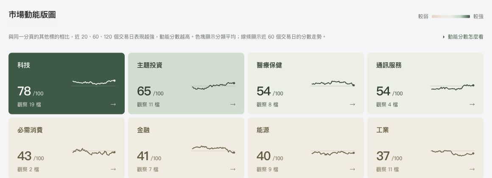

**過去表現較強的資產，中期可能繼續跑贏市場。** 動能投資正是建基於這個現象，透過數據尋找已經轉強並持續領先的資產。[動能研究](https://doi.org/10.1111/j.1540-6261.1993.tb04702.x)曾在股票的 3 至 12 個月持有期間觀察到這種現象。

[市場動能儀表板](/zh-HK/momentum/)將篩選流程分成兩個層次：先找出表現強勢的行業板塊及 ETF，再從 ETF 的成份股中篩選個股。若投資 ETF，可先完成首兩步；若想挑選個股，則可繼續深入分析。

## 用動能選股縮小觀察名單

切換至「動能選股」，再按選股目標設定條件：

- **強勢候選**：找出強勢板塊中，近期表現跑贏大市的股票。
- **回調觀察 · RSI 40–60**：適合已找到強勢股、但希望等待股價回調後再評估入市的情況。
- **超賣觀察 · RSI <30**：找出近期跌勢較強的股票，觀察股價是否開始止跌。

三種篩選方式都會先找出動能分數達 80 分或以上、近期持續跑贏大市的板塊 ETF，再從其成份股中篩選個股。「回調觀察」及「超賣觀察」會進一步檢視近期股價回調幅度及 RSI。

結果會列出平均每日成交額，方便比較股票的交易規模。落盤前，應留意成交額及買賣差價。

設定好條件後，按「查看篩選結果」。Pro 用戶可開啟個股詳情，查看動能分數、回調幅度及走勢，評估哪些股票值得繼續跟進。「候選個股」與「來源 ETF」會分開顯示；切換清單時，系統會保留目前的選取項目及捲動位置。來源 ETF 只會列出有個股入選的 ETF，並顯示入選成份股數目。選取個股所屬的來源 ETF，可直接查看該 ETF 詳情。免費版亦可使用相同篩選條件及查看符合條件的數量；升級至 Pro 後，便可查看完整名單及詳細資料。

以下四個步驟會示範如何由行業板塊篩選個股，再觀察入市時機。

## 1. 找出強勢板塊

選擇「行業與主題」，再切換至「近期動能強弱」。色塊顯示各板塊內資產的平均動能分數，可優先查看分數較高的板塊。旁邊的線條則顯示最近 60 個交易日的平均分數；線條向上，代表該板塊的相對排名正在改善。

選取板塊即可查看其中的 ETF。這一步可確認哪些 ETF 表現領先，以及高分是否只集中在少數 ETF。

另外兩個分頁適合不同的比較方式：「主要資產」涵蓋美股、海外市場、債券及商品；「市場結構」則比較大型股、小型股、等權重組合及不同的選股策略。各分頁的 ETF 會分開排名，比較時應先選定觀察範圍。

如要查看最近一個交易日的市場變化，可切換至「單日升跌」。此時色塊顯示各板塊內資產升跌幅的中位數，下方排名亦可按單日升跌排序。

## 2. 比較 ETF，確認是否持續領先

在「市場總覽」中，可先查看各板塊內動能分數較高的 ETF。選取 ETF 整列，即可查看最近 20、60 及 120 個交易日的表現，約相當於 1、3 及 6 個月。

**動能分數反映資產在指定期間內的相對表現排名。** 升幅較大或跌幅較小的資產，通常會取得較高分數。期間回報則顯示實際升跌幅度，方便判斷高分 ETF 是正在上升，還是在下跌市況中跌得較少。

「與 SPY 比較」會顯示資產跑贏或跑輸大市的幅度。SPY 是追蹤標普 500 指數的 ETF。例如同一期間 ETF 上升 12%、SPY 上升 8%，畫面便會顯示 ETF 跑贏 4 個百分點。

接著看「相對 SPY 強弱走勢」：

- **相對強度線向上**：代表該資產在這段期間跑贏 SPY；向下則代表跑輸。
- **相對強度線位於 20 日移動平均線上方，而移動平均線亦向上**：代表近期領先表現仍在延續，可列入觀察名單。

相對強度線以資產價格除以 SPY 價格計算，圖表起點設為 100。即使資產價格不同，亦可用同一基準觀察它們是否持續跑贏大市。

## 3. 從 ETF 的成份股篩選個股

在 ETF 詳情頁切換至「成份股」，即可查看股票名稱、持股比重及排名。Pro 用戶可設定「最低動能分數」及「最低平均成交額（百萬美元）」，縮小篩選範圍。

例如，如想篩選動能分數達 80 分或以上、平均每日成交額至少 1,000 萬美元的股票，可在兩個欄位分別輸入 **80** 及 **10**。這只是篩選示例，門檻可按個人的交易規模及投資策略調整。

**平均每日成交額**反映股票的交易規模。一般而言，成交額較大，買賣通常較容易。儀表板以最近 20 個交易日的每日收市價乘以成交量，再計算平均值；實際落盤時，亦要留意當時的買賣差價及市場掛盤量。

個股分數會與 SPY 成份股，以及其他已取得持股資料的 ETF 股票一併比較。例如從科技 ETF 詳情頁開啟某隻股票，看到的是該股票在整個美股比較範圍內的動能，而不只是與同一 ETF 的其他股票比較。畫面亦會列出參與比較的股票數目。

選取個股整列後，同樣可以查看各期間回報、與 SPY 的差距，以及相對強度線和 20 日移動平均線。這樣便可由強勢板塊一路找出其中持續領先的股票。返回 ETF 成份股清單後，仍可繼續比較其他股票，原有搜尋及篩選條件亦會保留。

部分 ETF 目前只提供主要持股資料，畫面會標示「部分名單」及持股涵蓋比重。持股日期與行情日期會分開顯示；如資料來源沒有提供持股日期，畫面亦會註明。目前成份股清單只列出以美元計價的股票持倉。

## 4. 強勢股回調時，用 RSI 觀察短期變化

找到候選股票後，可利用 **14 日 RSI** 觀察近期升跌動力。RSI 介乎 0 至 100：數值較高代表近期升勢較強，數值較低則代表跌勢較強。一般而言，70 以上常被視為偏熱，30 以下則偏冷。[RSI 指標說明](https://www.fidelity.com/learning-center/trading-investing/technical-analysis/technical-indicator-guide/RSI)

如想等待股價回調後才評估入市，可留意 RSI 從高位回落時，動能分數是否仍然偏高，以及相對強度線是否仍位於向上的移動平均線之上。綜合這幾項訊號，有助判斷股票短期回調後是否仍保持領先表現。

**RSI 低於 30 時，股價仍可能繼續下跌。** 在強烈跌勢中，RSI 可以長時間維持低位。動能分數涵蓋過去數月的表現，因此即使股價剛開始轉弱，分數仍可能偏高。查看「超賣觀察」名單時，應先觀察股價有否止跌，以及相對強度是否仍然轉弱，再評估入市。

持續跟進時，可用相同條件重新篩選。如動能分數下降、相對強度線持續走低，便應重新評估是否仍要把該股票保留在候選名單內。入市前宜先訂明可承受的虧損及持倉規模，方便其後按計劃管理投資組合。

## 動能分數的計算方式

儀表板使用經調整的收市價，計算最近 20、60 及 120 個交易日的回報，再將各期間表現轉換為 0 至 100 分的排名分數。三個期間的權重分別為 **20%、40% 及 40%**，加權後得出動能分數；較長期間佔較高權重，以減低單一月份波動對分數的影響。

ETF 會在各自分頁的清單內排名，個股則在上述共同美股觀察範圍內排名。板塊色塊顯示該板塊所含資產的平均分數。資料不足的期間會顯示為缺值；最新行情日期及觀察範圍可在儀表板查看。

## 免費版與 Pro

免費版可查看完整板塊版圖，以及指定免費 ETF 的動能分數、期間回報及詳情，亦可查看已提供的股票持倉名稱與比重。動能選股可設定篩選條件並查看符合條件的數量；完整候選名單則由 Pro 提供。

Pro 用戶可查看完整動能篩選結果、完整 ETF 觀察清單的排名及詳情，以及個股動能、RSI、成交額和走勢圖。

[前往市場動能儀表板，從強勢板塊開始篩選。](/zh-HK/momentum/)
